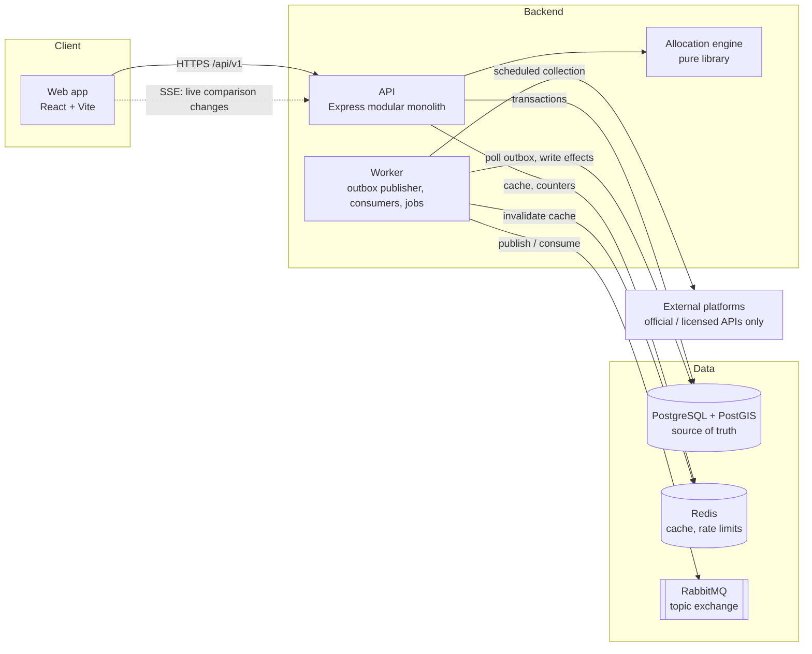
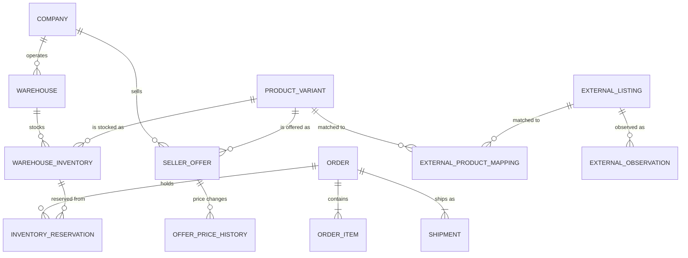
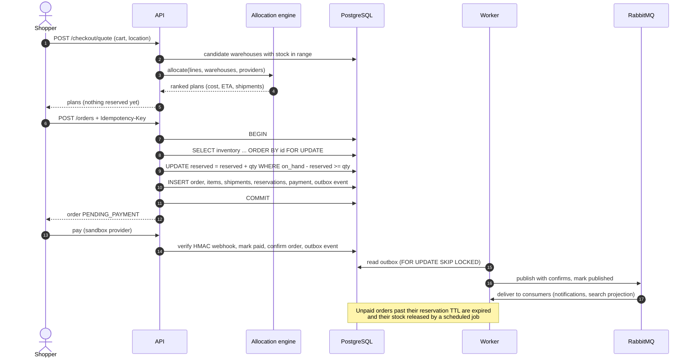
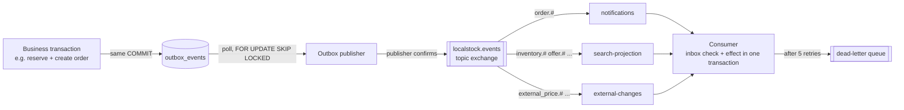
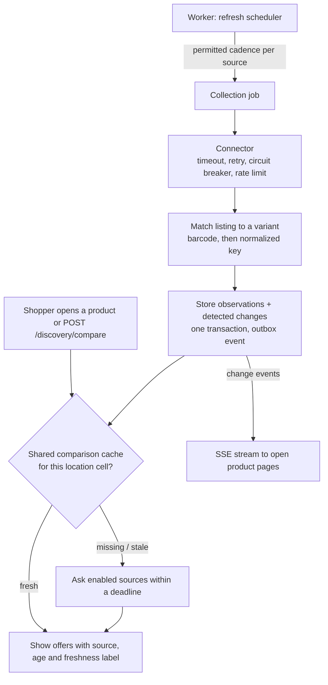
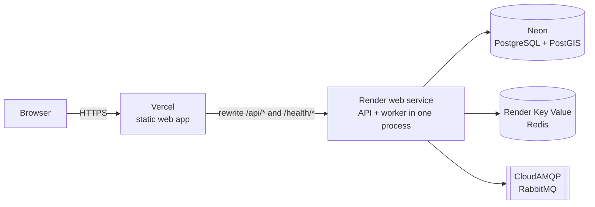

# LocalStock architecture

LocalStock is a hyperlocal commerce platform. Local sellers list products and stock in their
own warehouses; shoppers search for what is available near them, compare it with what other
platforms offer, and order with a guarantee that what they pay for is actually reserved.

This document explains how the system is put together and why. Detailed decisions live in the
[architecture decision records](adr/README.md); the [data dictionary](DATA_DICTIONARY.md),
[OpenAPI spec](openapi.yaml) and [runbook](RUNBOOK.md) cover the details.

## 1. Goals and constraints

| Goal | What it means in the design |
|---|---|
| **Never oversell** | Stock is reserved inside a database transaction guarded by constraints, never by a cache |
| **Never lose an event** | State changes and the events announcing them commit together (transactional outbox) |
| **Location first** | Every search is filtered by which warehouses can actually deliver to the shopper (PostGIS) |
| **Honest data** | External prices carry their source, age and freshness; demo or cached data is never shown as live |
| **Permitted sources only** | External platforms are reached only through licensed or official APIs, each disabled until configured |
| **Small team, low cost** | One modular monolith plus one worker; runs on free hosting tiers |

## 2. System overview

| Component | Responsibility |
|---|---|
| **Web app** (`apps/web`) | Storefront, cart and checkout, seller hub, admin console. A single-page app calling `/api/v1` on its own origin |
| **API** (`apps/api`) | One Express app with a folder per domain module: auth, organizations, warehouses, catalog, offers, inventory, discovery, checkout, orders, payments, delivery, matching, imports, realtime, admin, health |
| **Worker** (`apps/worker`) | Publishes outbox events, runs idempotent consumers, expires unpaid reservations, reconciles stock, collects from configured external sources, enforces data retention |
| **Allocation engine** (`packages/allocation-engine`) | Pure function deciding which warehouses fulfil an order and how it is delivered. No I/O, so it is unit-tested and benchmarked in isolation |
| **Connectors** (`packages/connectors`) | One adapter per external source behind a common contract, with timeouts, retries, circuit breaker and rate limits |
| **External data** (`packages/external-data`) | Collection, product matching, freshness rules, comparison cache, change detection, retention |

**Why a modular monolith** ([ADR-001](adr/README.md#adr-001-start-with-a-modular-monolith)): one team and
one database make end-to-end transactions (reserve stock + create order + enqueue event)
trivial and debugging easy. Module folders keep boundaries visible so inventory or orders can
be extracted later if measured load or team structure demands it.

## 3. Domain model

Three separate concepts ([ADR-009](adr/README.md#adr-009-separate-variant-seller-offer-and-inventory)):

- **Product variant**: *what* the product is (brand, name, pack size, barcode). One row per real-world product.
- **Seller offer**: *who* sells it and at what price. One per company and variant. Prices are integer paise.
- **Warehouse inventory**: *where* the stock physically is: `on_hand` and `reserved`, with
  `CHECK (reserved <= on_hand)` enforced by the database.

Products found only on other platforms become variants with `origin = EXTERNAL` and status
`PENDING_REVIEW`, so they are searchable and comparable but cannot be bought from a LocalStock
seller until an admin classifies them. Variants are matched by barcode first, then a normalized
brand + name + pack-size key; similar names without a distinguishing attribute go to a review
queue instead of being merged silently.

## 4. Key flows

### 4.1 Search near me

1. `GET /catalog/search?q&lat&lng&radiusKm` matches variants by full-text search or trigram similarity.
2. Offers are joined to inventory with free stock (`on_hand - reserved > 0`) in active warehouses
   whose service area covers the shopper: `ST_DWithin(warehouse.location, shopper, LEAST(service_radius, radius))`.
3. Each offer gets a distance (nearest qualifying warehouse) and an ETA estimate; results are sorted by price, ETA or a weighted score.
4. The response is cached in Redis for 30 s under a **version key**. Any offer, inventory, company
   or warehouse event bumps the version, so stale results are never served after a change, and
   no cache entries need to be found and deleted.

### 4.2 Checkout: reserve, pay, confirm

**Why it cannot oversell** ([ADR-005](adr/README.md#adr-005-atomic-sql-reservations)):

- Rows are locked in a fixed order (by id), so two concurrent orders never deadlock each other.
- Each update is conditional on enough free stock and its row count is checked; if any line
  fails, the whole transaction rolls back and nothing is reserved.
- The database constraint `reserved <= on_hand` is the last line of defence even against bugs.
- Redis is never consulted for stock decisions ([ADR-003](adr/README.md#adr-003-redis-is-a-cache-not-an-authority)).

**Why retries are safe**: `POST /orders` requires an `Idempotency-Key`. A retried request with the
same key and body returns the original order instead of reserving twice.

### 4.3 Events: transactional outbox and idempotent consumers

([ADR-006](adr/README.md#adr-006-transactional-outbox-and-idempotent-consumers))

- Writing the event in the same transaction as the change means there is no window where the
  order exists but its event is lost, or the event is sent for an order that rolled back.
- The publisher marks an event published only after the broker confirms it. A crash in between
  means it is published again, so delivery is **at least once**.
- Each consumer records `(consumer, message_id)` in `inbox_events` in the same transaction as
  its effect, so a duplicate delivery has **no second effect**. The system never claims
  exactly-once delivery, only exactly-once effects.
- Failures retry with exponential backoff and jitter, then go to a dead-letter queue for inspection.

### 4.4 Comparing with other platforms

- **Locations are bucketed** into geohash cells. Sources are queried at the centre of a cell,
  never at a shopper's exact coordinates, and one cached answer serves everyone in that cell.
- **Freshness is explicit**: each observation is FRESH, STALE (shown, labelled) or EXPIRED (not
  shown as current). Availability goes stale faster than price.
- **A deadline bounds every comparison**: sources slower than it are reported as `TIMEOUT` rather than delaying the page.
- **Only permitted sources run.** Every connector is disabled by default. Platforms without an
  official API are represented only by a search link that opens in the shopper's own browser;
  the server never fetches those sites.
- Every price change of a LocalStock offer is recorded by a database trigger into
  `seller_offer_price_history`, which feeds the price graph. Because a trigger records it, the history
  is correct no matter which path changed the price (API, CSV import or script).

## 5. Allocation engine

Given cart lines, candidate warehouses (with stock and distance) and delivery providers, the
engine returns ranked fulfilment plans ([ADR-008](adr/README.md#adr-008-staged-allocation-heuristic)):

1. **Stage A**: one warehouse that has everything (one shipment, simplest).
2. **Stage B**: one warehouse per line, chosen by greedy set cover.
3. **Stage C**: split a line's quantity across warehouses when no single one has enough.

Each plan gets delivery quotes and is ranked by landed cost, the slowest shipment's ETA, number of
shipments and risk. It is a heuristic, not a proven optimum: the trade-off is predictable,
fast responses at checkout. A benchmark (`npm run bench -w @localstock/allocation-engine`) guards its latency.

## 6. Reliability and security

| Concern | Approach |
|---|---|
| Configuration | Validated with zod at startup; the process refuses to start with a missing or invalid setting |
| Authentication | Short-lived JWT access tokens; rotating refresh tokens with reuse detection; scrypt password hashes |
| Authorization | Platform admin role, plus per-company roles (OWNER / ADMIN / STAFF). Non-members get 404, not 403, so company ids don't leak |
| Abuse | Redis fixed-window rate limits on login, search, compare, checkout and imports (fail open) |
| Payments | Webhooks verified by HMAC; webhook events deduplicated |
| Auditing | Seller and admin changes write before/after snapshots to `audit_logs` |
| Logging | JSON logs with request ids; request logs omit query strings |
| Graceful shutdown | Readiness fails first, in-flight requests finish, then connections close, with a hard deadline |
| Health | `/health/live` (process up) and `/health/ready` (Postgres and Redis reachable) |
| Migrations | Applied in order, each in a transaction, under an advisory lock; every migration after the initial schema has a down script |
| Testing | Unit and HTTP tests, database concurrency tests, an endpoint smoke test covering every route, CI on every push |

## 7. Deployment

The public demo runs entirely on free tiers ([guide](DEPLOY_FREE.md)). Because Render's free plan
has no background workers, `deploy/all-in-one.mjs` runs the release step, the API and the worker
in one process; it opens the port immediately with a "starting" placeholder so the platform's
port check passes while migrations run. All services sit in one region (Singapore) because the
API makes many small database round trips. Elsewhere the API and worker run as separate services
from their own Dockerfiles.

## 8. Scaling path

The current design is deliberately simple. What changes, and in what order, as load grows:

| Pressure | Next step |
|---|---|
| More search traffic | Horizontal API instances (stateless); Postgres read replicas for search; longer cache TTLs per cell |
| Worker backlog | Run several workers: `SKIP LOCKED` already lets them share the outbox safely; scale consumers per queue |
| Hot products (many buyers, same stock row) | Split stock into several bucket rows per warehouse and variant, keeping the same invariant per bucket |
| Order volume | Partition orders and reservations by time; archive old outbox and inbox rows (retention job exists) |
| Team growth | Extract inventory and orders into services along existing module boundaries, keeping the outbox as the integration contract |
| Real-time comparisons | Move change fan-out from per-process polling to a shared pub/sub channel |

## 9. Known limitations

- Delivery providers and payments are simulated (sandbox); real integrations go behind the existing interfaces.
- External sources are all disabled: no authorized platform access exists yet, so comparisons show demo fixtures, clearly labelled.
- The free deployment sleeps when idle, and the worker sleeps with it; a paid plan would run them separately and always on.
- The allocation engine is a heuristic and is not proven optimal.
