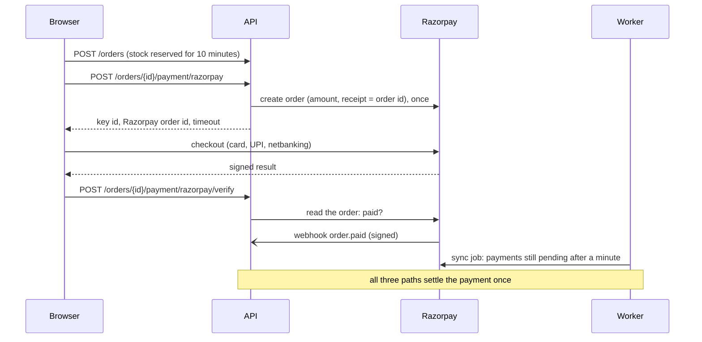

# Payments

Orders are paid either through the built-in **sandbox** (the default, for development and the
public demo) or through **Razorpay in test mode**. No real money moves in either: only Razorpay
test keys (`rzp_test_...`) are accepted.

## How a Razorpay payment works



1. **Order.** Placing an order reserves stock and creates a `payments` row with
   `provider = 'razorpay'` and no provider id yet.
2. **Pay.** The first click creates the Razorpay order and stores its id; later clicks reuse it.
   No Razorpay call ever runs inside the order transaction. A payment cannot start with less than
   a minute of reservation left, and the checkout closes itself 30 seconds before the
   reservation expires.
3. **Confirmation.** Three paths report a successful payment, and each ends in `settlePayment`
   with the same event id (`order.paid:<razorpay order id>`), so the order is confirmed once:
   - the **webhook** `order.paid`, verified with `X-Razorpay-Signature`;
   - the **checkout callback**: the browser sends Razorpay's signature, the API checks it and then
     reads the order from Razorpay, so the browser alone can never confirm an order;
   - the **sync job** in the worker, for payments still pending a minute after Pay was clicked.

   Before confirming, the paid amount, currency and order id are compared with ours. A mismatch
   confirms nothing and is logged for review.
4. **Failed attempts** do not cancel the order: Razorpay lets the shopper retry on the same order.
   An unpaid order is released by the reservation expiry job, as with the sandbox.
5. **Late payments.** A payment after the reservation deadline or after cancellation moves the
   order to `REFUND_PENDING`. The sync job sends the refund to Razorpay (looking up existing refunds
   first, so it is never sent twice) and the order becomes `REFUNDED` when Razorpay reports the
   refund processed, by webhook `refund.processed` or by the job.

Webhook events store ids only (`webhook_events.payload`), never the customer's email or phone
number that Razorpay includes.

## Set up test mode

1. Create an account at [razorpay.com](https://razorpay.com) and switch the dashboard to
   **Test Mode**.
2. **Account & Settings → API Keys → Generate Test Key.** Put both values in `.env`:
   ```
   RAZORPAY_KEY_ID=rzp_test_...
   RAZORPAY_KEY_SECRET=...
   ```
3. Restart the API and the worker. New orders are now paid through Razorpay; existing orders keep
   the sandbox.
4. Pay with a [test card](https://razorpay.com/docs/payments/payments/test-card-details/) or the
   UPI ID `success@razorpay` (`failure@razorpay` to try a failed attempt).

### Webhooks (deployed backend)

Razorpay cannot reach `localhost`, so locally the checkout callback and the sync job confirm
payments. For the deployed backend:

1. **Account & Settings → Webhooks → Add New Webhook**, in Test Mode.
2. URL: `https://<your backend>/api/v1/payments/webhooks/razorpay`.
3. Choose a secret and set it as `RAZORPAY_WEBHOOK_SECRET` on the backend.
4. Events: `order.paid`, `payment.failed` and `refund.processed`.

## Endpoints

| Method | Path | Purpose |
|---|---|---|
| POST | `/orders/{orderId}/payment/razorpay` | Start (or resume) the payment; returns checkout parameters |
| POST | `/orders/{orderId}/payment/razorpay/verify` | Checkout callback with Razorpay's signature |
| POST | `/payments/webhooks/razorpay` | Razorpay webhooks (only when `RAZORPAY_WEBHOOK_SECRET` is set) |

## Going live later

Live keys are rejected on purpose. Taking real payments needs Razorpay's business verification
(KYC), a settlement bank account, and published terms, refund, privacy and contact pages, and
the `rzp_test_` check in `packages/payments/src/index.js` would have to be lifted deliberately.
