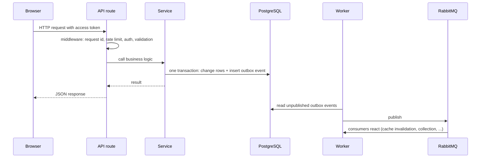

# LocalStock developer reference

This folder explains every part of the code: each file, each function, what it does and who
calls it. It is written for someone joining the project, including people new to backend work.

## Where to start

1. **What the product does and how it fits together:** [../ARCHITECTURE.md](../ARCHITECTURE.md).
2. **The technologies and why we use them:** [TECH_STACK.md](TECH_STACK.md).
3. **Run it on your machine:** the [README](../../README.md) "Getting started" section.
4. Then open the reference for the part you are working on.

## Reference by area

| Document | Covers |
|---|---|
| [TECH_STACK.md](TECH_STACK.md) | Every technology, version, purpose and location |
| [api-core-and-seller.md](api-core-and-seller.md) | API startup, configuration, middleware, shared helpers, seed scripts; modules: health, auth, organizations, warehouses, inventory, offers, catalog, imports, admin |
| [api-shopping-and-orders.md](api-shopping-and-orders.md) | Modules: discovery and search, price comparison and history, checkout and allocation quotes, orders and idempotency, payments (sandbox and Razorpay), delivery, real-time stream |
| [worker.md](worker.md) | Background worker: outbox publisher, RabbitMQ topology, consumers, scheduled jobs |
| [packages-core.md](packages-core.md) | `database` (migrations, transactions, domain SQL), `payments`, `allocation-engine`, `logger`, `metrics` |
| [packages-external-data.md](packages-external-data.md) | `connectors` and `external-data`: external price sources, matching, freshness, caching |
| [web.md](web.md) | React website: routes, pages, components, API client, state |
| [tooling-and-tests.md](tooling-and-tests.md) | Tests, smoke and load tests, Docker, CI, deployment files |

Related documents in `docs/`:

- [DATA_DICTIONARY.md](../DATA_DICTIONARY.md): every table and column.
- [openapi.yaml](../openapi.yaml): machine-readable API description.
- [PAYMENTS.md](../PAYMENTS.md): payment flows and Razorpay setup.
- [adr/README.md](../adr/README.md): why key design decisions were made.
- [RUNBOOK.md](../RUNBOOK.md): operating and troubleshooting the running system.
- [DEVELOPMENT.md](../DEVELOPMENT.md) and [DEPLOY_FREE.md](../DEPLOY_FREE.md).

## Repository map

```
apps/
  api/        REST API (Express). src/modules/<name>/ holds one feature each
  worker/     background process: publishes events, consumes them, runs timed jobs
  web/        React website (Vite)
packages/
  database/           SQL migrations, transaction helper, shared domain functions
  allocation-engine/  pure functions that split a cart across warehouses and couriers
  connectors/         adapters for external price sources (authorized APIs only)
  external-data/      matching, freshness, collection and caching of external prices
  payments/           Razorpay client and settlement logic
  logger/, metrics/   shared utilities
scripts/      smoke test and k6 load test
deploy/       all-in-one container for Render
docs/         this documentation
```

## How a typical request works



## Conventions you will see everywhere

- **One transaction per business action.** `withTransaction(pool, async (client) => ...)` commits
  or rolls back everything together, including the outbox event.
- **Errors** are thrown as `AppError(status, code, message)` and turned into
  `{ "error": { "code", "message", "details", "requestId" } }` by the error handler. Common
  PostgreSQL errors (duplicate key, broken reference, failed check) become `409` or `400`.
- **Validation** happens at the edge with Zod; services trust their input.
- **Money** is stored in minor units (paise) as integers, never as floating point rupees.
- **IDs** are UUIDs.
- **Logs** never contain secrets or personal data; the logger redacts them.
- **Multi-tenancy:** seller data belongs to a company; routes check the caller's company role.

## Glossary

| Term | Meaning |
|---|---|
| **Allocation** | Choosing which warehouses and couriers fulfil a cart, ranked by cost and delivery time. |
| **Circuit breaker** | Stops calling a failing external service for a while, so one bad source cannot slow everything. |
| **Connector** | Code that fetches prices from one external source through an authorized API. |
| **Dead-letter queue (DLQ)** | Where RabbitMQ parks messages that failed after all retries, for inspection. |
| **Fail open** | If an optional dependency (Redis) is down, carry on without it. |
| **HMAC signature** | A hash of a message made with a shared secret; proves the message came from someone who knows the secret and was not changed. |
| **Idempotency** | Doing the same request twice has the same effect as doing it once. Orders use an `Idempotency-Key` header; consumers record processed message ids. |
| **Inbox** | Table of `(consumer, message id)` pairs already processed, so a redelivered message is skipped. |
| **JWT** | JSON Web Token: a signed token that proves who the caller is without a database lookup. |
| **Middleware** | A function that runs before a route handler, e.g. to check the login token. |
| **Migration** | A numbered SQL file that changes the database schema in a controlled, reversible way. |
| **Minor units** | Money in the smallest unit (paise): Rs 12.50 is stored as `1250`. |
| **Modular monolith** | One deployable application, internally split into independent modules. |
| **Observation** | One recorded price/availability reading from an external source at a point in time. |
| **Outbox** | A table where events are written in the same transaction as the change they describe, then published by the worker. Guarantees no event is lost and none is sent for a rolled-back change. |
| **PostGIS** | PostgreSQL extension for maps and distances. |
| **Reservation** | Stock held for an order for a limited time (10 minutes) until it is paid or expires. |
| **Row lock / `FOR UPDATE`** | Locks database rows until the transaction ends, so two orders cannot take the same stock. |
| **`SKIP LOCKED`** | Skip rows another transaction has locked; lets several workers share a job table. |
| **Single-flight** | When identical requests arrive together, run the work once and give all of them the result. |
| **SSE (Server-Sent Events)** | A one-way stream from server to browser over HTTP, used for live price updates. |
| **Sandbox payment** | A built-in fake payment provider for development and demos. |
| **Webhook** | An HTTP call a provider (e.g. Razorpay) makes to our server to report an event. |

## Keeping this reference current

When you change a function's behaviour, update its entry in the same pull request. When you add
a file, add a section for it in the matching document. If a document and the code disagree,
the code is right; fix the document.
