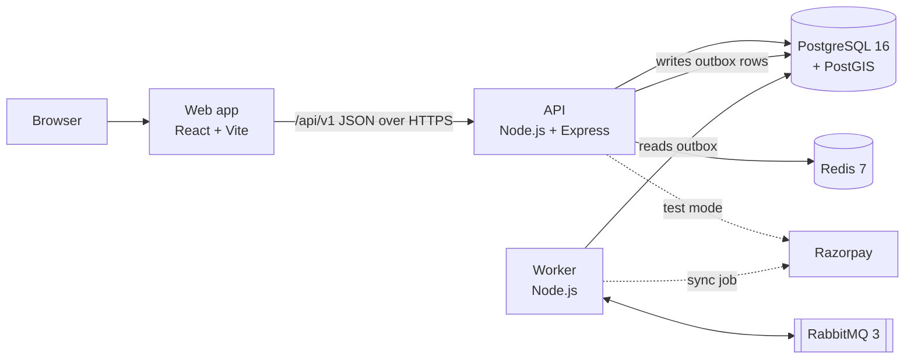

# Technology stack

Every technology LocalStock uses, what it is, why we chose it, and where it lives in the code.
If a word here is new to you, check the [glossary](README.md#glossary).

## At a glance

| Layer | Technology | Version | Where |
|---|---|---|---|
| Language and runtime | JavaScript on Node.js | 20.6 or newer | everything except `apps/web` runs on Node |
| Package management | npm workspaces | npm 10 | root `package.json` |
| HTTP API | Express | 5 | `apps/api` |
| Input validation | Zod | 4 | API routes, worker config, connectors |
| Database | PostgreSQL with PostGIS | 16 / 3.4 | `packages/database` |
| Database driver | node-postgres (`pg`) | 8 | `packages/database` |
| Cache and rate limits | Redis via `ioredis` | 7 / 5 | `apps/api/src/infrastructure/cache.js`, `packages/external-data/src/compare-cache.js` |
| Message broker | RabbitMQ via `amqplib` | 3 / 0.10 | `apps/worker` |
| Authentication | JSON Web Tokens (`jsonwebtoken`), Node `crypto` scrypt | 9 | `apps/api/src/modules/auth` |
| Payments | Razorpay (test mode) and a built-in sandbox | REST API v1 | `packages/payments`, `apps/api/src/modules/payments` |
| Frontend | React, React Router | 18 / 6 | `apps/web` |
| Build tool | Vite | 5 | `apps/web/vite.config.js` |
| Styling | Tailwind CSS, Radix UI, shadcn/ui pattern | 3 | `apps/web/src/components/ui` |
| Charts | MUI X Charts (loaded lazily) | 7 | `apps/web/src/components/mui` |
| Animation, icons, toasts | framer-motion, lucide-react, sonner | | `apps/web` |
| Logging | own JSON logger | | `packages/logger` |
| Metrics | own Prometheus text exporter | | `packages/metrics` |
| Tests | Node's built-in test runner, supertest | | `**/test/*.test.js` |
| Load tests | k6 | | `scripts/k6/search.js` |
| Containers | Docker, Docker Compose | | `docker-compose.yml`, `apps/*/Dockerfile`, `deploy/render/Dockerfile` |
| CI | GitHub Actions | | `.github/workflows` |
| Hosting (free demo) | Vercel, Render, Neon, CloudAMQP | | [DEPLOY_FREE.md](../DEPLOY_FREE.md) |

## Backend

### Node.js 20

Node.js runs JavaScript outside the browser. All backend code uses **ES modules**
(`import`/`export`, `"type": "module"` in each `package.json`). We rely on Node 20 features:

- the built-in `fetch` (Razorpay and connector HTTP calls), so no HTTP client library is needed;
- `node --watch` to restart on file changes in development;
- `node --test`, the built-in test runner;
- `crypto.scrypt` for password hashing and `crypto.createHmac` for webhook signatures.

Settings come from environment variables. In development they are read from the repository-root
`.env` file by `dotenv` (`apps/api/src/config/load-env.js`); copy `.env.example` to start.

### npm workspaces (monorepo)

One repository holds several packages. The root `package.json` lists `apps/*` and `packages/*`
as workspaces. `npm install` at the root installs everything and links the internal packages,
so `import { withTransaction } from '@localstock/database'` resolves to
`packages/database/src/index.js` with no publishing step.

| Workspace | Kind | What it is |
|---|---|---|
| `@localstock/api` | app | the REST API |
| `@localstock/worker` | app | background jobs and event consumers |
| `@localstock/web` | app | the React website |
| `@localstock/database` | library | migrations, transactions and shared domain SQL |
| `@localstock/allocation-engine` | library | splits a cart across warehouses and couriers (pure functions, no I/O) |
| `@localstock/connectors` | library | adapters for external price sources |
| `@localstock/external-data` | library | matching, freshness and collection of external prices |
| `@localstock/payments` | library | Razorpay client and payment settlement |
| `@localstock/logger` | library | structured JSON logs with secret redaction |
| `@localstock/metrics` | library | Prometheus counters, gauges and histograms |

### Express 5

Express is a small web framework: you register **routes** (a method plus a path) and
**middleware** (functions that run before the route, for example to check the login token).
Version 5 forwards errors from `async` handlers to the error handler automatically, which is
why the routes have no `try/catch` around every `await`.

The API is a **modular monolith**: one process, but code is split into modules under
`apps/api/src/modules/<name>/`, each with a `*.routes.js` file (HTTP layer) and, where the logic
is large, a `*.service.js` file (business logic). See [ADR-001](../adr/README.md).

### Zod

Zod describes the expected shape of data and rejects anything else. Every route validates its
body, query and path parameters with `shared/validate.js`, so handlers only ever see clean,
typed values. Invalid input returns `400` with the list of problems.

### PostgreSQL 16 and PostGIS

PostgreSQL is the **source of truth**: stock, orders and payments live only here, protected by
constraints (for example `CHECK (reserved <= on_hand)`) and transactions.

- **PostGIS** adds geography types and functions. Warehouses store a location and a delivery
  radius; search uses `ST_DWithin` to keep only warehouses that deliver to the shopper.
- **`pg_trgm`** (trigram matching) gives typo-tolerant search; **full-text search**
  (`tsvector`) ranks results by words.
- **Row locks** (`SELECT ... FOR UPDATE`) make stock reservation safe under concurrent orders;
  `FOR UPDATE SKIP LOCKED` lets several workers share a queue table without blocking each other.
- **Migrations** are numbered SQL files in `packages/database/migrations` (`001_init.sql` ...
  `008_payment_gateway.sql`), each with a `.down.sql` to roll back. `npm run db:migrate` applies them.

The column-by-column description is in [DATA_DICTIONARY.md](../DATA_DICTIONARY.md).

### Redis 7

An in-memory key-value store. LocalStock uses it only where losing it is harmless:

- search-result and comparison caches (with version keys for invalidation);
- rate-limit counters per IP and route.

Every Redis call **fails open**: if Redis is down the API is slower, never wrong. Redis is never
asked whether stock is available. See [ADR-003](../adr/README.md).

### RabbitMQ 3

A message broker. When something important happens (an order is placed, a payment settles) the
API writes an **outbox** row in the same transaction. The worker publishes those rows to the topic
exchange `localstock.events`, and consumers react to them (cache invalidation, external price
collection, and so on). Failed messages are retried and finally parked in a dead-letter queue.
Details: [worker.md](worker.md) and [ADR-004/006](../adr/README.md).

### Authentication

- Passwords are hashed with **scrypt** (Node's `crypto`), a deliberately slow hash.
- After login the API returns a short-lived **access token** (a JWT signed with
  `JWT_ACCESS_SECRET`) and a **refresh token** that is stored hashed in the database, rotated on
  each use, and revoked as a family if an old one is reused.
- Roles: customer, seller (company member with a company role) and platform admin.

### Payments

- **Sandbox**: built in, for development and the public demo; a signed fake webhook confirms
  the payment.
- **Razorpay test mode**: real Razorpay checkout (cards, UPI, netbanking) with test keys only.
  Confirmations are verified with HMAC-SHA256 signatures. See [PAYMENTS.md](../PAYMENTS.md).

### Observability

- **Logs**: one JSON object per line (`packages/logger`), with passwords, tokens, emails, phone
  numbers and coordinates replaced by `[REDACTED]`.
- **Metrics**: Prometheus text format at `/metrics` on the API, and on the worker when
  `WORKER_METRICS_PORT` is set, written without a third-party library. In production the caller
  must send `Authorization: Bearer <METRICS_TOKEN>`; without a token configured it answers 404.
- **Health**: `/health/live` (the process is up) and `/health/ready` (PostgreSQL and Redis answer
  within 2 seconds and the server is not shutting down; otherwise 503).

## Frontend

| Tool | What it does here |
|---|---|
| **React 18** | Builds the UI from components (functions that return markup). |
| **React Router 6** | Maps URLs such as `/orders/:id` to page components. |
| **Vite 5** | Dev server with instant reload (`npm run dev:web`, port 5173) and the production build into `apps/web/dist`. In development it forwards `/api` to the API on port 5000. |
| **Tailwind CSS 3** | Utility classes (`flex`, `p-4`, `text-sm`) instead of separate CSS files; colours are design tokens in `tailwind.config.js`. |
| **Radix UI + shadcn/ui pattern** | Accessible, unstyled primitives (dialogs, menus, tabs, selects) wrapped with Tailwind styles in `src/components/ui`. |
| **class-variance-authority, clsx, tailwind-merge** | Build class names for component variants; `cn()` in `src/lib/utils.js` merges them. |
| **MUI X Charts** | Price-history and dashboard charts, loaded only when needed to keep the first page small. |
| **framer-motion** | Small animations. |
| **lucide-react** | Icons. |
| **sonner** | Toast notifications. |
| **Vercel Web Analytics** (`@vercel/analytics`) | Page-view counts on the deployed site. `src/lib/url-privacy.js` removes order and company ids and the query string from every URL before it is sent. Loaded lazily, so an ad blocker that blocks it does not break the page. Logs to the console only in development. |
| **Vercel Speed Insights** (`@vercel/speed-insights`) | Real visitors' page speed (Core Web Vitals: loading, interaction delay, layout shift) per route, with the same URL filter. |
| **Razorpay Checkout.js** | Loaded at runtime from `checkout.razorpay.com` only when a shopper pays. |

Details for each page and component: [web.md](web.md).

## Infrastructure and delivery

| Tool | Use |
|---|---|
| **Docker Compose** | `npm run infra:up` starts PostgreSQL+PostGIS, Redis and RabbitMQ locally (`docker-compose.yml`). RabbitMQ's dashboard is at http://localhost:15672. |
| **Dockerfiles** | `apps/api`, `apps/worker` and `apps/web` each have one; `deploy/render/Dockerfile` runs the API and worker in one container for Render's free plan. |
| **GitHub Actions** | `ci.yml`: unit tests, database tests against a PostGIS service (migrations applied, rolled back, re-applied), web build, `npm audit`, image builds. `keep-awake.yml`: pings the Render backend during the day so it does not sleep. |
| **Vercel** | Hosts the website; `apps/web/vercel.json` forwards `/api/*` to Render. |
| **Render** | Runs the API and worker container (`render.yaml`), plus a free Redis-compatible Key Value store. |
| **Neon** | Hosted PostgreSQL with PostGIS. |
| **CloudAMQP** | Hosted RabbitMQ. |
| **k6** | Load test script for search (`scripts/k6/search.js`). |

How to deploy: [DEPLOY_FREE.md](../DEPLOY_FREE.md). How to run and test locally:
[DEVELOPMENT.md](../DEVELOPMENT.md) and [tooling-and-tests.md](tooling-and-tests.md).
