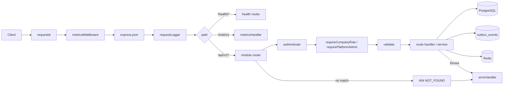

# API reference: core, seller and admin modules

This page documents, function by function, the "core" of the LocalStock API and the modules that sellers and platform admins use. It covers:

- app wiring and startup (`app.js`, `server.js`, `config/`)
- shared infrastructure, middleware and helpers (`infrastructure/`, `middleware/`, `shared/`)
- the modules `health`, `auth`, `organizations`, `warehouses`, `inventory`, `offers`, `catalog`, `imports` and `admin`
- the release and seed scripts (`scripts/`)
- the test helper `apps/api/test-support/db-app.js`

The shopping side of the API (discovery, compare, price history, checkout, orders, payments, delivery and the realtime stream) is documented in [api-shopping-and-orders.md](api-shopping-and-orders.md).

For the big picture, see [../ARCHITECTURE.md](../ARCHITECTURE.md). For table and column meanings, see [../DATA_DICTIONARY.md](../DATA_DICTIONARY.md).

## Contents

- [How a request flows](#how-a-request-flows)
- [Words used on this page](#words-used-on-this-page)
- [Environment variables](#environment-variables)
- Startup and wiring: [app.js](#appsapisrcappjs), [server.js](#appsapisrcserverjs), [config/env.js](#appsapisrcconfigenvjs), [config/load-env.js](#appsapisrcconfigload-envjs)
- Infrastructure: [cache.js](#appsapisrcinfrastructurecachejs), [metrics.js](#appsapisrcinfrastructuremetricsjs)
- Middleware: [auth.js](#appsapisrcmiddlewareauthjs), [error-handler.js](#appsapisrcmiddlewareerror-handlerjs), [rate-limit.js](#appsapisrcmiddlewarerate-limitjs), [request-context.js](#appsapisrcmiddlewarerequest-contextjs)
- Shared helpers: [audit.js](#appsapisrcsharedauditjs), [errors.js](#appsapisrcsharederrorsjs), [geo.js](#appsapisrcsharedgeojs), [validate.js](#appsapisrcsharedvalidatejs), [vendor-fields.js](#appsapisrcsharedvendor-fieldsjs)
- Modules: [health](#appsapisrcmoduleshealthhealthroutesjs), [auth](#appsapisrcmodulesauthauthroutesjs), [organizations](#appsapisrcmodulesorganizationsorganizationsroutesjs), [warehouses](#appsapisrcmoduleswarehouseswarehousesroutesjs), [inventory](#appsapisrcmodulesinventoryinventoryroutesjs), [offers](#appsapisrcmodulesoffersoffersroutesjs), [catalog](#appsapisrcmodulescatalogcatalogroutesjs), [imports](#appsapisrcmodulesimportsimportsroutesjs), [admin](#appsapisrcmodulesadminadminroutesjs)
- Scripts: [release.js](#appsapisrcscriptsreleasejs), [seed.js](#appsapisrcscriptsseedjs), [seed-catalog.js](#appsapisrcscriptsseed-catalogjs)
- Tests: [test-support/db-app.js](#appsapitest-supportdb-appjs)

## How a request flows

The API is a single Express 5 application. Express is the web framework: it receives an HTTP request and passes it through a chain of functions until one of them sends a response.

1. `server.js` reads the configuration, connects to PostgreSQL and Redis, and calls `createApp()` in `app.js`.
2. `app.js` registers **global middleware** that runs for every request: a request id, metrics, JSON body parsing and a request logger.
3. The health routes (`/health/live`, `/health/ready`) and `/metrics` are mounted at the root.
4. Every module router is mounted under the prefix **`/api/v1`**. So `POST /auth/login` in `auth.routes.js` is really `POST /api/v1/auth/login`.
5. Inside a router, each route lists its own middleware: usually `authenticate` (check the login token), then a role check, then `validate` (check the input), then the handler.
6. The handler runs SQL, either directly on the connection pool or inside `withTransaction` (all-or-nothing). Some handlers call a service object (for example `auth.service.js`).
7. Writes that other parts of the system must hear about are recorded as rows in `outbox_events`. A separate worker process later publishes them to RabbitMQ. Most writes also add a row to `audit_logs`.
8. If anything throws, Express 5 forwards the error to `errorHandler`, which turns it into a JSON error response. A request that matches no route gets a `404 NOT_FOUND`.



Note: `/metrics` is registered before the JSON parser, so it never parses a body. In the code the metrics middleware runs before `/metrics`, so requests to `/metrics` are themselves counted.

### Error response shape

Every error response, from any route, has this shape (built by `errorHandler`):

```json
{ "error": { "code": "SOME_CODE", "message": "Human readable text", "details": "optional", "requestId": "..." } }
```

## Words used on this page

| Word | Meaning |
| --- | --- |
| Middleware | A function `(req, res, next)` that runs before the route handler. It can stop the request (by calling `next(error)`) or let it continue (by calling `next()`). |
| Router | A group of routes. Each module exports a `createXRouter(deps)` function that returns an Express `Router`. |
| `deps` | The "dependencies" object passed to every router: `{ config, logger, pool, redis, state, connectors, changeFeed, metrics, ... }`. |
| Pool | A `pg.Pool`: a set of reusable PostgreSQL connections. `pool.query()` borrows a connection for one statement. |
| `withTransaction(pool, fn)` | From `@localstock/database`. Runs `fn(client)` between `BEGIN` and `COMMIT`. If `fn` throws, it rolls back. It retries the whole function up to 3 times on deadlock (`40P01`) or serialization failure (`40001`). |
| JWT | JSON Web Token. A signed string that proves who the user is. The API signs it with `JWT_ACCESS_SECRET` (algorithm HS256, issuer `localstock`). |
| Access token / refresh token | The access token is a short-lived JWT sent in `Authorization: Bearer <token>`. The refresh token is a long-lived random string used only to get a new access token. |
| Platform role | `users.platform_role`: `USER` or `ADMIN`. `ADMIN` is a LocalStock operator. |
| Company role | `company_members.role`: `OWNER`, `ADMIN` or `STAFF`. It is per company (a seller business). |
| Outbox event | A row in `outbox_events`, written in the same transaction as the business change. The worker publishes it to RabbitMQ later, so an event is never lost if the broker is down. Written with `enqueueEvent(client, {...})`. |
| Audit log | A row in `audit_logs` that records who changed what, with before/after values. Written with `writeAudit`. |
| Inventory movement | A row in `inventory_movements`. Every change to stock leaves one. Written with `recordMovement` from `@localstock/database`. |
| Minor units | Money is stored as whole paise (1 rupee = 100 paise). `priceMinor: 5500` means Rs 55.00. |
| Idempotent | Safe to run more than once with the same result. The seed scripts are idempotent. |
| zod | The validation library used for request bodies and environment variables. |

## Environment variables

These are read and validated by `loadConfig()` in `apps/api/src/config/env.js`. The API refuses to start if any value is invalid. Values below are code defaults, not real secrets.

| Name | Default | Meaning |
| --- | --- | --- |
| `NODE_ENV` | `development` | One of `development`, `test`, `production`. Controls `/metrics` access and sandbox payments. |
| `LOG_LEVEL` | `info` | One of `debug`, `info`, `warn`, `error`, `silent`. |
| `API_PORT` | `5000` | Port the API listens on. If `API_PORT` is not set but `PORT` is (hosting platforms set `PORT`), `PORT` is used. |
| `DATABASE_URL` | none (required) | PostgreSQL connection URL. |
| `REDIS_URL` | none (required) | Redis connection URL. |
| `JWT_ACCESS_SECRET` | none (required) | Secret used to sign access tokens. Must be at least 32 characters. |
| `ACCESS_TOKEN_TTL_SECONDS` | `900` | Access token lifetime (15 minutes). |
| `REFRESH_TOKEN_TTL_DAYS` | `30` | Refresh token lifetime. |
| `RESERVATION_TTL_SECONDS` | `600` | How long checkout holds stock for an unpaid order. Used by the orders module. |
| `MAX_CANDIDATE_RADIUS_KM` | `50` | Largest search radius for warehouses during checkout allocation. |
| `PAYMENT_WEBHOOK_SECRET` | none (required) | Secret for the sandbox payment webhook signature. At least 16 characters. |
| `COMPARE_DEADLINE_MS` | `5000` | Upper time limit for one `/discovery/compare` request (200 to 30000). Slower sources are reported as `TIMEOUT`. |
| `METRICS_TOKEN` | not set | Bearer token for `GET /metrics`. At least 16 characters. Without it, `/metrics` only answers when `NODE_ENV` is not `production`. |
| `ENABLE_SANDBOX_PAYMENTS` | `false` | `true` or `false`. Turns on sandbox payments in production (public demo only). Sandbox is always on outside production. |
| `RAZORPAY_KEY_ID` | not set | Razorpay test key id. Must start with `rzp_test_`. Must be set together with the secret. |
| `RAZORPAY_KEY_SECRET` | not set | Razorpay test key secret. |
| `RAZORPAY_WEBHOOK_SECRET` | not set | Razorpay webhook secret (optional). |
| `TRUST_PROXY` | `0` | Number of trusted reverse proxies (0 to 5). Passed to Express `trust proxy` so `req.ip` is the real visitor. Setting it too high lets a caller choose its own IP for rate limiting. |
| `COMPARE_RANKING_WEIGHTS` | not set | JSON with per-policy ranking weights. Parsed by `parseRankingWeights` in `modules/discovery/ranking.js`. |
| `EXTERNAL_FRESHNESS` | not set | JSON with per-source freshness overrides. Parsed by `parseFreshnessConfig` from `@localstock/external-data`. |

The returned config object also has a computed field `razorpay`: either `null` (no keys) or `{ keyId, keySecret, webhookSecret }` from `razorpaySettings()` in `@localstock/payments`.

Other variables used outside `env.js`, but by files on this page:

| Name | Used by | Meaning |
| --- | --- | --- |
| `SEED_DEMO_DATA` | `scripts/release.js` | When `true`, the release step also seeds demo data. |
| `SEED_PASSWORD` | `scripts/release.js`, `seed.js`, `seed-catalog.js` | Password for demo accounts. Default is the public `localstock-dev-password`. In production the release step requires 16+ characters and not the default. |
| `RUN_DB_TESTS` | `test-support/db-app.js` | Set to `1` to enable database tests. |
| Connector variables (`BLINKIT_ENABLED`, `DEMO_EXTERNAL_FIXTURES`, `LICENSED_PROVIDER_*`, ...) | `server.js` via `buildConnectorRegistry` | Read by `@localstock/connectors`, not by `env.js`. See `.env.example`. |

---

## `apps/api/src/app.js`

Builds the Express application. It does not start a server; `server.js` and the tests do that.

### `createApp(inputDeps)`

- **Signature:** `export function createApp(inputDeps): express.Application`
- **What it does:**
  1. Copies `inputDeps` into `deps` and fills three defaults:
     - `connectors`: if not given, `buildConnectorRegistry({ env: { NODE_ENV } })`. Because only `NODE_ENV` is passed, every external source is disabled.
     - `changeFeed`: if not given, `createChangeFeed({ pool, logger })` (realtime module).
     - `metrics`: if not given, `createApiMetrics()`.
  2. Creates the Express app and turns off the `X-Powered-By` header.
  3. If `config.TRUST_PROXY` is non-zero, sets Express `trust proxy` to that number.
  4. Stores the change feed in `app.locals.changeFeed` so `server.js` can close it on shutdown.
  5. Registers a gauge metric `change_feed_subscribers` (number of open `/discovery/stream` connections).
  6. Registers global middleware in this order: `requestId()`, `metricsMiddleware()`, `GET /metrics`, `express.json({ limit: '100kb' })`, `requestLogger()`. The JSON parser keeps the raw bytes in `req.rawBody` so payment webhooks can verify signatures.
  7. Mounts the health router at the root.
  8. Creates one `Router` and mounts every module router on it, in this order: auth, organizations, warehouses, delivery, catalog, offers, inventory, discovery, compare, price history, stream, checkout, orders, payments, imports, admin. Then mounts that router at `/api/v1`.
  9. Adds a final catch-all that raises `AppError(404, 'NOT_FOUND', 'Route not found')`, then the `errorHandler`.
- **Parameters:** `inputDeps` must contain at least `config`, `logger`, `pool`, `redis`, `state`. Optional: `connectors`, `changeFeed`, `metrics`, `razorpayClient` (used by the payments module).
- **Returns:** the configured Express app.
- **Errors:** none of its own.
- **Side effects:** none at build time except creating the change feed (if not supplied).
- **Called by:** `server.js` and `test-support/db-app.js`.
- **Why admin is last:** the admin router guards every `/admin` path with "must be platform admin". Routers mounted earlier (for example delivery's `POST /admin/delivery-providers`) keep their own checks. A side effect of this order: an unknown `/api/v1/admin/...` path returns 401 or 403 (not 404) to a caller who is not a platform admin.

---

## `apps/api/src/server.js`

The process entry point. It loads configuration, opens connections, starts listening and handles graceful shutdown. It is a script: it runs top to bottom when Node starts it.

### Top-level startup code

- Imports `./config/load-env.js` first, so the repository `.env` file is loaded before anything reads `process.env`.
- `loadConfig()` validates the environment (throws and stops the process if invalid).
- `createLogger({ level: LOG_LEVEL, base: { service: 'api' } })` from `@localstock/logger`.
- `createPool(DATABASE_URL)` from `@localstock/database` (max 10 connections). An `error` listener logs errors from idle PostgreSQL connections.
- `createRedis(REDIS_URL, logger)` then `redis.connect()`. If Redis is down, it logs a warning and continues: Redis is only a cache and rate-limit store.
- `buildConnectorRegistry({ env: process.env, logger })` builds the external source connectors from the full environment, and logs which ones are enabled.
- `state = { shuttingDown: false }` is shared with the health router.
- `createApp(...)` then `app.listen(API_PORT)`.
- Listens for `SIGINT` and `SIGTERM` and calls `shutdown(signal)`.

### `shutdown(signal)` (internal)

- **Signature:** `async function shutdown(signal: string): Promise<void>`
- **What it does:**
  1. Returns at once if a shutdown is already running.
  2. Sets `state.shuttingDown = true`, so `/health/ready` starts answering 503.
  3. Starts a 10 second timer. If shutdown is not done by then, it logs an error and exits with code 1. The timer is `unref()`-ed so it does not keep the process alive by itself.
  4. Closes the change feed (`app.locals.changeFeed.close()`), so open event streams do not keep the server open.
  5. Calls `server.close()`, which stops new connections. When all connections are closed, it ends the PostgreSQL pool and quits Redis (`Promise.allSettled`, so one failure does not block the other), logs, and exits with code 0.
  6. Calls `server.closeIdleConnections()` to drop keep-alive connections that are not serving a request.
- **Parameters:** `signal` is only used in the log line.
- **Called by:** the `SIGINT` / `SIGTERM` handlers.

---

## `apps/api/src/config/env.js`

Defines the environment schema (see [Environment variables](#environment-variables)) and validates it once at startup, so a missing setting fails immediately instead of on the first request that needs it.

### `schema` (internal)

A zod object describing each variable, its type, its limits and its default. Two fields (`COMPARE_RANKING_WEIGHTS`, `EXTERNAL_FRESHNESS`) are JSON strings. They are parsed during validation; a parse error becomes a validation issue. `ENABLE_SANDBOX_PAYMENTS` is turned from the text `'true'`/`'false'` into a boolean. Numeric values are coerced from strings.

### `loadConfig(env = process.env)`

- **Signature:** `export function loadConfig(env?: object): Config`
- **What it does:** If `env.API_PORT` is undefined and `env.PORT` is defined, it uses `PORT` as `API_PORT`. It validates `env` with the schema. Then it adds `razorpay: razorpaySettings(data)`.
- **Parameters:** `env` is a plain object of strings. Tests pass their own object instead of `process.env`.
- **Returns:** the parsed config object (all fields typed and defaulted), plus `razorpay` (`null` or `{ keyId, keySecret, webhookSecret }`).
- **Errors:** throws `Error('Invalid environment configuration:\n  <path>: <message>...')` listing every problem. If the Razorpay keys are invalid (only one of the two set, or a key that does not start with `rzp_test_`), it throws `Invalid environment configuration:\n  RAZORPAY_KEY_ID: <reason>`.
- **Side effects:** none.
- **Called by:** `server.js`, `test-support/db-app.js`.

---

## `apps/api/src/config/load-env.js`

A side-effect-only module. When imported, it calls `dotenv`'s `config()` with the path of the repository-root `.env` file (four folders up from this file). This makes the `.env` file load no matter which folder the API was started from. Variables already set in the real environment are not overwritten (default `dotenv` behaviour). It defines no functions.

Imported by: `server.js`, `scripts/seed.js`, `scripts/seed-catalog.js`.

---

## `apps/api/src/infrastructure/cache.js`

Creates the Redis client and holds a shared cache key name.

### `createRedis(url, logger)`

- **Signature:** `export function createRedis(url: string, logger): Redis`
- **What it does:** Creates an `ioredis` client with:
  - `lazyConnect: true`: it does not connect until `connect()` is called.
  - `maxRetriesPerRequest: 1` and `enableOfflineQueue: false`: while disconnected, commands fail quickly instead of waiting in a queue. Callers can then fall back to PostgreSQL (or, for the rate limiter, let the request through).
  - An `error` listener that logs a warning at most once every 30 seconds, so a Redis outage does not flood the logs.
- **Returns:** the Redis client (not yet connected).
- **Errors:** none thrown by this function.
- **Called by:** `server.js`.

### `SEARCH_VERSION_KEY`

- **Value:** `'search:version'`
- **Meaning:** A Redis counter. Discovery search results are cached under keys that include this version. Increasing the counter makes old cached results unused. It is read by the discovery service and increased by the worker (on catalogue or stock events) and by `seed-catalog.js`.

---

## `apps/api/src/infrastructure/metrics.js`

Prometheus-style metrics for the API. Route labels use the Express route pattern (for example `/api/v1/companies/:companyId/offers`), never the raw URL, so ids in the URL cannot create unlimited metric series.

### `createApiMetrics()`

- **Signature:** `export function createApiMetrics(): { registry, requests, duration, compareSources }`
- **What it does:** Creates a registry with `createRegistry()` from `@localstock/metrics` and three metrics:
  - `http_requests_total` (counter, labels `method`, `route`, `status`)
  - `http_request_duration_seconds` (histogram, labels `method`, `route`)
  - `compare_source_results_total` (counter; incremented by `compare.service.js` with labels `source`, `status`, `cache`)
- **Returns:** the registry and the three metric objects.
- **Called by:** `createApp` (default for `deps.metrics`).

### `metricsMiddleware(metrics)`

- **Signature:** `export function metricsMiddleware(metrics): Middleware`
- **What it does:** Notes the start time. When the response finishes, it records one request in `http_requests_total` and its duration in `http_request_duration_seconds`. The route label is `req.route.path` with `/api/v1` put back in front when the URL starts with `/api/v1/` (Express resets `req.baseUrl` by the time the response finishes). If no route matched, the label is `unmatched`.
- **Side effects:** updates in-memory metrics.
- **Called by:** `createApp` (global middleware).

### `metricsHandler(metrics, config)`

- **Signature:** `export function metricsHandler(metrics, config): AsyncHandler`
- **What it does:** Builds an access check with `metricsAccess({ token: METRICS_TOKEN, production })`. The rule: if a token is configured, the `Authorization` header must be exactly `Bearer <token>`; if no token is configured, access is allowed only outside production. A denied caller gets the same `404 NOT_FOUND` body as an unknown route, so the endpoint is hidden. An allowed caller gets the metrics text with the registry's content type.
- **Called by:** `createApp` for `GET /metrics`.

| Method | Path | Who | Response | Errors |
| --- | --- | --- | --- | --- |
| GET | `/metrics` (no `/api/v1` prefix) | Anyone outside production; with `METRICS_TOKEN` set, only `Authorization: Bearer <token>` | Metrics in text exposition format | 404 `NOT_FOUND` when not allowed |

---

## `apps/api/src/middleware/auth.js`

Authentication (who are you?) and authorization (are you allowed?) middleware.

### `COMPANY_ROLES`, `COMPANY_MANAGERS`

- `COMPANY_ROLES = ['OWNER', 'ADMIN', 'STAFF']`: every company member.
- `COMPANY_MANAGERS = ['OWNER', 'ADMIN']`: members allowed to change company setup (warehouses, offers, members, imports).
- Both are frozen arrays.

### `UUID_RE` (internal)

A regular expression that matches a UUID in the standard 8-4-4-4-12 hex format (case-insensitive).

### `authenticate(config)`

- **Signature:** `export function authenticate(config): Middleware`
- **What it does:** Reads the `Authorization` header. It must be `Bearer <token>`. It verifies the JWT with `config.JWT_ACCESS_SECRET`, algorithm `HS256` and issuer `localstock`. On success it sets `req.user = { id: payload.sub, platformRole: payload.role }`.
- **Errors:**
  - Missing header or wrong scheme: `401 UNAUTHORIZED` ("Authentication required").
  - Bad signature, expired, wrong issuer or malformed token: `401 INVALID_TOKEN`.
- **Side effects:** none. It does not check the database, so a suspended user keeps access until the access token expires (at most `ACCESS_TOKEN_TTL_SECONDS`).
- **Called by:** almost every router that needs a logged-in user.

### `requirePlatformAdmin(req, res, next)`

- **Signature:** `export function requirePlatformAdmin(req, _res, next): void`
- **What it does:** Lets the request through only if `req.user.platformRole === 'ADMIN'`. Must run after `authenticate`.
- **Errors:** `403 FORBIDDEN` otherwise.
- **Called by:** catalog admin routes, the admin router, delivery's platform provider route.

### `requireCompanyRole(pool, roles = COMPANY_ROLES)`

- **Signature:** `export function requireCompanyRole(pool, roles?: string[]): AsyncMiddleware`
- **What it does:** The tenant check for every `/companies/:companyId/...` route. ("Tenant" means one seller company; a user must only see their own companies.)
  1. Checks that `req.params.companyId` is a UUID.
  2. Looks up the caller's membership row in `company_members`, joined with `companies`, where the company is `ACTIVE`.
  3. If there is no row, answers 404 (not 403). This way, outsiders cannot find out whether a company id exists.
  4. If the member's role is not in `roles`, answers 403.
  5. Sets `req.membership = { companyId, role }`.
- **Parameters:** `pool`: the PostgreSQL pool. `roles`: allowed roles (default: all).
- **Errors:** `400 VALIDATION_FAILED` ("Invalid companyId"), `404 COMPANY_NOT_FOUND` (not a member, or the company is suspended), `403 FORBIDDEN` (role too low).
- **Side effects:** reads `company_members`, `companies`.
- **Called by:** organizations, warehouses, inventory, offers, imports routers (and some shopping-side routers). Must run after `authenticate` because it uses `req.user.id`.

---

## `apps/api/src/middleware/error-handler.js`

Turns any thrown error into a consistent JSON error response.

### `PG_ERRORS` (internal)

A table that maps PostgreSQL error codes to HTTP answers:

| PostgreSQL code | Meaning | HTTP | API code |
| --- | --- | --- | --- |
| `23505` | unique violation | 409 | `DUPLICATE` |
| `23503` | foreign key violation | 409 | `REFERENCE_NOT_FOUND` |
| `23514` | check constraint violation | 409 | `CONSTRAINT_VIOLATION` |
| `22P02` | invalid text representation (for example a bad UUID) | 400 | `INVALID_INPUT` |

### `errorHandler(logger)`

- **Signature:** `export function errorHandler(logger): ErrorMiddleware` (four arguments `(err, req, res, next)`, which is how Express recognizes error middleware)
- **What it does:** Picks the status and body in this order:
  1. `AppError`: uses its `status`, `code`, `message`, `details`.
  2. `err.type === 'entity.parse.failed'` (bad JSON from `express.json`): `400 MALFORMED_JSON`.
  3. `err.type === 'entity.too.large'` (body over the limit): `413 PAYLOAD_TOO_LARGE`.
  4. `err.domainCode` set (domain errors from `@localstock/database`, for example stock or order transition errors): `409` with that code, message and details.
  5. A known PostgreSQL code from `PG_ERRORS`: that status and code; `details.constraint` holds the constraint name when known.
  6. Anything else: `500 INTERNAL_ERROR` with a generic message. The real error is never sent to the client.
- **Side effects:** logs at `error` level for status 500 and above, with the request id.
- **Response:** `{ error: { code, message, details?, requestId } }`.
- **Called by:** `createApp`, as the last middleware.

---

## `apps/api/src/middleware/rate-limit.js`

### `rateLimit(redis, logger, { keyPrefix, limit, windowSeconds })`

- **Signature:** `export function rateLimit(redis, logger, options): AsyncMiddleware`
- **What it does:** A fixed-window rate limiter stored in Redis. Time is cut into windows of `windowSeconds`. For each request it increments the Redis key `ratelimit:<keyPrefix>:<req.ip>:<windowNumber>`. On the first hit of a window it sets the key to expire after `windowSeconds`. If the count is above `limit`, the request is refused.
- **Parameters:** `keyPrefix` names the limit (for example `auth`). `limit` is the number of allowed requests per window per IP. `windowSeconds` is the window length.
- **Errors:** `429 RATE_LIMITED` with a `Retry-After: <windowSeconds>` header.
- **Fails open:** if Redis is unavailable, it logs at `debug` level and lets the request through. A Redis outage must not take login or checkout down.
- **Side effects:** Redis `INCR` and `EXPIRE` on `ratelimit:*` keys.
- **Called by:** the auth router (`auth`, 20 per 60 s), the imports router (`catalogue-import`, 20 per 60 s) and shopping-side routers.
- **Note:** `req.ip` depends on `TRUST_PROXY`. Behind a proxy with `TRUST_PROXY=0`, every visitor would share the proxy's IP.

---

## `apps/api/src/middleware/request-context.js`

### `SAFE_ID` (internal)

Regular expression `^[\w.-]{1,128}$`: letters, digits, underscore, dot, dash; 1 to 128 characters.

### `requestId()`

- **Signature:** `export function requestId(): Middleware`
- **What it does:** If the client sent an `x-request-id` header that matches `SAFE_ID`, it reuses it. Otherwise it creates a random UUID. It stores it in `req.id` and returns it in the `x-request-id` response header. The id appears in logs and in every error body, so one request can be traced.
- **Called by:** `createApp` (first global middleware).

### `requestLogger(logger)`

- **Signature:** `export function requestLogger(logger): Middleware`
- **What it does:** When the response finishes, it logs one `info` line `request` with `requestId`, `method`, `path` (without the query string), `status`, `durationMs` and `userId` (if `authenticate` ran).
- **Called by:** `createApp`.

---

## `apps/api/src/shared/audit.js`

### `writeAudit(client, entry)`

- **Signature:** `export async function writeAudit(client, { actorUserId, companyId = null, action, entityType, entityId = null, before = null, after = null, sourceOfChange = 'USER' }): Promise<void>`
- **What it does:** Inserts one row into `audit_logs`. `before` and `after` are stored as JSON text.
- **Parameters:**
  - `client`: a pool or a transaction client. Pass the transaction client so the audit row is committed or rolled back together with the change.
  - `action`: a short name such as `offer.created`.
  - `entityType` / `entityId`: what was changed.
  - `sourceOfChange`: `USER` (default), `ADMIN`, `CSV_IMPORT` or `SYSTEM`.
- **Errors:** database errors propagate.
- **Called by:** organizations, warehouses, inventory, offers, catalog, imports and admin modules (and others).

---

## `apps/api/src/shared/errors.js`

### `class AppError extends Error`

- **Signature:** `new AppError(status: number, code: string, message: string, details?: any)`
- **What it is:** The error type for "expected" failures. `errorHandler` sends its `status`, `code`, `message` and `details` to the client. `name` is `'AppError'`.

### Helper constructors

| Function | Returns |
| --- | --- |
| `badRequest(message, details)` | `AppError(400, 'BAD_REQUEST', message, details)` |
| `unauthorized(message = 'Authentication required')` | `AppError(401, 'UNAUTHORIZED', message)` |
| `forbidden(message = 'You do not have permission for this action')` | `AppError(403, 'FORBIDDEN', message)` |
| `notFound(code, message)` | `AppError(404, code, message)` |
| `conflict(code, message, details)` | `AppError(409, code, message, details)` |

They only build the error; the caller throws it or passes it to `next()`.

---

## `apps/api/src/shared/geo.js`

### `pointSql(latParam, lngParam)`

- **Signature:** `export const pointSql = (latParam: string, lngParam: string) => string`
- **What it does:** Returns a SQL fragment that builds a PostGIS geography point from two numeric SQL parameters, for example `pointSql('$4', '$5')` gives `ST_SetSRID(ST_MakePoint($5::float8, $4::float8), 4326)::geography`. Note the order: PostGIS wants longitude first.
- **Parameters:** the placeholder names (such as `'$4'`), not the values. Values are still passed as query parameters, so this is safe from SQL injection.
- **Called by:** `warehouses.routes.js` and shopping-side code (discovery, checkout, orders).

### `estimateDeliveryMinutes(distanceMeters)`

- **Signature:** `export function estimateDeliveryMinutes(distanceMeters: number | null): number | null`
- **What it does:** A rough estimate for listings: road distance = straight distance x 1.3, speed 25 km/h, plus 15 minutes. Formula: `15 + ceil((km * 1.3 / 25) * 60)`. Returns `null` if the distance is null or undefined. Checkout uses real delivery quotes instead.
- **Called by:** discovery code (see [api-shopping-and-orders.md](api-shopping-and-orders.md)).

---

## `apps/api/src/shared/validate.js`

### `validate(schemas)`

- **Signature:** `export function validate(schemas: { params?, query?, body? }): Middleware`
- **What it does:** For each of `params`, `query`, `body` that has a zod schema, it parses `req[part]` (or `{}` if missing). On the first failure it stops. On success it stores the cleaned values in `req.valid.params`, `req.valid.query`, `req.valid.body`. Handlers read from `req.valid`, never directly from `req.body`, so they always get trimmed, lower-cased, defaulted values.
- **Errors:** `400 VALIDATION_FAILED` ("Request validation failed") with `details` = list of `{ path, message }`, where `path` looks like `body.email`.
- **Note:** a route that calls `validate` replaces `req.valid` entirely, so only one `validate` per route is expected.

### Exported schema pieces

| Name | Meaning |
| --- | --- |
| `uuid` | `z.string().uuid()` |
| `idParams(...names)` | A params schema where each name must be a UUID. Example: `idParams('companyId', 'offerId')`. |
| `point` | `{ lat: -90..90, lng: -180..180 }` (numbers) |
| `pagination` | `{ page: 1..1000 (default 1), limit: 1..50 (default 20) }`, coerced from query strings. Spread into a `z.object`. |

---

## `apps/api/src/shared/vendor-fields.js`

Shared zod schemas for seller (vendor) fields.

| Name | Meaning |
| --- | --- |
| `phone` | Trimmed string matching `^\+?[0-9 ()-]{6,20}$`. Mirrors the database CHECK constraints on `companies.contact_phone` and `warehouses.contact_phone`. |
| `VENDOR_TYPES` | `['RETAILER', 'WHOLESALER', 'DISTRIBUTOR', 'BRAND', 'OTHER']` |
| `openingHours` | A partial record keyed by `mon`..`sun`. Each day is a list of at most 3 `[open, close]` ranges in `HH:MM` 24-hour time, with `open < close`. Example: `{"mon": [["08:00","13:00"],["16:00","22:00"]], "sun": []}`. A missing day means "unknown"; an empty list means "closed". A store open past midnight must use two ranges on two days. |

Internal: `DAYS` (the day keys), `time` (HH:MM regex), `range` (a validated `[open, close]` pair).

---

## `apps/api/src/modules/health/health.routes.js`

Health checks for the hosting platform and load balancer. Mounted at the root, not under `/api/v1`.

### `withTimeout(promise, ms)` (internal)

- Races `promise` against a timer. Rejects with `Error('timed out after <ms> ms')` if the timer wins. Always clears the timer.

### `check(fn)` (internal)

- Calls `fn()` with a 2 second timeout.
- **Returns:** `{ ok: true, latencyMs }` on success, or `{ ok: false, error: message }` on failure. It never throws.

### `createHealthRouter({ pool, redis, state })`

Returns a router with the two endpoints below.

| Method | Path | Who | Response | Errors |
| --- | --- | --- | --- | --- |
| GET | `/health/live` | Anyone | `200 { "status": "ok" }` | none |
| GET | `/health/ready` | Anyone | `200` or `503` with `{ status: "ready" \| "not_ready", shuttingDown, checks: { postgres, redis } }` | `503` when shutting down, or PostgreSQL or Redis fails |

Notes:

- **Liveness** (`/live`) only says "the process is running". It never checks dependencies, so a database outage does not make the platform restart the API.
- **Readiness** (`/ready`) runs `SELECT 1` on PostgreSQL and `PING` on Redis in parallel. It is ready only if both succeed and `state.shuttingDown` is false. Each check reports its latency or its error message.

---

## `apps/api/src/modules/auth/auth.routes.js`

HTTP layer for registration, login, token refresh, logout and "who am I".

### Schemas (internal)

- `email`: trimmed, lower-cased, valid email, max 254 characters.
- `registerBody`: `{ name (1-120), email, password (10-200 characters) }`.
- `loginBody`: `{ email, password (1-200) }`.
- `refreshBody`: `{ refreshToken (20-200 characters) }`.

### `createAuthRouter(deps)`

Creates the service with `createAuthService(deps)` and a rate limiter `rateLimit(redis, logger, { keyPrefix: 'auth', limit: 20, windowSeconds: 60 })`. The limiter is shared by register, login and refresh: together, 20 requests per minute per IP.

| Method | Path | Who | Request | Response | Notable errors |
| --- | --- | --- | --- | --- | --- |
| POST | `/api/v1/auth/register` | Anyone (rate-limited) | `{ name, email, password }` | `201 { user, accessToken, refreshToken, tokenType: "Bearer", expiresIn }` | 400 `VALIDATION_FAILED`, 409 `EMAIL_TAKEN`, 429 `RATE_LIMITED` |
| POST | `/api/v1/auth/login` | Anyone (rate-limited) | `{ email, password }` | `200` same shape as register | 401 `INVALID_CREDENTIALS`, 429 |
| POST | `/api/v1/auth/refresh` | Anyone holding a refresh token (rate-limited) | `{ refreshToken }` | `200` same shape as register (new tokens) | 401 `INVALID_REFRESH_TOKEN`, 429 |
| POST | `/api/v1/auth/logout` | Anyone holding a refresh token (not rate-limited) | `{ refreshToken }` | `204` no body | 400 `VALIDATION_FAILED` |
| GET | `/api/v1/users/me` | Logged in | none | `200 { id, name, email, platformRole, memberships: [{ companyId, companyName, role }] }` | 401, 404 `USER_NOT_FOUND` |

`user` in the token responses is `{ id, name, email, platformRole }`.

Logout always answers 204, even if the token was unknown or already revoked.

---

## `apps/api/src/modules/auth/auth.service.js`

Business logic for accounts and tokens.

### Internal helpers

- `sha256(value)`: hex SHA-256 of a string. Refresh tokens are stored only as this hash, so a database leak does not reveal usable tokens.
- `REFRESH_GRACE_SECONDS = 30`.
- `invalidRefresh()`: builds `AppError(401, 'INVALID_REFRESH_TOKEN', ...)`.
- `publicUser(u)`: maps a database row to `{ id, name, email, platformRole }` (never includes the password hash).

### `createAuthService({ pool, config })`

- **Returns:** an object with `register`, `login`, `refresh`, `logout`, `me`.
- At creation it starts hashing a random password (`dummyHash`, a Promise). Login checks against this hash when the email is unknown, so a login for an unknown email takes about as long as one for a known email. This stops attackers from discovering which emails are registered by timing.
- **Called by:** `createAuthRouter`.

### `issueTokens(db, user)` (internal)

- **Signature:** `async function issueTokens(db, user: { id, platform_role }): Promise<{ refreshTokenId, tokens }>`
- **What it does:**
  - Signs an access JWT: payload `{ role: user.platform_role }`, `sub` = user id, expires in `ACCESS_TOKEN_TTL_SECONDS`, issuer `localstock`, HS256.
  - Creates a refresh token: 32 random bytes, base64url.
  - Inserts `refresh_tokens (user_id, token_hash, expires_at = now() + REFRESH_TOKEN_TTL_DAYS days)`.
- **Returns:** `{ refreshTokenId, tokens: { accessToken, refreshToken, tokenType: 'Bearer', expiresIn } }`.
- **Side effects:** writes `refresh_tokens`.

### `register({ name, email, password })`

- Hashes the password (scrypt, see `passwords.js`), then in a transaction inserts into `users` with `ON CONFLICT DO NOTHING`. If no row was inserted (the email already exists), throws `409 EMAIL_TAKEN`. Otherwise issues tokens in the same transaction.
- **Returns:** `{ user, accessToken, refreshToken, tokenType, expiresIn }`.
- **Side effects:** writes `users`, `refresh_tokens`.

### `login({ email, password })`

- Finds the user by `lower(email)`. Verifies the password against the stored hash, or against `dummyHash` if there is no user. Fails if there is no user, the password is wrong, or `users.status` is not `ACTIVE`.
- **Errors:** `401 INVALID_CREDENTIALS` (the same message for all three failure reasons).
- **Returns:** same shape as `register`.
- **Side effects:** reads `users`, writes `refresh_tokens` (not in a transaction).

### `refresh(refreshToken)`

Refresh tokens **rotate**: every successful use revokes the old token and issues a new one.

- In a transaction, looks up the token by hash, joined with its user, and locks the token row (`FOR UPDATE OF t`). It also computes `just_rotated`: true if the token was replaced by a newer one less than 30 seconds ago.
- Decision order:
  1. Unknown token: `401 INVALID_REFRESH_TOKEN`.
  2. `just_rotated`: `401 INVALID_REFRESH_TOKEN`, nothing else. This is most likely a second browser tab refreshing at the same moment, so it is not treated as theft.
  3. Already revoked (and not just rotated): treated as **token reuse**, which suggests the token leaked. All of this user's un-revoked refresh tokens are revoked (every session is logged out). The transaction commits, and then `401 INVALID_REFRESH_TOKEN` is thrown. Throwing after commit keeps the revocation.
  4. Expired, or user status not `ACTIVE`: `401 INVALID_REFRESH_TOKEN`.
  5. Otherwise: issues new tokens, and marks the old row `revoked_at = now(), replaced_by = <new id>`.
- **Returns:** same shape as `register`.
- **Side effects:** reads/writes `refresh_tokens`, reads `users`.

### `logout(refreshToken)`

- Sets `revoked_at = now()` on the matching un-revoked token. Does nothing if not found.
- **Note:** the access token stays valid until it expires; there is no access-token blocklist.

### `me(userId)`

- Reads the user, then the user's company memberships (all companies, ordered by name; company status is not filtered here).
- **Errors:** `404 USER_NOT_FOUND`.
- **Returns:** `{ id, name, email, platformRole, memberships: [{ companyId, companyName, role }] }`.

---

## `apps/api/src/modules/auth/passwords.js`

Password hashing with scrypt (built into Node, memory-hard, so no native module is needed). The parameters are saved inside each hash so they can be raised later without breaking old hashes.

### `hashPassword(password)`

- **Signature:** `export async function hashPassword(password: string): Promise<string>`
- **What it does:** Generates a 16-byte random salt and derives a 64-byte key with `N=16384, r=8, p=1`.
- **Returns:** `scrypt$16384$8$1$<salt base64>$<hash base64>`.
- **Called by:** `auth.service.js`, `seed.js`, `seed-catalog.js`.

### `verifyPassword(password, stored)`

- **Signature:** `export async function verifyPassword(password: string, stored: string): Promise<boolean>`
- **What it does:** Splits the stored string on `$`. Returns `false` if the algorithm is not `scrypt`. Recomputes the hash with the stored parameters and salt and compares with `timingSafeEqual` (a comparison that takes the same time whether the first or last byte differs).
- **Errors:** a malformed stored string can make `scrypt` or `timingSafeEqual` throw; this is not caught here. (Test users created by `db-app.js` have the hash `'x'`, which returns `false` because the algorithm is not `scrypt`.)
- **Called by:** `auth.service.js` `login`.

---

## `apps/api/src/modules/organizations/organizations.routes.js`

Seller companies and their members. A "company" is a seller business; users join it with a role.

### Schemas (internal)

- `createCompanyBody`: `{ name (2-200), registrationNumber? (max 100), vendorType (default RETAILER), contactPhone? }`.
- `addMemberBody`: `{ email, role: 'ADMIN' | 'STAFF' }`. You cannot add another `OWNER` through the API.

### `createOrganizationsRouter({ pool, config })`

`router.use('/companies', authenticate(config))` makes every `/companies...` request that passes through this router require login. (Because this router is mounted before the warehouses, inventory, offers and imports routers, this check runs for their `/companies/...` routes too; they also call `authenticate` themselves.)

| Method | Path | Who | Request | Response | Notable errors |
| --- | --- | --- | --- | --- | --- |
| POST | `/api/v1/companies` | Logged in | `{ name, registrationNumber?, vendorType?, contactPhone? }` | `201 { id, name, registrationNumber, vendorType, contactPhone, status, role: "OWNER" }` | 400, 401 |
| GET | `/api/v1/companies` | Logged in | none | `200 { items: [{ id, name, status, vendorType, contactPhone, role }] }` (companies the caller belongs to, by name) | 401 |
| POST | `/api/v1/companies/:companyId/members` | Company OWNER or ADMIN | `{ email, role }` | `201 { userId, name, email, role }` | 404 `COMPANY_NOT_FOUND`, 403, 404 `USER_NOT_FOUND` (must register first), 409 `ALREADY_MEMBER` |
| GET | `/api/v1/companies/:companyId/members` | Any company member | none | `200 { items: [{ userId, name, email, role }] }` ordered by join time | 404 `COMPANY_NOT_FOUND` |

Handler notes:

- **Create company:** one transaction inserts `companies`, adds the caller to `company_members` as `OWNER`, and writes audit `company.created`. Any logged-in user can create a company.
- **List companies:** includes suspended companies (no status filter), with the caller's role.
- **Add member:** in a transaction: finds the user by lower-cased email; inserts the membership with `ON CONFLICT (company_id, user_id) DO NOTHING`; if nothing was inserted, the user is already a member. Writes audit `member.added`.

---

## `apps/api/src/modules/warehouses/warehouses.routes.js`

A warehouse is a physical store or stock point of a company, with a location and a delivery radius.

### Internal pieces

- `createBody`: `{ name, address?, lat, lng, serviceRadiusKm (>0, max 100, default 10), contactPhone?, openingHours? }`.
- `updateBody`: any of `{ name, address|null, serviceRadiusKm, status: ACTIVE|INACTIVE, contactPhone|null, openingHours|null }`; at least one field. Location cannot be changed after creation.
- `COLUMNS`: the SELECT list, which turns the PostGIS `location` into `lat` (`ST_Y`) and `lng` (`ST_X`).
- `toWarehouse(r)`: maps a row to `{ id, name, address, status, lat, lng, serviceRadiusKm, contactPhone, openingHours }`. The radius is stored in metres (`service_radius_m`) and returned in km.
- `keepOr(value, current)`: for nullable PATCH fields. `undefined` keeps the current value; `null` clears it; anything else replaces it.

### `createWarehousesRouter({ pool, config })`

| Method | Path | Who | Request | Response | Notable errors |
| --- | --- | --- | --- | --- | --- |
| POST | `/api/v1/companies/:companyId/warehouses` | Company OWNER or ADMIN | `createBody` | `201` warehouse | 400, 403, 404 `COMPANY_NOT_FOUND` |
| GET | `/api/v1/companies/:companyId/warehouses` | Any company member | none | `200 { items: [warehouse] }` by name | 404 `COMPANY_NOT_FOUND` |
| PATCH | `/api/v1/companies/:companyId/warehouses/:warehouseId` | Company OWNER or ADMIN | `updateBody` | `200` warehouse | 400, 403, 404 `WAREHOUSE_NOT_FOUND` |

Handler notes:

- **Create:** one transaction inserts into `warehouses` (location built with `pointSql`, radius converted to metres, opening hours stored as JSON) and writes audit `warehouse.created`.
- **Update:** one transaction locks the warehouse row (`FOR UPDATE`), checking it belongs to the company. `name`, `serviceRadiusKm` and `status` use `COALESCE` (not sent = unchanged). `address`, `contactPhone`, `openingHours` use `keepOr`, so `null` clears them. Writes audit `warehouse.updated` with before and after.
- No outbox event is written for seller warehouse changes in this file. (Admin status changes do emit one; see the admin router.)

---

## `apps/api/src/modules/inventory/inventory.routes.js`

Stock levels per warehouse and offer, and manual stock adjustments.

### Internal pieces

- `adjustmentBody`: `{ warehouseId, offerId, delta (non-zero integer), reason: RESTOCK|CORRECTION|DAMAGE|RETURN, note? (max 500) }`.
- `listQuery`: `{ warehouseId? }`.
- `toInventory(r)`: maps a row to `{ id, warehouseId, warehouseName, offerId, sellerSku, variantName, onHand, reserved, available (= onHand - reserved), version, updatedAt }`.

`on_hand` is the physical stock. `reserved` is stock promised to unpaid or unfulfilled orders. `version` increases on every change (useful for clients to detect updates).

### `createInventoryRouter({ pool, config })`

| Method | Path | Who | Request | Response | Notable errors |
| --- | --- | --- | --- | --- | --- |
| POST | `/api/v1/companies/:companyId/inventory/adjustments` | Any company member (including STAFF) | `adjustmentBody` | `201` inventory row | 404 `WAREHOUSE_NOT_FOUND`, 404 `OFFER_NOT_FOUND`, 409 `ADJUSTMENT_BELOW_RESERVED` |
| GET | `/api/v1/companies/:companyId/inventory` | Any company member | query `warehouseId?` | `200 { items: [inventory row] }` ordered by warehouse name, then variant name | 400, 404 `COMPANY_NOT_FOUND` |

Handler notes for the adjustment (all in one transaction):

1. Checks the warehouse and the offer both belong to the company.
2. Creates the `warehouse_inventory` row if it does not exist yet (`ON CONFLICT DO NOTHING`).
3. Updates `on_hand = on_hand + delta`, `version + 1`, but only if `on_hand + delta >= reserved`. If that condition fails, no row is updated and the request gets `409 ADJUSTMENT_BELOW_RESERVED`. This means stock can never drop below what customers already reserved.
4. Records an `inventory_movements` row (`referenceType: 'adjustment'`, the reason, note and actor).
5. Writes audit `inventory.adjusted`.
6. Enqueues outbox event `InventoryChanged` with `{ inventoryId, warehouseId, offerId, onHand, reserved, version }`.

The response of a POST does not include `warehouseName`, `sellerSku` or `variantName` (they are `undefined` because the UPDATE does not return them).

---

## `apps/api/src/modules/offers/offers.routes.js`

An offer (`seller_offers`) is one company selling one catalogue product variant at a price.

### Internal pieces

- `MRP_BELOW_PRICE`: the message used when the MRP (printed maximum retail price) would be lower than the selling price.
- `createBody`: `{ variantId, sellerSku (1-100), priceMinor (>= 0), mrpMinor? (>= priceMinor) }`.
- `updateBody`: any of `{ priceMinor, mrpMinor|null, status: ACTIVE|PAUSED|ARCHIVED }`; at least one.
- `COLUMNS`: offer columns plus variant name, brand and first image (`VARIANT_IMAGE_SQL` from the catalog module).
- `toOffer(r)`: maps a row to `{ id, variantId, variantName, brand, imageUrl, sellerSku, priceMinor, mrpMinor, status }`.

### `findOffer(db, offerId, companyId, lock = false)` (internal)

- **What it does:** Reads one offer of this company joined with its variant. With `lock = true`, it adds `FOR UPDATE OF o` to lock the offer row until the transaction ends.
- **Returns:** the row, or `undefined`.

### `createOffersRouter({ pool, config })`

| Method | Path | Who | Request | Response | Notable errors |
| --- | --- | --- | --- | --- | --- |
| POST | `/api/v1/companies/:companyId/offers` | Company OWNER or ADMIN | `createBody` | `201` offer | 404 `VARIANT_NOT_FOUND`, 409 `VARIANT_NOT_ACTIVE`, 409 `DUPLICATE` (unique constraint, for example the company already has an offer for this variant or SKU) |
| GET | `/api/v1/companies/:companyId/offers` | Any company member | none | `200 { items: [offer] }` by variant name | 404 `COMPANY_NOT_FOUND` |
| PATCH | `/api/v1/companies/:companyId/offers/:offerId` | Company OWNER or ADMIN | `updateBody` | `200` offer | 404 `OFFER_NOT_FOUND`, 422 `MRP_BELOW_PRICE` |

Handler notes:

- **Create** (one transaction): checks the variant exists and is `ACTIVE`; inserts `seller_offers`; re-reads it with `findOffer`; writes audit `offer.created`; enqueues `OfferCreated` with `{ offerId, variantId, companyId, priceMinor, mrpMinor }`.
- **Update** (one transaction): locks the offer; computes the new price and MRP (MRP `null` clears it; not sent keeps it); refuses with 422 if the new MRP is below the new price (this covers changing only the price too); updates; writes audit `offer.updated` (before/after); enqueues `OfferUpdated` with `{ offerId, priceMinor, mrpMinor, status }`.

---

## `apps/api/src/modules/catalog/catalog.routes.js`

The shared product catalogue: categories, product groups and product variants. A **group** is a product family (for example "Bread"). A **variant** is one exact sellable item (for example "Brand X Whole Wheat Bread 400 g").

### Internal pieces

- `categoryBody`: `{ name, slug (lower-case a-z, 0-9, -), parentId? }`.
- `groupBody`: `{ categoryId, name, description? }`.
- `variantBody`: `{ groupId, brand?, name, attributes (object of string/number/boolean, default {}), barcode? (8-14 digits, a GTIN) }`.
- `variantStatusBody`: `{ status: ACTIVE|ARCHIVED }`.
- `variantEditBody`: any of `{ groupId, brand|null, name, attributes, barcode|null }`; at least one.
- `VARIANT_COLUMNS`: variant columns plus group name and first image.

### `VARIANT_IMAGE_SQL` (exported)

A SQL subquery that returns the first image URL of variant alias `v` (alphabetically by URL), or null. Also used by `offers.routes.js`.

### `toVariant(r)` (exported)

Maps a variant row to `{ id, groupId, groupName, brand, name, attributes, barcode, status, origin, imageUrl, packSize }`.

- `origin` is `LOCALSTOCK` (catalogue product) or `EXTERNAL` (discovered on another platform; has no group until an admin classifies it, and is not sellable until `ACTIVE`).
- `packSize` is `{ quantity, unit, count }` from the `pack_*` columns, or `null` if no unit is stored.

It is exported, but at the time of writing only this file uses it.

### `findVariant(db, where, params)` (internal)

- Reads one variant (with `LEFT JOIN` to its group, so variants without a group are found) using a caller-supplied `WHERE` fragment. Also returns `normalized_key`.
- **Returns:** the row or `undefined`.

### `createCatalogRouter({ pool, config })`

| Method | Path | Who | Request | Response | Notable errors |
| --- | --- | --- | --- | --- | --- |
| GET | `/api/v1/catalog/categories` | Anyone (no login) | none | `200 { items: [{ id, parentId, name, slug }] }` by name | none |
| POST | `/api/v1/catalog/categories` | Platform admin | `categoryBody` | `201 { id, parentId, name, slug }` | 403, 409 `DUPLICATE` (slug), 409 `REFERENCE_NOT_FOUND` (parent) |
| GET | `/api/v1/catalog/groups/:groupId` | Anyone | none | `200 { id, categoryId, name, description, variants: [variant] }` (only `ACTIVE` variants) | 404 `GROUP_NOT_FOUND` |
| POST | `/api/v1/catalog/groups` | Platform admin | `groupBody` | `201 { id, categoryId, name, description }` | 403, 409 `REFERENCE_NOT_FOUND` |
| GET | `/api/v1/catalog/variants/:variantId` | Anyone | none | `200` variant (any status) | 404 `VARIANT_NOT_FOUND` |
| POST | `/api/v1/catalog/variants` | Any logged-in user | `variantBody` | `201 { created: true, match: null, variant, possibleDuplicates }` or `200 { created: false, match: "BARCODE" \| "NORMALIZED_ATTRIBUTES", variant }` | 404 `GROUP_NOT_FOUND`, 409 `VARIANT_CONFLICT` |
| PATCH | `/api/v1/catalog/variants/:variantId/status` | Platform admin | `{ status }` | `200` variant | 404 `VARIANT_NOT_FOUND`, 422 `GROUP_REQUIRED` |
| PATCH | `/api/v1/catalog/variants/:variantId` | Platform admin | `variantEditBody` | `200` variant | 404 `VARIANT_NOT_FOUND`, 404 `GROUP_NOT_FOUND`, 409 `DUPLICATE` |

Handler notes:

- **Propose a variant (`POST /catalog/variants`).** Sellers use this to add a product that is missing. It decides between "already exists", "conflict", "maybe duplicate" and "new", in one transaction:
  1. The group must exist.
  2. If a barcode is given and a variant with that barcode exists, return it (`match: "BARCODE"`, status 200).
  3. Compute the identity key with `variantKey(input)`. If a variant with the same `normalized_key` exists: if both have barcodes and they differ, throw `409 VARIANT_CONFLICT` (a human must review); otherwise return it (`match: "NORMALIZED_ATTRIBUTES"`, status 200).
  4. Look for up to 5 similar names in the same group with the same brand (case-insensitive), not archived, with trigram `similarity(name, input) >= 0.6` (needs the PostgreSQL `pg_trgm` extension). Drop candidates that `hasDistinguishingAttribute` says are clearly different (for example a different weight). The rest become `possibleDuplicates` with a rounded score.
  5. Insert the variant with status `PENDING_REVIEW` if there are possible duplicates, otherwise `ACTIVE`. Pack size is parsed from the attributes with `packSizeFromAttributes`.
  6. Write audit `variant.created`.
- **Change status:** not in a transaction and not audited. Approving (`ACTIVE`) a variant with no group is refused with 422 `GROUP_REQUIRED`.
- **Edit variant:** one transaction; locks the row; merges the changes (`null` clears brand or barcode); checks the group if one is set; recomputes `normalized_key` with `variantKey` and the pack size, so later seller proposals of the same product will match it; writes audit `variant.edited` with `sourceOfChange: 'ADMIN'`.
- No outbox events are written in this file.

---

## `apps/api/src/modules/catalog/product-matching.js`

Pure functions (no database) that decide product identity. Barcode matches are exact. Fuzzy name matches never merge products; they only flag them for review.

### `normalizeText` (re-export)

Re-exported from `@localstock/database`. It applies Unicode NFKC normalization, lower-cases, replaces runs of characters other than letters, digits and `.` with a space, joins a number to a following unit (`"400 g"` becomes `"400g"`) and trims.

### `normalizeAttributes(attributes = {})`

- **Signature:** `export function normalizeAttributes(attributes?: object): object`
- **What it does:** Normalizes every key and value with `normalizeText`, and sorts the keys.
- **Returns:** a new object.

### `variantKey({ brand, name, attributes })`

- **Signature:** `export function variantKey(v: { brand?, name, attributes? }): string`
- **What it does:** Builds the identity key `brand|name|k1=v1;k2=v2` from normalized parts (brand may be empty).
- **Example:** `{ brand: 'Brand X', name: 'Whole Wheat Bread', attributes: { weight: '400 g' } }` gives `brand x|whole wheat bread|weight=400g`.
- **Called by:** catalog routes, `seed.js`, `seed-catalog.js`. The value is stored in `product_variants.normalized_key`.

### `hasDistinguishingAttribute(a, b)`

- **Signature:** `export function hasDistinguishingAttribute(a: object, b: object): boolean`
- **What it does:** Returns `true` if some attribute key exists in both objects with different normalized values (for example `weight: 400g` vs `weight: 700g`). Keys present in only one object do not count.
- **Called by:** catalog routes (possible-duplicate filter).

---

## `apps/api/src/modules/imports/imports.routes.js`

Bulk upload of a seller's offers and stock from a CSV file.

### Internal pieces

- `importQuery`: `{ dryRun: 'true' | 'false' }` (default `false`), turned into a boolean.
- `csvBody`: `express.text({ type: ['text/csv', 'text/plain'], limit: '1mb' })`. It reads the body as a string only for those content types.
- `class InvalidImport extends Error` (internal): carries `errors` and `summary` out of the transaction so the route can roll back and then answer 422.

### `createImportsRouter({ pool, config, redis, logger })`

Middleware order: `authenticate` → rate limiter (`catalogue-import`, 20 per 60 s per IP) → `requireCompanyRole(OWNER, ADMIN)` → `csvBody` → `validate(query)`.

| Method | Path | Who | Request | Response | Notable errors |
| --- | --- | --- | --- | --- | --- |
| POST | `/api/v1/companies/:companyId/catalogue-imports?dryRun=true\|false` | Company OWNER or ADMIN | Raw CSV body, `Content-Type: text/csv` or `text/plain`, max 1 MB | Dry run: `200 { dryRun: true, valid, errors, summary, rows }`. Real run: `201 { dryRun: false, valid: true, errors: [], summary, rows }` | 415 `UNSUPPORTED_MEDIA_TYPE`, 413 `PAYLOAD_TOO_LARGE`, 422 `IMPORT_INVALID`, 429 |

Handler logic:

1. If the body is not a string (wrong content type, or no body), answer `415 UNSUPPORTED_MEDIA_TYPE`.
2. Parse the CSV with `parseCsv`. A `CsvError` becomes `422 IMPORT_INVALID` with `details.errors = [{ line, message }]`.
3. Check the shape with `validateRows`. If there are errors: a dry run answers `200` with `valid: false`, the errors, `summary: null`, `rows: []`; a real run answers `422 IMPORT_INVALID` with `details.errors`.
4. **Dry run:** `planImport(pool, ...)` without locks. Answers `200` with `valid` (no plan errors), `errors`, `summary` and `describePlan(plan)`. Nothing is written.
5. **Real run:** in one transaction, `planImport(client, ..., { lock: true })`. If the plan has errors, it throws `InvalidImport`, the transaction rolls back, and the route answers `422 IMPORT_INVALID` with `details: { errors, summary }`. Otherwise `applyImport` writes everything and the route answers `201`. It is all or nothing.

The `summary` object is `{ rows, offersCreated, offersUpdated, offersUnchanged, stockChanged, stockUnchanged }`.

---

## `apps/api/src/modules/imports/csv.js`

A small CSV parser following RFC 4180: fields separated by commas, optional double quotes, `""` inside quotes for a literal quote, CRLF or LF line ends, and an optional byte order mark (BOM) at the start. Blank lines are skipped.

### `class CsvError extends Error`

- **Signature:** `new CsvError(message: string, line: number)`
- `message` becomes `line <n>: <message>`. `line` is stored on the error. `name` is `'CsvError'`.

### `parseCsv(text)`

- **Signature:** `export function parseCsv(text: string): { rows: Array<{ line: number, cells: string[] }> }`
- **What it does:** Walks the text character by character. It keeps the line number where each row starts (a quoted field can contain new lines, so rows and lines may differ). Cells are not trimmed here.
- **Errors:** `CsvError('unexpected quote inside an unquoted field')` when a `"` appears after non-blank text in an unquoted field; `CsvError('unterminated quoted field')` when the file ends inside quotes.
- **Called by:** `imports.routes.js`.

Internal closures: `endField()` pushes the current field; `endRow()` ends the row and skips it if it is a single blank cell.

---

## `apps/api/src/modules/imports/catalogue-import.js`

The rules of the CSV import. Columns: `sku, barcode, variant_id, price, mrp, warehouse, quantity`. Prices are in rupees. `quantity` is the new absolute stock level, not a change. Products must already exist in the catalogue. Any error means nothing is written.

### Constants

- `MAX_IMPORT_ROWS = 2000` (exported): maximum data rows per file.
- `KNOWN_COLUMNS` (internal): the seven column names above.
- `UUID_RE`, `MONEY_RE` (internal): UUID format; money as up to 9 digits with optional 1-2 decimals.

### `rupeesToMinor(text)`

- **Signature:** `export function rupeesToMinor(text: string): number`
- **What it does:** Converts a rupee string to paise without floating-point maths. `"45.5"` gives `4550`, `"45"` gives `4500`. Assumes the text already matched `MONEY_RE`.

### `validateRows(csvRows)`

- **Signature:** `export function validateRows(csvRows): { rows, errors }`
- **What it does:** Shape checks only, no database. The first row is the header.
  - Header checks: file not empty; no unknown columns; `sku` and `price` present; `barcode` or `variant_id` present; no duplicate column names; at least one data row; at most 2000 data rows. If any header check fails, it stops and returns those errors.
  - Row checks: not more cells than columns; `sku` required (max 100); `barcode` or `variant_id` required; barcode is 8-14 digits; `variant_id` is a UUID; `price` matches `MONEY_RE`; `mrp` (optional) matches `MONEY_RE` and is not below the price; `quantity` (optional) is 0-9999999 whole units and needs a `warehouse`.
- **Returns:** `rows` = `[{ line, sku, barcode|null, variantId|null, priceMinor, mrpMinor|null, warehouse|null, quantity|null }]` and `errors` = `[{ line, column?, message }]`. All errors are collected, not just the first.
- **Called by:** `imports.routes.js`.

### `planImport(db, companyId, rows, { lock = false })`

- **Signature:** `export async function planImport(db, companyId, rows, options?): Promise<{ planned, offers, summary, errors }>`
- **What it does:** Works out what the import would change, without writing.
  1. Loads the variants named by barcode or id.
  2. Loads all the company's offers (with `FOR UPDATE` when `lock` is true).
  3. Loads the company's warehouses.
  4. Loads all the company's stock rows (with `FOR UPDATE OF i` when `lock` is true). Rows are read in id order.
  5. For each CSV row:
     - Finds the variant (by barcode first, else by id). Errors: barcode and id point to different products; no product found; product not `ACTIVE`.
     - The SKU must not belong to one of the company's offers for a different product.
     - One offer per product: if the same product appears twice in the file, both lines must have the same sku, price and mrp. Two different products in the file must not share a SKU.
     - A blank `mrp` keeps the offer's current MRP. If that MRP is below the new price, it is an error ("give a new mrp too").
     - The offer action is `CREATE` (no offer yet), `UPDATE` or `UNCHANGED` (same sku, price and mrp).
     - If `quantity` is given: resolves the warehouse by id, or by name (trimmed, case-insensitive; an ambiguous name is an error); the same product and warehouse must not appear twice; the new quantity must not be below the reserved stock. Stock action is `SET` or `UNCHANGED`.
  6. Builds the `summary` counts.
- **Parameters:** `db` is the pool (dry run) or a transaction client (real run). `lock: true` keeps the offers and stock rows locked until commit, so the plan stays true while it is applied.
- **Returns:** `planned` (per-line `{ line, offer, stock }`), `offers` (one plan per product), `summary`, `errors`.
- **Side effects:** reads `product_variants`, `seller_offers`, `warehouses`, `warehouse_inventory`; takes row locks when `lock` is true.

Internal closures: `fail`, `resolveWarehouse(ref)`, `stockKey(warehouseId, offerId)`.

### `applyImport(client, { companyId, actorUserId, plan })`

- **Signature:** `export async function applyImport(client, { companyId, actorUserId, plan }): Promise<void>`
- **What it does:** Writes a plan made with `lock: true`, inside the same transaction.
  - For each offer plan:
    - `CREATE`: insert `seller_offers`; audit `offer.created`; outbox `OfferCreated` with `{ offerId, companyId, variantId, sellerSku, priceMinor, mrpMinor }`.
    - `UPDATE`: update sku, price, mrp; audit `offer.updated`; outbox `OfferUpdated` with `{ offerId, priceMinor, mrpMinor, status }` (status is the existing one; imports do not change status).
    - `UNCHANGED`: nothing written.
  - Stock rows with action `SET` are applied in a fixed order: existing rows by id first, then new ones. This is the same order checkout locks rows in, which avoids deadlocks. For each: create the inventory row if missing; set `on_hand` to the new value (only if `reserved <= new value`); record an `inventory_movements` row (`reason: 'CORRECTION'`, `note: 'CSV import'`, `referenceType: 'import'`, delta = to minus from); audit `inventory.imported`; outbox `InventoryChanged`.
  - All audit rows use `sourceOfChange: 'CSV_IMPORT'`.
- **Errors:** throws a plain `Error('stock for <sku> changed during import')` if a stock update matched no row. The code comment says this can only happen if the plan was not made with `lock: true`. Such an error becomes a 500.
- **Side effects:** writes `seller_offers`, `warehouse_inventory`, `inventory_movements`, `audit_logs`, `outbox_events`.

### `describePlan(plan)`

- **Signature:** `export const describePlan = (plan) => Array<...>`
- **Returns:** one entry per planned line: `{ line, variantId, product, sku, offer (action), priceMinor, mrpMinor, stock: { warehouseId, warehouse, from, to, action } | null }`.
- **Called by:** `imports.routes.js` for the response `rows`.

---

## `apps/api/src/modules/admin/admin.routes.js`

Platform admin tools: suspend or restore companies and warehouses, plus the routes registered from `mapping-review.routes.js` and `sources.routes.js`.

Suspending a company or warehouse removes it from search and checkout. Existing orders and reservations are not changed. Each change emits an outbox event so the worker can invalidate the search cache.

### Internal pieces

- `listQuery`: `{ status?: ACTIVE|SUSPENDED }`.
- `companyStatusBody`: `{ status: ACTIVE|SUSPENDED, reason? (max 500) }`.
- `warehouseStatusBody`: `{ status: ACTIVE|INACTIVE, reason? }`.
- `toCompany(r)`: `{ id, name, status, vendorType, contactPhone, registrationNumber, createdAt, warehouses (count), activeOffers (count) }`.
- `COMPANY_SQL`: company columns plus the two counts.
- `WAREHOUSE_COLUMNS`, `toWarehouse(r)`: like the seller warehouse mapping but with `companyId` and without opening hours.

### `createAdminRouter({ pool, config, connectors })`

`router.use('/admin', authenticate(config), requirePlatformAdmin)` protects every `/admin...` path in this router (including the mapping-review and sources routes). Then it calls `registerMappingReviewRoutes(router, { pool })` and `registerSourceRoutes(router, { pool, connectors })`.

| Method | Path | Who | Request | Response | Notable errors |
| --- | --- | --- | --- | --- | --- |
| GET | `/api/v1/admin/companies` | Platform admin | query `status?` | `200 { items: [company] }` by name | 401, 403 |
| PATCH | `/api/v1/admin/companies/:companyId/status` | Platform admin | `{ status, reason? }` | `200` company | 404 `COMPANY_NOT_FOUND` |
| GET | `/api/v1/admin/companies/:companyId/warehouses` | Platform admin | none | `200 { items: [warehouse] }` by name (empty list if the company does not exist) | 400 |
| PATCH | `/api/v1/admin/warehouses/:warehouseId/status` | Platform admin | `{ status, reason? }` | `200` warehouse | 404 `WAREHOUSE_NOT_FOUND` |

Handler notes:

- **Company status** (one transaction): locks the company. If the status really changes: updates it; writes audit `company.status_changed` (`sourceOfChange: 'ADMIN'`, the reason goes into `after`); enqueues `CompanyStatusChanged` with `{ schemaVersion: 1, companyId, from, to }`. If the status is the same, nothing is written. Returns the company with counts.
- **Warehouse status** (one transaction): same pattern; audit `warehouse.status_changed`; outbox `WarehouseStatusChanged` with `{ schemaVersion: 1, warehouseId, companyId, from, to }`. Same status: returns the current row without writing.
- A suspended company also disappears for its own members, because `requireCompanyRole` only accepts `ACTIVE` companies.

---

## `apps/api/src/modules/admin/mapping-review.routes.js`

Admin review of "mappings": links between a listing seen on an external platform (`external_listings`) and a LocalStock catalogue variant (`product_variants`). The matcher creates mappings automatically; uncertain ones get `match_status = 'NEEDS_REVIEW'`. A confirmation is refused when both pack sizes are known and differ (500 ml is never 1 l).

### Internal pieces

- `decisionBody`: `{ decision: CONFIRM|REJECT, note? }`.
- `manualBody`: `{ variantId, note? }`.
- `queueQuery`: pagination. `variantQueueQuery`: pagination plus `origin?: LOCALSTOCK|EXTERNAL`.
- `ACCEPTED = ['AUTO_CONFIRMED', 'CONFIRMED']`: statuses that count as "this listing is linked".

### `packOf(r, prefix = '')` (internal)

Builds `{ quantity, unit, count }` from `<prefix>pack_quantity`, `pack_unit`, `pack_count` columns, or `null` if there is no unit.

### `assertSameSizeOrUnknown(listingPack, variantPack)` (internal)

Throws `422 PACK_SIZE_MISMATCH` (with both sizes in `details`) if both pack sizes are known and `samePackSize` says they differ. If either is unknown, it allows the link.

### `lockListing(client, listingId)` (internal)

Reads and locks (`FOR UPDATE`) the listing. Throws `404 LISTING_NOT_FOUND`. Returns `{ id, pack_quantity, pack_unit, pack_count }`. Locking the listing first means two admins cannot confirm two different candidates for the same listing at once.

### `variantPack(client, variantId)` (internal)

Reads the variant. Throws `404 VARIANT_NOT_FOUND`. Returns the row plus `pack`: from the stored pack columns, or else parsed from its attributes.

### `rejectOtherCandidates(client, listingId, keepMappingId, reviewerId)` (internal)

Sets every other `NEEDS_REVIEW` mapping of the listing to `REJECTED`, records the reviewer and time, and adds `closedBecause: "another candidate was confirmed"` to its `evidence` JSON.

### `registerMappingReviewRoutes(router, { pool })`

Adds routes to the admin router (so they are already protected by the admin check).

| Method | Path | Who | Request | Response | Notable errors |
| --- | --- | --- | --- | --- | --- |
| GET | `/api/v1/admin/product-mapping/review-queue` | Platform admin | query `page`, `limit` | `200 { page, limit, total, items: [{ listing, waitingSince, candidates }] }` | 400 |
| POST | `/api/v1/admin/product-mapping/:mappingId/decision` | Platform admin | `{ decision, note? }` | `200 { mappingId, listingId, variantId, status }` | 404 `MAPPING_NOT_FOUND`, 404 `LISTING_NOT_FOUND`, 409 `MAPPING_ALREADY_DECIDED`, 409 `LISTING_ALREADY_MAPPED`, 422 `PACK_SIZE_MISMATCH` |
| POST | `/api/v1/admin/product-mapping/listings/:listingId/manual` | Platform admin | `{ variantId, note? }` | `201 { mappingId, listingId, variantId, status: "CONFIRMED" }` | 404 `LISTING_NOT_FOUND`, 404 `VARIANT_NOT_FOUND`, 409 `VARIANT_NOT_ACTIVE`, 409 `LISTING_ALREADY_MAPPED`, 422 `PACK_SIZE_MISMATCH` |
| GET | `/api/v1/admin/catalog/variants/review-queue` | Platform admin | query `page`, `limit`, `origin?` | `200 { page, limit, total, items: [{ id, brand, name, group, attributes, barcode, origin, discoveredOn, createdAt }] }` | 400 |

Handler notes:

- **Review queue:** one page of listings that have at least one `NEEDS_REVIEW` mapping, oldest waiting first. `total` counts such listings. For each listing it returns platform info (`code`, `name`, `isDemo`), title, brand, variant text, GTIN, pack size, last seen time, and the candidate variants ordered by confidence (with method, confidence, evidence and the variant's pack size).
- **Decision:** in one transaction: find the mapping; lock its listing; lock the mapping.
  - `CONFIRM`: only from `NEEDS_REVIEW`; the listing must not already have an accepted mapping; pack sizes must agree or be unknown. Sets `CONFIRMED`, then rejects the other open candidates.
  - `REJECT`: allowed from any status except `REJECTED`. This also unlinks a mapping that was accepted by mistake.
  - Adds `reviewNote` to `evidence`, records reviewer and time, writes audit `product_mapping.confirmed` or `product_mapping.rejected` (`sourceOfChange: 'ADMIN'`).
- **Manual link:** in one transaction: lock the listing; load the variant. The variant must be `ACTIVE`, or an `EXTERNAL` variant in `PENDING_REVIEW`. Pack sizes must agree or be unknown. The listing must not already have an accepted mapping. Inserts a `MANUAL`, confidence 1, `CONFIRMED` mapping, or updates the existing row for the same listing and variant. Rejects other open candidates. Writes audit `product_mapping.manual`.
- **Variant review queue:** variants with status `PENDING_REVIEW`, oldest first, optionally filtered by origin. `LOCALSTOCK` ones are seller proposals that may be duplicates (see `POST /catalog/variants`). `EXTERNAL` ones were discovered on another platform and need a group. `discoveredOn` names the source platform when known. `total` comes from a window count, so it is `0` when the page is empty (even if earlier pages exist).
- No outbox events are written in this file.

---

## `apps/api/src/modules/admin/sources.routes.js`

Admin view and control of external data sources (connectors to other shopping platforms). A source's `integration_status` can only become `ACTIVE` here, by an admin, for a configured non-demo source, with a note describing the acceptance tests.

### Internal pieces

- `codeParams`: `{ code }` matching `^[a-z0-9][a-z0-9-]{1,49}$`.
- `runsQuery`: `{ limit: 1..100, default 20 }`.
- `statusBody`: `{ integrationStatus: RESEARCH_REQUIRED|ACCESS_REQUESTED|SANDBOX|APPROVED|ACTIVE|DISABLED, note? (max 1000) }`. For `ACTIVE`, `note` must be at least 10 characters.
- `DOCS`: map from platform code to its documentation path, built from `PLATFORMS` in `@localstock/connectors`.

### `registerSourceRoutes(router, { pool, connectors })`

Creates `sources = createSourceRegistry({ pool })` from `@localstock/external-data`. Its `ensure(connector)` upserts a row in `external_platforms` and in `external_sources` for that connector (new sources start as `SANDBOX` if configured, otherwise `RESEARCH_REQUIRED`; it never sets `ACTIVE`). Results are cached in memory per connector code for the life of the process.

Internal `connectorOr404(code)`: finds the connector in `connectors.list()` or throws `404 SOURCE_NOT_FOUND`.

| Method | Path | Who | Request | Response | Notable errors |
| --- | --- | --- | --- | --- | --- |
| GET | `/api/v1/admin/external-platforms` | Platform admin | none | `200 { items: [{ platform, listings, openReviews, sources: [...] }] }` | none of its own |
| GET | `/api/v1/admin/external-sources/:code/runs` | Platform admin | query `limit` | `200 { items: [run] }` newest first | 400 |
| POST | `/api/v1/admin/external-sources/:code/test-connection` | Platform admin | none | `200 { source, ...healthCheckResult, durationMs }` | 404 `SOURCE_NOT_FOUND` |
| PATCH | `/api/v1/admin/external-sources/:code/status` | Platform admin | `{ integrationStatus, note? }` | `200 { code, integrationStatus, previous }` | 400, 422 `SOURCE_NOT_CONFIGURED`, 422 `DEMO_SOURCE`, 404 `SOURCE_NOT_FOUND` |

Handler notes:

- **List platforms:** first calls `sources.ensure(c)` for every connector this deployment knows, so every one has a database row (this is a write side effect of a GET). Then one query joins `external_platforms`, `external_sources`, `external_source_health`, a 24-hour summary of `external_collection_runs`, the number of listings with open reviews, and the number of listings. Rows are grouped per platform. Each source includes:
  - `configured`: whether the connector's `validateConfiguration()` is ok right now.
  - `inThisDeployment`: whether a connector with that code exists in this process.
  - `reason`, `missing`: why it is not configured, if not.
  - `capabilities`, `health` (status, circuit state, last success/failure, last error code, p50 latency, error rate, checked at) or `null`, `runs24h` `{ total, failed, lastRunAt }`, `updatedAt`.
  - Platforms are ordered real first (`is_demo` false), then by name.
- **Runs:** the latest collection runs of a source, with the job type and geohash cell from `external_collection_jobs`. An unknown code returns an empty list.
- **Test connection:** calls `connector.healthCheck()` live and returns its result plus the time it took. Nothing is stored.
- **Change status:** for `ACTIVE`, the connector must exist and be configured (else 422 `SOURCE_NOT_CONFIGURED`) and must not be a demo (`isDemo` or access type `DEMO_FIXTURE`, else 422 `DEMO_SOURCE`). Then, in one transaction: lock the `external_sources` row by code (404 if missing), update `integration_status`, write audit `external_source.status_changed` (`sourceOfChange: 'ADMIN'`, the note goes into `after`).

---

## `apps/api/src/scripts/release.js`

The release step run before (or alongside) a deploy. Usage: `node apps/api/src/scripts/release.js`. It is also imported by `deploy/all-in-one.mjs`, which is why every step is asynchronous: that server keeps answering while the steps run.

### `step(label, script)` (internal)

- **Signature:** `const step = async (label: string, script: string) => Promise<void>`
- **What it does:** Logs `release: <label>`, then runs `script` (a path relative to this file) as a child Node process with inherited output. If the child fails to start or exits non-zero, it logs the failure and exits the whole process with that code.

### Top-level code

1. Runs the database migrations: `packages/database/src/cli/migrate.js`.
2. If `SEED_DEMO_DATA === 'true'`:
   - In production, requires `SEED_PASSWORD` to be at least 16 characters and not the public default `localstock-dev-password`; otherwise exits with code 1.
   - Runs `seed.js`, then `seed-catalog.js`, then `packages/database/src/cli/backfill-pack-size.js` (parses pack sizes for variants).
3. Logs `release: done`.

---

## `apps/api/src/scripts/seed.js`

Seeds a small demo dataset around Delhi and Noida. Usage: `npm run seed -w @localstock/api`. Safe to re-run: if the user `admin@localstock.dev` already exists, it does nothing.

### Top-level code

- Loads `.env`, opens a pool with one connection.
- If the admin user exists: prints "seed data already present; nothing to do".
- Otherwise runs `seed` in one transaction with no retries, then prints the demo logins. The password is printed only if it is the public default (otherwise it says "from SEED_PASSWORD").
- On error: prints the message and sets exit code 1. Always closes the pool.

Internal constants: `PASSWORD` (`SEED_PASSWORD` or the default), `point(lat, lng)` (an EWKT string `SRID=4326;POINT(lng lat)`).

### `seed(client)` (internal)

- **What it does:** Inserts, using small local helpers (`one`, `user`, `company`, `warehouse`, `variant`, `offer`, `stock`, `provider`):
  - 4 users (password hashed once): `admin@localstock.dev` (platform `ADMIN`), `seller.a@localstock.dev`, `seller.b@localstock.dev`, `customer@localstock.dev`.
  - 2 companies, each with its seller as `OWNER`: "FreshMart Noida", "Daily Needs Delhi".
  - 4 warehouses: Noida Sector 18 and Sector 62 (15 km radius), Connaught Place and Lajpat Nagar (12 km).
  - Categories Grocery > Bakery, Grocery > Dairy; groups Bread and Milk.
  - 4 variants with barcodes and `normalized_key` from `variantKey`.
  - 6 offers and 8 stock rows, each stock row with a `RESTOCK` movement (note `seed`).
  - 3 delivery providers: "LocalStock Fleet" (platform fleet), "QuickDrop" (third party), "FreshMart Riders" (seller fleet).
- **Side effects:** writes `users`, `companies`, `company_members`, `warehouses`, `categories`, `product_groups`, `product_variants`, `seller_offers`, `warehouse_inventory`, `inventory_movements`, `delivery_providers`. No audit rows and no outbox events.

---

## `apps/api/src/scripts/seed-catalog.js`

Adds a larger demo catalogue and five more sellers, on top of `seed.js`. Usage (after the base seed): `npm run seed:catalog -w @localstock/api`. Idempotent: it looks things up before inserting and uses `ON CONFLICT DO NOTHING`. Data comes from `scripts/data/demo-catalog.json` (categories, groups and products with barcode, brand, name, attributes, group, image and reference `priceMinor`).

### Constants

- `PASSWORD`: `SEED_PASSWORD` or the default.
- `dataset`: the parsed JSON file (read at module load).
- `SELLERS`: seven seller definitions. The first two (`existing: true`) come from `seed.js`. The other five have an owner, warehouses and sometimes their own delivery fleet. Each has a SKU `prefix`, a `priceFactor` (share of the reference price it charges) and `coverage` (share of products it lists).
- `BASE_SEED_IMAGES`: illustrated images (`/products/<barcode>.svg`) for the four base-seed products, which have fictional brands.
- `point(lat, lng)`: EWKT point string.
- `stats`: counters printed at the end.

### `rng(seedText)` (internal)

- **Signature:** `function rng(seedText: string): () => number`
- **What it does:** A small deterministic pseudo-random number generator. It hashes the text (FNV-1a style) into a seed and returns a function that gives numbers in `[0, 1)`. The same text always gives the same sequence, so every run produces the same prices and stock.

### `seed(client)` (internal)

1. Finds or creates the root category `grocery`; finds or creates each dataset category under it, and each group (matched by category and case-insensitive name).
2. For each product: finds the variant by barcode, else by `normalized_key`, else inserts it. Adds one `product_images` row if the variant has none.
3. Adds the base-seed images if those variants have no image.
4. For each seller:
   - Finds the company by name. If missing and `existing`, prints a warning and skips it. Otherwise creates the owner user (if missing), the company and the `OWNER` membership.
   - Creates missing warehouses (by company and name) and the seller fleet in `delivery_providers` (by company and name).
   - For each product, using `rng("<company>|<barcode>")`: skips it if the random draw is above `coverage`. Price = reference price x `priceFactor` x a random factor between 0.96 and 1.04, rounded to the rupee, at least Rs 1, never above the reference price. Inserts the offer (SKU `<prefix>-<barcode>`) with `ON CONFLICT (company_id, variant_id) DO NOTHING`; if it already existed, skips stock.
   - For each active warehouse of the company: about 20% chance of no stock; otherwise about 12% chance of low stock (1-5) and else 8-79 units. Inserts the stock row (`ON CONFLICT DO NOTHING`) and a `RESTOCK` movement (note `demo catalog seed`).
- **Side effects:** writes `categories`, `product_groups`, `product_variants`, `product_images`, `users`, `companies`, `company_members`, `warehouses`, `delivery_providers`, `seller_offers`, `warehouse_inventory`, `inventory_movements`. No audit rows and no outbox events.

### Top-level code

- Runs `seed` in one transaction with no retries, prints `stats` and the new seller logins (`seller.c` to `seller.g @localstock.dev`).
- Then connects to Redis and increments `search:version`, so cached search results are not used and the new catalogue appears at once. If Redis is unavailable it prints a warning (the message says the search cache expires within 30 seconds).
- On error: prints the message, exit code 1. Always closes the pool.

---

## `apps/api/test-support/db-app.js`

A helper for integration tests. It builds the real API against an isolated test database (the `*_test` database) with an in-memory stand-in for Redis. It loads the repository `.env` at import time.

### `dbTestsEnabled`

- **Type:** `boolean` (exported constant)
- **Meaning:** `true` only when `RUN_DB_TESTS=1` and a test database URL is available (`testDatabaseUrl()` from `@localstock/database/test-support`). Tests use it to skip themselves otherwise.

### `memoryRedis()` (internal)

- **Returns:** an object with the Redis methods the API uses in tests: `ping`, `get`, `set`, `incr`, `expire` (always returns 1, does nothing), plus `flush()` to clear the store. Data is kept in a `Map`. Tests call `flush()` to drop cached search results.

### `createTestApi({ connectors, changeFeed, env = {}, razorpayClient } = {})`

- **Signature:** `export async function createTestApi(options?): Promise<{ pool, app, redis, config, one, createUser, createGroup }>`
- **What it does:**
  1. `prepareTestDatabase({ max: 10 })` gives a pool for the test database (from `@localstock/database/test-support`).
  2. `loadConfig()` with fixed test values (`NODE_ENV=test`, test database URL, `redis://localhost:6379`, a 32+ character test JWT secret, a test webhook secret), merged with `env` (for example Razorpay test keys).
  3. Creates the app with `createApp`, a silent logger, the memory Redis, `state.shuttingDown = false`, and the optional `connectors`, `changeFeed(pool)` (a factory) and `razorpayClient` (a fake Razorpay client).
- **Parameters:** `connectors` (default: all sources disabled), `changeFeed` (a function that receives the pool), `env` (extra settings), `razorpayClient` (stub).
- **Returns:**
  - `pool`, `app`, `redis`, `config`.
  - `one(sql, params)`: runs a query and returns the first row.
  - `createUser(role = 'USER')`: inserts a user with a random tag (email `<tag>@test.local`, password hash `'x'`, so password login is impossible) and returns `{ id, auth: 'Bearer <jwt>' }`. The JWT is signed with the test secret, 10-minute expiry.
  - `createGroup()`: inserts a category "Dairy" (slug `dairy-<tag>`) and a group "Milk" in it, and returns the group `{ id }`.
- **Called by:** the API's database tests.
