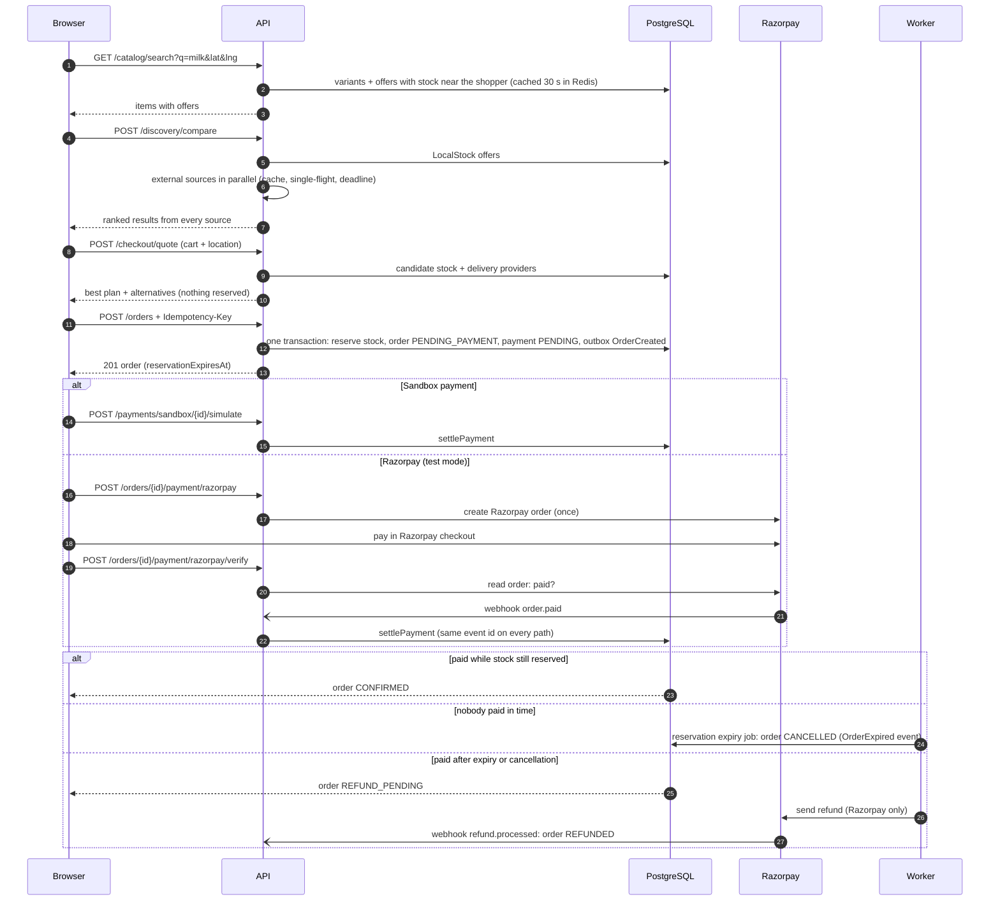
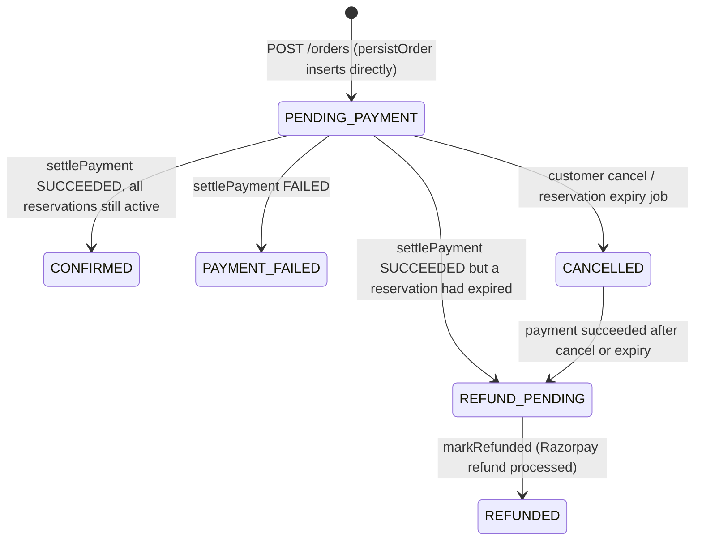
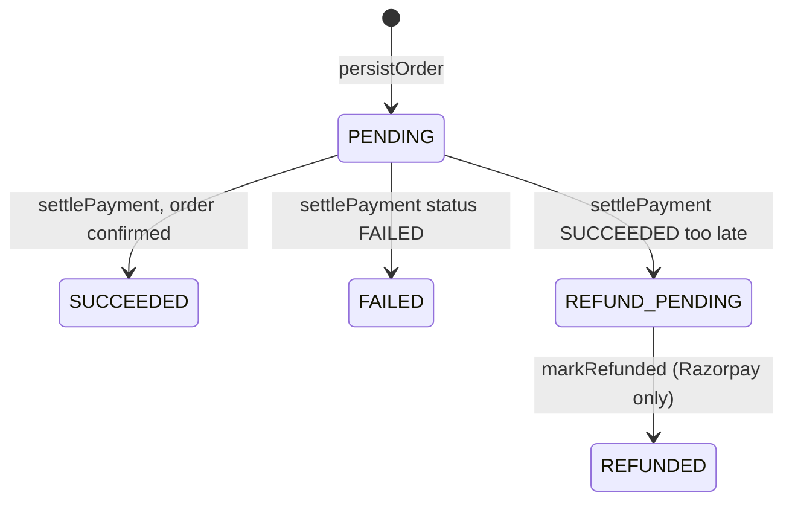

# API reference: shopping, orders and payments

This page documents, function by function, the part of the LocalStock API that a shopper uses:
finding products, comparing prices, getting a delivery quote, placing an order, paying for it, and
watching live price changes. It covers these folders under `apps/api/src/modules/`:

- `discovery/` (search, offers, comparison, ranking, price history)
- `checkout/` (allocation quote)
- `orders/` (placing, reading and cancelling orders; idempotency)
- `payments/` (sandbox and Razorpay payments)
- `delivery/` (delivery providers)
- `realtime/` (the live change stream)

Authentication, catalog, seller, admin and shared middleware are documented in
[api-core-and-seller.md](api-core-and-seller.md).

## How routers are mounted

`apps/api/src/app.js` builds one `deps` object (`pool`, `redis`, `logger`, `config`,
`connectors`, `changeFeed`, `metrics`, and optionally `razorpayClient`) and passes it to every
`createXRouter(deps)` function. All routers are mounted under the prefix **`/api/v1`**, so a route
written as `/orders` in a route file is served at `/api/v1/orders`. Full paths in the tables below
include that prefix.

Things every route in this page shares:

- **Validation.** `validate({ params, query, body })` (in `apps/api/src/shared/validate.js`)
  parses each request part with a [zod](https://zod.dev) schema. Parsed values go into
  `req.valid`. A failure returns `400 VALIDATION_FAILED` with a list of issues.
- **Authentication.** `authenticate(config)` requires an `Authorization: Bearer <access token>`
  header. A missing header returns `401 UNAUTHORIZED`; a bad or expired token returns
  `401 INVALID_TOKEN`. On success `req.user = { id, platformRole }`.
- **Rate limits.** `rateLimit(redis, logger, { keyPrefix, limit, windowSeconds })` counts requests
  per client IP in a fixed time window, in the Redis key `ratelimit:<prefix>:<ip>:<window>`. Over
  the limit it returns `429 RATE_LIMITED` with a `Retry-After` header. If Redis is down, it lets
  the request through ("fails open").
- **Errors.** Handlers throw `AppError(status, code, message, details)`. The error handler turns
  it into `{ "error": { code, message, details, requestId } }`. Domain errors from
  `@localstock/database` that carry a `domainCode` (for example `ILLEGAL_TRANSITION`,
  `INSUFFICIENT_STOCK`) become `409` with that code.
- **Money.** All amounts are integers in **minor units** (paise for INR), in fields ending in
  `Minor`.

### Words used on this page

- **Offer**: one seller's listing of one product variant at a price (`seller_offers`).
- **Allocation**: deciding which warehouse(s) send which items. Done by the pure function
  `allocate()` in `packages/allocation-engine`.
- **Reservation**: a hold on stock for one order. Placing an order raises
  `warehouse_inventory.reserved` and writes `inventory_reservations` rows with an `expires_at`
  deadline. Reserved stock cannot be sold to anyone else until the hold is released, expires or
  is confirmed by payment.
- **Idempotency key**: a unique string the client sends in the `Idempotency-Key` header. If the
  same request is sent twice (for example after a network timeout), the server returns the first
  answer instead of creating a second order.
- **Outbox event**: a row in `outbox_events`, written in the same database transaction as the
  business change. The worker later publishes it to RabbitMQ. Because it commits with the change,
  an event can be delayed but never lost.
- **Row lock (`FOR UPDATE` / `FOR SHARE`)**: a PostgreSQL lock held until the transaction ends.
  `FOR UPDATE` stops other transactions changing or locking the row; `FOR SHARE` stops changes but
  allows other readers to share the lock.
- **Single-flight**: when several identical requests to a slow source arrive at once, only one real
  call is made and all requests wait for its answer.
- **SSE (Server-Sent Events)**: a long-lived HTTP response with `content-type: text/event-stream`
  that the server keeps writing events into. Browsers read it with `EventSource`, which reconnects
  by itself and sends back the last event id it saw in a `Last-Event-ID` header.
- **Geohash cell**: a short string that names a rectangle on the map. Shorter strings are bigger
  areas. The API returns the cell instead of exact coordinates.

## 1. The shopper journey



## 2. Status lifecycles

### Order status (`orders.status`)

The allowed moves are in `ORDER_TRANSITIONS` in `packages/database/src/domain/orders.js`. Every
change goes through `transitionOrder(client, { orderId, from, to, source, actorUserId })`, which:

1. throws `IllegalTransitionError` (`domainCode: ILLEGAL_TRANSITION`, HTTP 409) if `to` is not
   listed for `from`;
2. runs `UPDATE orders SET status = to WHERE id = orderId AND status = from` (a
   "compare-and-set": it only succeeds if the status is still what the caller read). Zero rows
   updated also throws `IllegalTransitionError` ("order status changed concurrently");
3. inserts a row into `order_status_history`.

| From | Allowed to |
|---|---|
| `CREATED` | `PENDING_PAYMENT`, `CANCELLED` |
| `PENDING_PAYMENT` | `CONFIRMED`, `PAYMENT_FAILED`, `CANCELLED`, `REFUND_PENDING` |
| `CONFIRMED` | `PARTIALLY_FULFILLED`, `FULFILLED`, `CANCELLED`, `PARTIALLY_CANCELLED`, `REFUND_PENDING` |
| `PARTIALLY_FULFILLED` | `FULFILLED`, `PARTIALLY_CANCELLED` |
| `FULFILLED` | `DELIVERED` |
| `CANCELLED` | `REFUND_PENDING` |
| `PAYMENT_FAILED` | `REFUND_PENDING` |
| `PARTIALLY_CANCELLED` | `REFUND_PENDING` |
| `REFUND_PENDING` | `REFUNDED` |
| `DELIVERED` | (final) |
| `REFUNDED` | (final) |

Transitions that the current code actually performs:



Notes:

- New orders are inserted straight into `PENDING_PAYMENT`; no code in this scope uses `CREATED`.
- No code in the repository currently moves an order into `PARTIALLY_FULFILLED`, `FULFILLED`,
  `PARTIALLY_CANCELLED` or `DELIVERED`. The states exist in the table and the transition map only.
- When the reservation expiry job (`apps/worker/src/jobs/reservation-expiry.js`) releases an
  unpaid order, the order becomes **`CANCELLED`** (source `reservation-expiry`) and an
  `OrderExpired` outbox event is written. There is no separate "EXPIRED" order status; `EXPIRED`
  is a *reservation* status.
- `settlePayment` reads the order status and passes it as `from`. A payment that succeeds for a
  `PAYMENT_FAILED` order is not possible in practice, because the payment row is already `FAILED`
  and `settlePayment` returns `ALREADY_SETTLED` first.

### Payment status (`payments.status`)

Allowed values (table CHECK): `PENDING`, `SUCCEEDED`, `FAILED`, `REFUND_PENDING`, `REFUNDED`.



- `settlePayment` only acts on a payment that is still `PENDING`; otherwise it returns
  `ALREADY_SETTLED`.
- Only the Razorpay gateway (`packages/payments/src/gateway.js`) calls `markRefunded`. A
  **sandbox** payment that reaches `REFUND_PENDING` has no code path to `REFUNDED`.

### Reservation status (`inventory_reservations.status`)

Allowed values: `ACTIVE`, `CONFIRMED`, `CONSUMED`, `EXPIRED`, `RELEASED`.

- `ACTIVE`: written by `persistOrder`, with `expires_at = now() + RESERVATION_TTL_SECONDS`
  (default 600 seconds).
- `ACTIVE` to `CONFIRMED`: payment succeeded in time (`settlePayment`).
- `ACTIVE` to `RELEASED`: customer cancel or failed payment. `CONFIRMED` to `RELEASED`: late
  payment that had partially confirmed.
- `ACTIVE` to `EXPIRED`: deadline passed (expiry job, or `settlePayment` noticing it first).
- `CONSUMED` is not set by any code in this scope.

Releasing (`RELEASED` or `EXPIRED`) lowers `warehouse_inventory.reserved` and writes an
`inventory_movements` row (reason `RELEASE` or `EXPIRY`); see `releaseReservations` in
`packages/database/src/domain/inventory.js`.

### Shipment status (as touched by this scope)

`persistOrder` inserts shipments as `INVENTORY_RESERVED`. `cancelShipments` (and the copies in
`settlePayment` and the expiry job) sets every shipment still `PENDING` or `INVENTORY_RESERVED`
to `CANCELLED`.

---

## 3. Discovery

### `apps/api/src/modules/discovery/discovery.routes.js`

**Purpose.** Public product search and per-variant offer lists. Builds a discovery service with
`createDiscoveryService(deps)`.

#### Module-level values

| Name | What it is |
|---|---|
| `locationQuery` | Shared zod fields: `lat` (-90..90, optional), `lng` (-180..180, optional), `radiusKm` (positive, max 50, default 10), `sort` (`best_value` \| `lowest_price` \| `fastest` \| `nearest`, default `best_value`). Values are coerced from query-string text to numbers. |
| `requireBoth(q)` | Returns `true` when `lat` and `lng` are both present or both absent. Used in `.refine()` so sending only one gives `400 VALIDATION_FAILED` ("lat and lng must be provided together"). |
| `searchQuery` | `q` (trimmed, max 200, default `''`), `category` (trimmed, lower-cased, `^[a-z0-9-]{0,100}$`, default `''`), the location fields, plus `page` (1..1000, default 1) and `limit` (1..50, default 20). |
| `offersQuery` | The location fields only. |

#### `createDiscoveryRouter(deps)`

- **Parameters:** `deps` (uses `redis`, `logger`, and whatever `createDiscoveryService` needs:
  `pool`, `redis`, `logger`).
- **Returns:** an Express `Router`.
- **Called by:** `createApp` in `app.js`.

#### Endpoints

| Method | Full path | Who | Request | Response | Notable errors |
|---|---|---|---|---|---|
| GET | `/api/v1/catalog/search` | Public. Rate limit `search`: 300 per minute per IP. | Query: `q`, `category`, `lat`, `lng`, `radiusKm`, `sort`, `page`, `limit` | `{ items, page, limit, total }` (see `search` below) | 400 `VALIDATION_FAILED`, 429 `RATE_LIMITED` |
| GET | `/api/v1/catalog/variants/:variantId/offers` | Public. No rate limit. | Path: `variantId` (UUID). Query: `lat`, `lng`, `radiusKm`, `sort` | `{ variantId, offers }` | 400 `VALIDATION_FAILED` |

Handler logic: both handlers only validate and call the service (`service.search(req.valid.query)`
and `service.variantOffers({ variantId, ...query })`), then send the result as JSON. An unknown
`variantId` is not an error: it returns an empty `offers` list.

### `apps/api/src/modules/discovery/discovery.service.js`

**Purpose.** Runs catalog search and offer lookups against PostgreSQL, with a short Redis cache for
search.

#### `CACHE_TTL_SECONDS` (constant)

`30`. How long a search answer stays in Redis.

#### `findOffers(pool, { variantIds, lat, lng, radiusMeters })` (internal)

- **What it does:** Finds every active offer for the given variants that has sellable stock
  (`on_hand - reserved > 0`) in an active warehouse of an active company. With a location, it
  only counts warehouses within `LEAST(warehouse.service_radius_m, radiusMeters)` of the shopper
  (PostGIS `ST_DWithin`), and records the distance to the nearest such warehouse. Groups by offer.
- **Parameters:** `variantIds` (array of UUIDs); `lat`, `lng` (numbers or `null`/`undefined`);
  `radiusMeters` (number).
- **Returns:** an array of
  `{ offerId, variantId, sellerName, priceMinor, available, availableUnits, distanceMeters, estimatedDeliveryMinutes }`.
  `availableUnits` is the sum of `on_hand - reserved` over qualifying warehouses. `available` is
  `availableUnits > 0` (always `true`, because rows without stock are filtered out).
  `distanceMeters` is rounded, or `null` without a location. `estimatedDeliveryMinutes` comes
  from `estimateDeliveryMinutes()` in `shared/geo.js` (`15 + ceil(distance_km * 1.3 / 25 * 60)`),
  or `null` without a location.
- **Returns early:** `[]` when `variantIds` is empty (no query is run).
- **Reads:** `seller_offers`, `companies`, `warehouse_inventory`, `warehouses`. No locks, no writes.
- **Called by:** `search` and `variantOffers` below.

#### `sortOffers(offers, sort)` (internal)

- **What it does:** Sorts the array **in place** and returns it.
  - `lowest_price`: by price, then by ETA.
  - `fastest` or `nearest`: by ETA, then by price. (Both use the ETA estimate, which grows with
    distance.)
  - anything else (`best_value`): by a score `0.6 * price / maxPrice + 0.4 * eta / maxEta`
    (lower is better), ties broken by price then ETA. `maxPrice` and `maxEta` are at least 1.
  - A `null` ETA counts as `0` in all of these.
- **Called by:** `search` and `variantOffers`.

#### `createDiscoveryService({ pool, redis, logger })`

Returns `{ search, variantOffers }`. Called by `createDiscoveryRouter`.

##### `cached(params, compute)` (internal, inside the factory)

- **What it does:** A read-through cache.
  1. Reads the version number from Redis key `search:version` (`SEARCH_VERSION_KEY`, default
     `'0'`).
  2. Builds the key `search:v<version>:<sha1 of JSON.stringify(params)>`.
  3. On a hit, returns the parsed JSON.
  4. On a miss, runs `compute()`, then writes the result with a 30-second expiry. The write is
     not awaited and its errors are ignored.
- **Why a version:** the worker runs `INCR search:version` when inventory or offers change
  (`createSearchProjectionHandler` in `apps/worker/src/consumers/handlers.js`). Every old key
  then stops being used, without scanning or deleting keys.
- **Errors:** any Redis error is logged at debug level and the request falls back to
  `compute()`. The cache never fails the request. Stock shown from the cache can be up to 30
  seconds old; checkout re-checks stock.

##### `search(params)`

- **Parameters:** the parsed `searchQuery`: `{ q, category, lat, lng, radiusKm, sort, page, limit }`.
- **What it does** (inside `cached({ op: 'search', ...params }, ...)`):
  1. Matches variants that are `ACTIVE`, or `EXTERNAL` products still `PENDING_REVIEW` (these
     come from other platforms; they have no LocalStock offers but are listed so they can be
     compared). With text, a variant matches if its full-text `search_vector` matches
     `websearch_to_tsquery('english', q)` **or** its name is trigram-similar (`%`) to `q`. With a
     `category` slug, only variants whose product group is in that category.
  2. Orders by `ts_rank + similarity` (when `q` is non-empty), then name, then id. Applies
     `LIMIT`/`OFFSET` from `page` and `limit`.
  3. Takes `total` from a `count(*) OVER ()` window column. If the page is empty (for example a
     page past the end), it runs a separate `count(*)` query.
  4. Calls `findOffers` for the variant ids on the page, with `radiusMeters = radiusKm * 1000`.
  5. For each variant, sorts its offers with `sortOffers` and removes the `variantId` field.
- **Returns:** `{ items: [{ variantId, name, brand, group, attributes, origin, imageUrl, offers }], page, limit, total }`.
  `imageUrl` uses `VARIANT_IMAGE_SQL` from the catalog module, or `null`.
- **Reads:** `product_variants`, `product_groups`, `categories`, plus the `findOffers` tables.
  **Redis:** `search:version`, `search:v<n>:<hash>`.
- **Called by:** `GET /catalog/search`.

##### `variantOffers({ variantId, lat, lng, radiusKm, sort })`

- **What it does:** `findOffers` for one variant, sorted with `sortOffers`, `variantId` field removed
  from each offer. Not cached.
- **Returns:** `{ variantId, offers }`.
- **Called by:** `GET /catalog/variants/:variantId/offers`.

### `apps/api/src/modules/discovery/local-vendor-source.js`

**Purpose.** Makes LocalStock's own sellers look like one more "source" in the price comparison,
returning results in the same shape as the external platform results.

#### `LOCAL_SOURCE` (exported constant)

Frozen `{ code: 'localstock', name: 'LocalStock sellers' }`. Used by `compare.service.js` for the
source metadata.

#### `splitQuery(query)` (exported)

- **What it does:** Pulls a pack size out of a free-text query using `extractPackSize` from
  `@localstock/database`. Example: `"Amul toned milk 1 litre"` becomes
  `{ text: "Amul toned milk", packSize: <1000 ml> }`. The size phrase is removed and spaces
  collapsed. If removing it would leave an empty string, the original trimmed query is used as
  `text`.
- **Returns:** `{ text, packSize }`. `packSize` is whatever `extractPackSize` returns (falsy when
  no size is found).
- **Called by:** `findVariants` (below) and `compare()` in `compare.service.js`.

#### `firstAttributeValue(attributes)` (internal)

Returns the first string value in the `attributes` object (for example `"1 L"`), or `null`. Used
as the product's "variant" text.

#### `createLocalVendorSource({ pool })` (exported)

Returns `{ code, name, search }`. Called by `createCompareService` (as the default
`localSource`).

##### `findVariants(query, limit)` (internal)

- **What it does:** Splits the query with `splitQuery`. Finds `ACTIVE` variants where the
  full-text vector matches the text, or the name is trigram-similar, or the `barcode` equals the
  text. Orders by: exact barcode match first; then variants whose pack (`pack_unit`,
  `pack_quantity`, `pack_count`) equals the requested pack size; then text rank plus similarity
  of `brand + name`; then id. A requested size **ranks** matching packs first but does not hide
  other sizes.
- **Returns:** raw rows: `id, brand, name, attributes, barcode, pack_quantity, pack_unit, pack_count, image_url`.
- **Reads:** `product_variants` (plus the image subquery).

##### `findOffers(variantIds, { lat, lng }, radiusMeters)` (internal)

- **What it does:** Like `findOffers` in `discovery.service.js`, but always location-based, and
  returns one row per offer (`DISTINCT ON (o.id)`) for the **nearest** qualifying warehouse, with
  `available_units` summed across all qualifying warehouses for that offer (window function).
- **Returns:** rows with `offer_id, variant_id, price_minor, mrp_minor, company_id, company_name, warehouse_id, warehouse_name, meters, available_units`.
- **Reads:** `seller_offers`, `companies`, `warehouse_inventory`, `warehouses`.

##### `search({ query, location, radiusKm, limit, now = Date.now() })`

- **Parameters:** `query` (string), `location` (`{ lat, lng }`), `radiusKm` (number), `limit`
  (max variants), `now` (milliseconds, for freshness).
- **What it does:** `findVariants`, then (if any) `findOffers` for their ids. Maps each offer to a
  comparison result:
  - `sourceType: 'LOCAL_VENDOR'`, `sourceId: 'localstock'`, `sourceName` = company name,
    `sellerId`, `listingId` = offer id, `canonicalProductId` = variant id,
    `matchStatus: 'CANONICAL'`.
  - `product`: title, brand, variant text, `gtin` (barcode), `imageUrl`, `packSize` (from the
    pack columns, or parsed from the variant text with `parsePackSize`).
  - `price`: `itemPriceMinor`, `mrpMinor`, `currency: 'INR'`, all fees `null`,
    `feesNote: 'Delivery fee is calculated at checkout'`, `totalKnownCostMinor` = item price,
    `totalCostCompleteness: 'PARTIAL'`.
  - `availability: 'IN_STOCK'`, `availableUnits`, `serviceability: 'SERVICEABLE'`.
  - `fulfillmentNode`: the nearest warehouse, `verification: 'VERIFIED'`.
  - `distance: { km (1 decimal), status: 'VERIFIED' }`.
  - `eta: { minMinutes: null, maxMinutes: <estimate>, status: 'ESTIMATED', provenance }`.
  - `freshness` from `assessFreshness({ sourceType: 'LOCALSTOCK_INVENTORY', collectedAt: now })`.
  - `dataProvenance`, `orderCapability: 'LOCALSTOCK_CHECKOUT'`, `deepLink: null`.
- **Returns:** an array of results; `[]` when no variant matches.
- **Called by:** `queryLocal` in `compare.service.js`.

### `apps/api/src/modules/discovery/ranking.js`

**Purpose.** Orders comparison results. Two **hard rules** come first and no weight can override
them: the requested pack size, then availability. Inside those groups, a weighted score orders
results (lower is better). Unknown distance or ETA always scores as the worst, never as zero.

#### Constants

| Name | Value |
|---|---|
| `POLICIES` (exported) | `['best_value', 'lowest_price', 'fastest', 'nearest']` |
| `FACTORS` | `['price', 'eta', 'distance', 'freshness', 'match']` |
| `DEFAULT_WEIGHTS` (exported, frozen) | `best_value`: price 0.45, eta 0.2, distance 0.1, freshness 0.15, match 0.1. `lowest_price`: price 0.8, freshness 0.1, match 0.1. `fastest`: price 0.15, eta 0.7, freshness 0.15. `nearest`: price 0.15, distance 0.7, freshness 0.15. (Missing factors are 0.) |
| `weightsSchema` | zod schema: optional policies, each with optional factors, each a number 0..1. |
| `UNAVAILABLE` | `OUT_OF_STOCK`, `NOT_SERVICEABLE`, `FETCH_FAILED` |
| `KNOWN_DISTANCE` | `VERIFIED`, `SOURCE_PROVIDED` |
| `FRESHNESS_COST` | `FRESH` 0, `STALE` 0.5, `UNVERIFIED` 0.75, `EXPIRED` 1 (anything else 1) |
| `MATCH_COST` | `CANONICAL` 0, `MATCHED` 0, `NEEDS_REVIEW` 0.5, `UNMAPPED` 1 (anything else 1) |
| `SIZE_RANK` | `EXACT` 0, `NOT_REQUESTED` 0, `UNKNOWN` 1, `DIFFERENT` 2 |

#### `parseRankingWeights(text)` (exported)

- **What it does:** Parses the `COMPARE_RANKING_WEIGHTS` environment variable (JSON). Empty or
  blank text returns `DEFAULT_WEIGHTS` unchanged. Otherwise validates with `weightsSchema` and
  merges each policy's given factors over its defaults.
- **Returns:** an object with all four policies, each with all factors.
- **Throws:** plain `Error('COMPARE_RANKING_WEIGHTS must be valid JSON')` for bad JSON, or
  `Error('COMPARE_RANKING_WEIGHTS: <path>: <message>')` for a schema failure (for example an
  unknown policy or a weight above 1). This happens at startup, so the API refuses to start.
- **Called by:** `apps/api/src/config/env.js`; tested in `apps/api/test/ranking.test.js`.

#### Small helpers (internal)

| Helper | Returns |
|---|---|
| `priceOf(r)` | `r.price.itemPriceMinor` or `null` |
| `etaOf(r)` | `r.eta.maxMinutes`, else `r.eta.minMinutes`, else `null` |
| `kmOf(r)` | `r.distance.km` only when `distance.status` is `VERIFIED` or `SOURCE_PROVIDED`; else `null` |
| `normalizer(values)` | A function mapping a value to 0 (best known) .. 1 (worst known). `null` maps to 1. If all known values are equal, every known value maps to 0. |
| `group(r)` | `SIZE_RANK[r.sizeMatch] * 2 + (unavailable ? 1 : 0)`. Group 0 means "requested size (or none requested) and available". |

#### `rankResults(results, { policy = 'best_value', weights = DEFAULT_WEIGHTS } = {})` (exported)

- **Parameters:** `results` (array of comparison results; each must already have `sizeMatch`);
  `policy` (one of `POLICIES`; an unknown policy falls back to `best_value` weights); `weights`
  (per-policy weights).
- **What it does:**
  1. Picks the "comparable" results (group 0). Normalisers for price, ETA and distance are built
     from the comparable results, or from all results if none are comparable.
  2. For each result, computes factor costs (price, eta, distance from the normalisers;
     freshness and match from the cost tables) and `score = sum(weight * factor)`.
  3. Adds **reason codes**: `VARIANT_MISMATCH` (different size), `UNAVAILABLE`,
     `LOWEST_ITEM_PRICE`, `LOWEST_KNOWN_TOTAL` (lowest total among results whose total is
     `COMPLETE`), `INCOMPLETE_TOTAL`, `NEAREST_VERIFIED_STORE`, `UNKNOWN_DISTANCE`,
     `FASTEST_KNOWN_ETA`, `FRESHNESS_PENALTY` (freshness not `FRESH`), `UNCONFIRMED_PRODUCT`
     (`UNMAPPED` or `NEEDS_REVIEW`). The "lowest/nearest/fastest" claims are only given to
     comparable results.
  4. Sorts by group, then score, then item price (unknown last), then `sourceName`, then
     `listingId`.
  5. The first result gets `BEST_AVAILABLE_VALUE` added at the front of its reasons, but only if
     it is comparable.
- **Returns:** a **new** array; each item is the original result plus `rank` (1-based) and
  `ranking: { score, reasons, factors }` (numbers rounded to 3 decimals). The input array is not
  modified.
- **Called by:** `compare()` in `compare.service.js`.

### `apps/api/src/modules/discovery/compare.routes.js`

**Purpose.** The public price-comparison endpoint across LocalStock sellers and external
platforms.

#### `compareBody` (zod schema)

| Field | Rule | Default |
|---|---|---|
| `query` | string, trimmed, 1..200 | required |
| `location` | `{ latitude: -90..90, longitude: -180..180 }` | required |
| `radiusKm` | positive, max 50 | 5 |
| `includeLocalVendors` | boolean | `true` |
| `platforms` | up to 10 codes matching `^[a-z0-9-]{2,50}$` | all known platforms |
| `refreshPolicy` | `cache_only` \| `prefer_fresh` \| `refresh_supported` | `prefer_fresh` |
| `limit` | integer 1..50 | 20 |
| `rankingPolicy` | one of `POLICIES` | `best_value` |

#### `createCompareRouter(deps)`

Creates the service with `createCompareService(deps)` and returns a `Router`. Called by
`createApp`.

| Method | Full path | Who | Request | Response | Notable errors |
|---|---|---|---|---|---|
| POST | `/api/v1/discovery/compare` | Public. Rate limit `compare`: 60 per minute per IP. | JSON body `compareBody` | The object returned by `compare()` (below) | 400 `VALIDATION_FAILED`; 400 `UNKNOWN_PLATFORM` with `details.known` listing valid codes; 429 `RATE_LIMITED` |

Handler logic: if `platforms` is given, every code must be in `service.platformCodes()`;
otherwise it throws `UNKNOWN_PLATFORM`. It then calls `service.compare(body, { requestId: req.id })`.

### `apps/api/src/modules/discovery/compare.service.js`

**Purpose.** Asks LocalStock and every selected external source at the same time, under a
deadline, and merges the answers into one ranked list. A slow or failing source never fails the
whole request; it is reported in `sources` instead.

#### Constants

- `PREFER_FRESH_MAX_AGE_SECONDS = 120`: with `prefer_fresh`, a cached answer younger than this is
  reused.
- `FEE_KEYS = ['deliveryFeeMinor', 'platformFeeMinor', 'handlingFeeMinor', 'otherFeeMinor']`.

#### `haversineKm(a, b)` (internal)

Great-circle distance in km between two `{ lat, lng }` points (Earth radius 6371 km). Used for
external results whose fulfilment node has coordinates.

#### `externalResult(connector, listing, { location, now, packSize, match, issues, freshness })` (exported)

- **What it does:** Converts one external platform listing into the shared result shape.
  - `price`: copies item price, MRP, currency, tax flag and the four fees.
    `totalKnownCostMinor` is item price plus known fees, **or `null`** when the listing's
    `totalCostCompleteness` is `UNKNOWN` (an unknown total is never shown as a total).
    `price` is `null`/falsy when the listing has no price.
  - `canonicalProductId` is set only when `match.matchStatus === 'MATCHED'`. `matchStatus` is
    `match.matchStatus` or `'UNMAPPED'`.
  - `serviceability`: `NOT_SERVICEABLE` if availability says so; `SERVICEABLE` if there is a price;
    else `UNKNOWN`.
  - `distance`: computed with `haversineKm` only when the node has both `lat` and `lng`
    (`status: 'SOURCE_PROVIDED'`); otherwise `{ km: null, status: 'UNKNOWN' }`, never zero.
  - `eta`: the listing's ETA plus `status: 'SOURCE_REPORTED'`, or `null`.
  - `freshness` from `assessFreshness` with the freshness policy.
  - `dataProvenance` marks demo connectors as "Demo fixture data, not real prices".
  - `orderCapability: 'EXTERNAL_PLATFORM'`, `deepLink` from the listing, `availableUnits: null`.
- **Defaults:** `packSize = listingPackSize(listing)`, `match = null`, `issues = []`,
  `freshness = createFreshnessPolicy()`.
- **Called by:** `toResults` inside `querySource`; tested in `apps/api/test/compare.test.js`.

#### `sizeMatch(requested, actual)` (exported)

Returns `NOT_REQUESTED` when no size was asked for, `UNKNOWN` when the result's size is unknown,
else `EXACT` or `DIFFERENT` using `samePackSize` from `@localstock/database`. Called by
`compare()`.

#### `safeError(err)` (internal)

Turns an error into something safe to show the client: a `ConnectorError` keeps its `code` and
`message`; any other error becomes `{ code: UPSTREAM_ERROR, message: 'The source could not be queried' }`.

#### `createCompareService({ pool, redis, logger, connectors, config, localSource, matching, freshness, metrics })` (exported)

- **Parameters:** `connectors` is the registry from `@localstock/connectors` (`list()` returns
  connector objects). `config.COMPARE_DEADLINE_MS` (default 5000) is the per-source deadline.
  `config.COMPARE_RANKING_WEIGHTS` (parsed by `parseRankingWeights`) or `DEFAULT_WEIGHTS`.
  `localSource`, `matching` and `freshness` default to the real implementations and can be
  replaced in tests. `metrics` is optional.
- **State:** `inFlight`, a `Map` from a flight key to a pending connector call (for
  single-flight).
- **Returns:** `{ platformCodes, compare }`.
- **Called by:** `createCompareRouter`.

##### `readCache(key)` (internal)

Calls `readCompareCache(redis, key)` (`GET` on the key, JSON-parsed). Any Redis error is logged at
debug level and returns `null`.

##### `writeCache(key, value)` (internal)

Calls `writeCompareCache` (`SET key value EX 3600`) without waiting, and ignores errors.

##### `querySource(connector, { query, location, cell, refreshPolicy, limit, requestId, now })` (internal)

Asks one external source. Always resolves (never rejects) to a source answer:
`{ sourceId, sourceName, platformCode, sourceType: 'EXTERNAL_PLATFORM', isDemo, status, ..., results }`.

1. If `connector.validateConfiguration()` is not ok: `status: 'NOT_CONFIGURED'` with the reason.
2. If the connector does not support `product_search`: `status: 'UNSUPPORTED'`.
3. Cache key: `compareCacheKey(code, cell, query)` = `compare:src:<code>:<cell>:<sha1 of normalised query>`.
4. Unless `refreshPolicy` is `refresh_supported`, it reads the cache. It uses the cached items if
   the policy is `cache_only`, or if the entry is younger than 120 seconds. Result:
   `status: 'RESPONDED', fromCache: true`. With `cache_only` and no entry: `status: 'NOT_CACHED'`.
5. Otherwise it calls the source with **single-flight**: the flight key is
   `<cacheKey>:<limit>:<lat>,<lng>`. If the same call is already running, it waits for that one.
   A new call runs `connector.searchProducts(query, location, { limit, requestId })`, writes the
   items to the cache when it finishes (even if that is after the deadline), and removes itself
   from `inFlight` when done.
6. It waits at most `COMPARE_DEADLINE_MS` (`withTimeout`). A timeout or error returns
   `status: 'FAILED'` with `safeError(err)` and `durationMs`. The late call keeps running and can
   still fill the cache.
7. Success: `status: 'RESPONDED', fromCache: false, durationMs`.

Inner helper `toResults(items)`: runs `checkListingQuality` on each listing (data-quality issues
and pack size), then `matching.resolve(connector, entries)` to find which LocalStock product each
listing is. If matching throws, it logs a warning and leaves every listing unmapped. It then maps
each listing through `externalResult`.

##### `queryLocal({ query, location, radiusKm, limit, now, requestId })` (internal)

Runs `localSource.search(...)` under the same deadline. Returns a source answer with
`sourceType: 'LOCAL_VENDOR'`, `status: 'RESPONDED'` or, on error/timeout, `status: 'FAILED'` (the
error is logged).

##### `platformCodes()`

Returns the unique `platformCode` values of every connector in the registry. Used by the route to
reject unknown platforms.

##### `compare(body, { requestId = randomUUID() } = {})`

- **Parameters:** the validated `compareBody` fields.
- **What it does:**
  1. Converts the location to `{ lat, lng }` and a coarse geohash `cell` (`locationCell`).
  2. Picks connectors whose `platformCode` is in `platforms` (or all).
  3. If at least one picked connector is configured, records demand with `recordDemand`: a
     `ZINCRBY` on the hourly Redis sorted set `external:demand:<YYYY-MM-DDTHH>` (expires after 4
     hours) for `{ q: normalised query, cell }`. The background collector uses this to decide
     what to refresh. Errors are ignored.
  4. Runs `querySource` for every picked connector and, if `includeLocalVendors`, `queryLocal`
     first, all in parallel (`Promise.all`).
  5. Takes the requested pack size from `splitQuery(query)`, sets `sizeMatch` on each result, and
     ranks them with `rankResults`.
  6. Increments the `compareSources` metric per source (labels `source`, `status`,
     `cache: hit|miss`) when metrics are present.
  7. Adds plain-English `notices` for: demo data present; external listings not `MATCHED`;
     data-quality issues of severity `ERROR`; different pack sizes present when a size was asked.
- **Returns:**
  `{ requestId, query, requestedPackSize, location: { cell, radiusKm }, refreshPolicy, ranking: { policy, weights, rules }, generatedAt, results, sources, sourceSummary: { requested, responded, failed, notConfigured, unsupported, notCached }, notices }`.
  `sources` is each source answer without its `results`, plus `resultCount`. Exact coordinates
  are never echoed back; only the cell.
- **Side effects:** Redis reads/writes described above; calls to external connectors. No database
  writes in this file (the matching service may read the database).
- **Called by:** `POST /discovery/compare`.

### `apps/api/src/modules/discovery/price-history.routes.js`

**Purpose.** Daily lowest-price history for a product variant, and links to the same product on
other shopping platforms. Days without data are `null`; nothing is filled in or guessed.

#### Module-level values

- `params`: `{ variantId: UUID }`.
- `historyQuery`: `days` (integer 1..365, default 30), optional `lat`/`lng` (must come together).

#### `day(d)` (internal)

Returns the `YYYY-MM-DD` part of a `Date` or a date string.

#### `loadVariant(pool, variantId)` (internal)

Reads `id, brand, name, attributes, pack_*` from `product_variants`. Throws
`404 VARIANT_NOT_FOUND` when missing. Returns the row.

#### `createPriceHistoryRouter({ pool })`

Returns a `Router`. Called by `createApp`.

| Method | Full path | Who | Request | Response | Notable errors |
|---|---|---|---|---|---|
| GET | `/api/v1/catalog/variants/:variantId/price-history` | Public | Path `variantId`. Query `days`, `lat`, `lng` | `{ variantId, days, location, dates, series, summary, notes }` | 400 `VALIDATION_FAILED`, 404 `VARIANT_NOT_FOUND` |
| GET | `/api/v1/catalog/variants/:variantId/platform-links` | Public | Path `variantId` | `{ query, links, note }` | 400, 404 `VARIANT_NOT_FOUND` |

**Price history handler logic.** Runs four queries in parallel:

1. `loadVariant` (only for the 404 check).
2. LocalStock series: for each day in the range, and each offer of the variant from an active
   company, the price row in `seller_offer_price_history` that was in force at the end of that
   day (latest `valid_from` before the next midnight). Takes the minimum price among rows whose
   status is `ACTIVE`.
3. The list of all days in the range (`generate_series`).
4. External series: from `external_price_observations` for listings whose mapping
   (`external_product_mappings`) is `AUTO_CONFIRMED` or `CONFIRMED`, grouped by platform and day,
   minimum `item_price_minor`. With `lat`/`lng`, only observations from the same geohash cell
   (`query_cell`).

It then builds `series`: a `localstock` series (`kind: 'LOCAL'`) only if at least one day has a
price, and one series per external platform (`kind: 'EXTERNAL'`, `isDemo` from the platform).
Every series has one point per date, with `priceMinor` or `null`. `summary` holds the lowest and
highest points across all series (with `source` = series label), or `null` when there is no data.
`location` is `{ cell }` or `null`. Reads only; no writes.

**Platform links handler logic.** Loads the variant and, in parallel, the most recently seen
`deep_link` per platform for confirmed mappings. Builds a search text from brand, name and the
first string attribute. For every platform in `platformSearchLinks(query)` (from
`@localstock/connectors`), returns `kind: 'LISTING'` with the stored deep link when there is one,
else `kind: 'SEARCH'` with the platform's search URL.

---

## 4. Checkout

### `apps/api/src/modules/checkout/checkout.routes.js`

**Purpose.** The allocation quote: "what would this cart cost, from which warehouses, and how
fast?" A quote **never reserves stock**. Reservation only happens in `POST /orders`.

#### `cartBody` (exported zod schema)

| Field | Rule | Default |
|---|---|---|
| `location` | `{ lat: -90..90, lng: -180..180 }` | required |
| `items` | 1..50 of `{ variantId: UUID, quantity: integer 1..100 }` | required |
| `preferences.allowSplit` | boolean | `true` |
| `preferences.preferSingleWarehouse` | boolean | `true` |
| `preferences.sort` | `best_value` \| `lowest_price` \| `fastest` | `best_value` |

`preferences` itself defaults to `{}` (so the inner defaults apply). The same schema is reused
by `POST /orders`.

#### `createCheckoutRouter({ pool, config })`

Returns a `Router`. Called by `createApp`.

| Method | Full path | Who | Request | Response | Notable errors |
|---|---|---|---|---|---|
| POST | `/api/v1/checkout/quote` | Any signed-in user (Bearer token). No rate limit. | JSON `cartBody` | `200` either `{ status: 'OK', best, alternatives }` or `{ status, reason, shortages, plans: [] }` | 400 `VALIDATION_FAILED`, 401 |

Handler logic:

1. `loadAllocationInput(pool, body, { maxCandidateRadiusKm: config.MAX_CANDIDATE_RADIUS_KM })`
   (default 50 km).
2. `allocate({ items, candidates, providers, preferences })` from `@localstock/allocation-engine`.
3. If `result.status !== 'OK'` (the engine returns `UNAVAILABLE` with `reason`
   `NO_DELIVERY_PROVIDER` or `INSUFFICIENT_STOCK`), the response is still **HTTP 200** with that
   status, the reason and the `shortages` list.
4. Otherwise returns `best` and up to four `alternatives` (`plans[1..4]`), each passed through
   `presentPlan`.

### `apps/api/src/modules/checkout/allocation-input.js`

**Purpose.** Loads everything the allocation engine needs from the database, so the engine itself
can stay a pure function (no I/O).

#### `loadAllocationInput(db, { location, items }, { maxCandidateRadiusKm })` (exported)

- **Parameters:** `db` is a pool or a transaction client; `location` `{ lat, lng }`; `items`
  (only `variantId` is used here); `maxCandidateRadiusKm`.
- **What it does:**
  1. Finds every inventory row for the requested variants with sellable stock, where the
     warehouse and company are active, the offer is active, and the warehouse is within
     `LEAST(service_radius_m, maxCandidateRadiusKm * 1000)` of the customer.
  2. Loads `ACTIVE` delivery providers that are either platform-wide (`company_id IS NULL`) or
     belong to one of the candidate companies (seller fleets), and maps them with `toProvider`.
- **Returns:** `{ candidates: [{ inventoryId, warehouseId, companyId, offerId, variantId, unitPriceMinor, available, distanceMeters }], providers }`.
- **Reads:** `warehouses`, `companies`, `warehouse_inventory`, `seller_offers`,
  `delivery_providers`. No locks. This is a snapshot; stock can change before an order is placed.
- **Called by:** `POST /checkout/quote` and `placeOrder` in `orders.service.js`.

#### `presentPlan(plan)` (exported)

- **What it does:** Copies the public fields of an allocation plan: `strategy`
  (`SINGLE_WAREHOUSE`, `WAREHOUSE_PER_LINE` or `SPLIT`), `itemsCostMinor`, `deliveryFeeMinor`,
  `totalLandedCostMinor`, `maxEtaMinutes`, `shipmentCount`, `score`, and `shipments` (each with
  `warehouseId`, `distanceMeters`, `itemsCostMinor`, `lines`, `delivery`). It **removes
  `inventoryId`** from every line, because quotes are public-facing.
- **Called by:** `POST /checkout/quote`.

---

## 5. Orders

### `apps/api/src/modules/orders/orders.routes.js`

**Purpose.** Place, list, read and cancel the signed-in shopper's orders.

`IDEMPOTENCY_KEY = /^[\w-]{8,128}$/`: 8 to 128 letters, digits, `_` or `-`.

#### `createOrdersRouter(deps)`

Creates the service with `createOrdersService(deps)`, an `authenticate` middleware, and a
`checkout` rate limiter (30 per minute per IP). Returns a `Router`. Called by `createApp`.

| Method | Full path | Who | Request | Response | Notable errors |
|---|---|---|---|---|---|
| POST | `/api/v1/orders` | Signed-in user. Rate limit `checkout`: 30/min/IP. | Header **`Idempotency-Key`** (required). JSON `cartBody` (same as quote). | `201` the full order (`loadOrder` shape). A replay returns the stored status and body plus header `Idempotent-Replayed: true`. | 400 `IDEMPOTENCY_KEY_REQUIRED`; 400 `VALIDATION_FAILED`; 409 `ITEMS_UNAVAILABLE` (`details.reason`, `details.shortages`); 409 `STOCK_CHANGED`; 409 `OFFER_UNAVAILABLE`; 409 `REQUEST_IN_PROGRESS`; 422 `IDEMPOTENCY_KEY_REUSED`; 429 |
| GET | `/api/v1/orders` | Signed-in user | none | `{ items: [{ id, status, totalMinor, createdAt }] }`, newest first, max 50 | 401 |
| GET | `/api/v1/orders/:orderId` | Signed-in user; own orders only | Path `orderId` (UUID) | The full order (`loadOrder` shape) | 404 `ORDER_NOT_FOUND` (also for another user's order) |
| POST | `/api/v1/orders/:orderId/cancel` | Signed-in user; own orders only | Path `orderId` | The cancelled order (`loadOrder` shape) | 404 `ORDER_NOT_FOUND`; 409 `ORDER_NOT_CANCELLABLE` |

Handler notes:

- `POST /orders` runs, in order: auth, rate limit, body validation, then the `Idempotency-Key`
  check, then the service. So a request with a bad body fails validation (400) before the key is
  looked at.

### `apps/api/src/modules/orders/idempotency.js`

**Purpose.** Makes `POST /orders` safe to retry. The table `idempotency_keys` has primary key
`(user_id, key)`, a `request_hash`, a `status` (`IN_PROGRESS` or `COMPLETED`), and the stored
`response_status` / `response_body`.

How it works in one paragraph: the first request **claims** the key by inserting a row. When the
order is created, the response is saved into the same row **in the same transaction** as the
order. A retry with the same key and body gets the saved response. A retry while the first is
still running gets `409 REQUEST_IN_PROGRESS`. If the first request fails, it deletes its claim so
the client can retry. If a request crashed and left a claim behind, the claim can be taken over
after 5 minutes. The claim's `created_at` value acts as a **fencing token**: an old holder whose
claim was taken over cannot complete or delete it any more, because its `created_at` no longer
matches.

#### `stableStringify(value)` (internal)

JSON-encodes a value with object keys sorted, so `{a:1,b:2}` and `{b:2,a:1}` give the same text.

#### `requestHash(body)` (exported)

SHA-256 hex of `stableStringify(body)`. Called by `createOrder` with the **validated** body
(defaults filled in).

#### `STALE_AFTER_SECONDS` (constant)

`300`. An `IN_PROGRESS` claim older than this can be taken over.

#### `claimIdempotencyKey(pool, { userId, key, hash }, retried = false)` (exported)

- **What it does:**
  1. `INSERT ... ON CONFLICT (user_id, key) DO NOTHING RETURNING created_at`. If a row was
     inserted, returns `{ claimed: true, claimedAt }` (`claimedAt` is the text form of
     `created_at`).
  2. Otherwise reads the existing row.
     - Row gone (the other holder released it between the two statements): retries once; on the
       second time throws `409 REQUEST_IN_PROGRESS`.
     - Different `request_hash`: throws **`422 IDEMPOTENCY_KEY_REUSED`**.
     - `COMPLETED`: returns `{ replay: { status, body } }`.
     - `IN_PROGRESS`: tries to take it over with
       `UPDATE ... SET created_at = clock_timestamp() WHERE status = 'IN_PROGRESS' AND created_at < now() - 300 s`.
       Success returns `{ claimed: true, claimedAt }` with the new timestamp; otherwise throws
       `409 REQUEST_IN_PROGRESS`.
- **Writes:** `idempotency_keys` (insert or update), outside any transaction.
- **Called by:** `createOrder`.

#### `completeIdempotencyKey(client, { userId, key, claimedAt, status, body })` (exported)

- **What it does:** Inside the order transaction, sets the row to `COMPLETED` with the response
  status and JSON body, but only where `created_at = claimedAt` and status is `IN_PROGRESS`.
- **Throws:** `409 REQUEST_IN_PROGRESS` if no row matched (someone took the key over). Because
  this runs in the order transaction, throwing rolls the whole order back.
- **Called by:** `persistOrder`.

#### `releaseIdempotencyKey(pool, { userId, key, claimedAt })` (exported)

- **What it does:** Deletes the row if it is still `IN_PROGRESS` with the same `created_at`. Does
  nothing otherwise.
- **Called by:** `createOrder` when placing the order fails.

### `apps/api/src/modules/orders/orders.service.js`

**Purpose.** All order business logic: placing an order (allocate, reserve stock, write the order,
shipments, reservations, payment row and outbox event in one transaction), reading orders, and
customer cancellation.

#### `MAX_PLACEMENT_ATTEMPTS` (constant)

`3`. How many times `placeOrder` re-runs allocation when stock changed underneath it.

#### `cancelShipments(client, orderId)` (exported)

Sets `shipments.status = 'CANCELLED'` for the order's shipments still in `PENDING` or
`INVENTORY_RESERVED`. Called by `cancelOrder`. (`settlePayment` and the expiry job have their own
copy of this query.)

#### `loadOrder(db, orderId, customerId = null)` (exported)

- **What it does:** Reads the order (filtered by `customerId` when given). If found, runs four
  queries in parallel: items (with variant name, brand, image, seller name), shipments (with
  warehouse name and delivery provider), payments (newest first), and the earliest `expires_at`
  among the order's `ACTIVE` reservations.
- **Returns:** `null` if the order is not found (or belongs to someone else), else:
  `{ id, status, currency, subtotalMinor, deliveryFeeMinor, totalMinor, createdAt, updatedAt, reservationExpiresAt, items: [...], shipments: [...], payment }`.
  `reservationExpiresAt` is `null` when no reservation is active. `payment` is the newest
  payment `{ provider, providerPaymentId, amountMinor, status }` or `null`.
- **Reads:** `orders`, `order_items`, `product_variants`, `seller_offers`, `companies`,
  `shipments`, `warehouses`, `delivery_providers`, `payments`, `inventory_reservations`.
- **Note:** when `db` is a transaction client, the four parallel queries are queued on that one
  client.
- **Called by:** `persistOrder`, `getOrder`, `cancelOrder`.

#### `createOrdersService({ pool, config })` (exported)

Returns `{ createOrder, getOrder, listOrders, cancelOrder }`. Uses
`config.RESERVATION_TTL_SECONDS`, `config.MAX_CANDIDATE_RADIUS_KM` and `config.razorpay`. Called
by `createOrdersRouter`.

##### `persistOrder(client, { userId, input, plan, idempotency })` (internal)

Runs inside one transaction (the caller opens it). Steps, in order:

1. Generates a new `orderId` (UUID). Flattens all plan lines.
2. **Reserves stock** with `reserveInventory(client, lines, { referenceType: 'order', referenceId: orderId })`.
   This locks the `warehouse_inventory` rows `FOR UPDATE` in id order (so two orders cannot
   deadlock), then for each row runs
   `UPDATE ... SET reserved = reserved + qty WHERE on_hand - reserved >= qty`. If any row is short,
   it throws `InsufficientStockError`. On success it writes one `inventory_movements` row per
   inventory row (reason `RESERVATION`).
3. **Re-reads prices** of the offers used, `FOR SHARE`, only if still `ACTIVE`. The order charges
   the price in force now, not the price from the plan. If any offer is missing or inactive:
   `409 OFFER_UNAVAILABLE`.
4. Groups lines by offer into order items and computes `subtotal = sum(quantity * current price)`,
   `deliveryFee = plan.deliveryFeeMinor`, `total = subtotal + deliveryFee`.
5. Inserts the `orders` row with status `PENDING_PAYMENT` and the delivery point, and an
   `order_status_history` row (`NULL -> PENDING_PAYMENT`, source `checkout`).
6. Inserts one `order_items` row per offer.
7. Computes `expires_at = now() + RESERVATION_TTL_SECONDS` in SQL.
8. For each plan shipment: inserts a `shipments` row (`INVENTORY_RESERVED`, provider, fee, ETA);
   for each of its lines, a `fulfillment_allocations` row and an `inventory_reservations` row
   (`ACTIVE`, `expires_at`).
9. Inserts the `payments` row with status `PENDING`. If `config.razorpay` is set the provider is
   `razorpay` with `provider_payment_id = NULL` (the Razorpay order is created later, when the
   shopper clicks Pay, so no external call runs while this transaction holds locks). Otherwise the
   provider is `sandbox` with id `sbx_<24 hex chars>`.
10. Writes the outbox event **`OrderCreated`** with
    `{ orderId, customerId, totalMinor, shipmentCount }`.
11. Loads the order with `loadOrder` and stores it as the idempotency response
    (`completeIdempotencyKey`, status 201).

- **Returns:** the order body.
- **Throws:** `InsufficientStockError`, `409 OFFER_UNAVAILABLE`, `409 REQUEST_IN_PROGRESS`, or any
  database error. Any throw rolls everything back, including the reservation.

##### `placeOrder(userId, input, idempotency)` (internal)

- **What it does:** Loops up to 3 times:
  1. `loadAllocationInput` (a snapshot, outside the transaction) and `allocate`.
  2. If the result is not `OK`: throws `409 ITEMS_UNAVAILABLE` with `{ reason, shortages }`.
  3. Runs `persistOrder` for `result.best` inside `withTransaction`. (`withTransaction` itself
     retries up to 3 times on PostgreSQL serialization failure `40001` or deadlock `40P01`.)
  4. If `persistOrder` throws `InsufficientStockError` (stock changed since the snapshot), it
     starts again with a fresh snapshot. After the third attempt it throws
     `409 STOCK_CHANGED` ("please request a new quote"). Any other error is re-thrown at once.
- **Returns:** the order body.

##### `createOrder(userId, key, input)`

- **What it does:** Claims the idempotency key with the hash of `input`. On a replay, returns
  `{ status, body, replayed: true }`. Otherwise calls `placeOrder`; on success returns
  `{ status: 201, body, replayed: false }`. On any error, releases the key (ignoring release
  errors) and re-throws.
- **Called by:** `POST /orders`.

##### `getOrder(userId, orderId)`

`loadOrder(pool, orderId, userId)`; throws `404 ORDER_NOT_FOUND` if `null`. Called by
`GET /orders/:orderId`.

##### `listOrders(userId)`

Returns `{ items }`: the user's 50 newest orders with `id, status, totalMinor, createdAt`. Reads
`orders`. Called by `GET /orders`.

##### `cancelOrder(userId, orderId)`

In one transaction:

1. Locks the order row `FOR UPDATE` (filtered by owner). Missing: `404 ORDER_NOT_FOUND`.
2. If status is not `PENDING_PAYMENT`: `409 ORDER_NOT_CANCELLABLE`. (A paid order cannot be
   cancelled by the customer through this endpoint.)
3. `releaseReservations(..., toStatus: 'RELEASED', actorUserId)`: marks the `ACTIVE`
   reservations `RELEASED`, lowers `warehouse_inventory.reserved` (rows locked in id order), and
   writes `inventory_movements` (reason `RELEASE`).
4. `transitionOrder` `PENDING_PAYMENT -> CANCELLED` (source `customer`).
5. `cancelShipments`.
6. Outbox event **`OrderCancelled`** with `{ orderId, reason: 'customer' }`.
7. Returns `loadOrder(client, orderId)`.

The payment row stays `PENDING`. If the shopper still pays afterwards, `settlePayment` sends the
order to `REFUND_PENDING`. Called by `POST /orders/:orderId/cancel`.

---

## 6. Payments

There are two payment providers. Which one a new order uses is decided in `persistOrder`:
**Razorpay** when both `RAZORPAY_KEY_ID` and `RAZORPAY_KEY_SECRET` are set (only `rzp_test_`
keys are accepted; see `razorpaySettings` in `packages/payments/src/index.js`), otherwise the
built-in **sandbox**. See also [PAYMENTS.md](../PAYMENTS.md).

Every successful or failed payment, on every path, ends in **`settlePayment`**
(`packages/database/src/domain/payments.js`). It is summarised here because the routes depend on
it:

- One transaction. First it inserts `(provider, event_id)` into `webhook_events`; if that pair
  already exists it returns `{ outcome: 'DUPLICATE_EVENT' }` and does nothing else (this is how
  repeated webhooks are ignored).
- Finds the payment by `(provider, provider_payment_id)`; unknown: `PaymentNotFoundError`.
- Locks the **order row first** (`FOR UPDATE`), then the payment row. The customer cancel and the
  expiry job also lock the order row first, so only one of them can win.
- Payment not `PENDING`: `{ outcome: 'ALREADY_SETTLED', paymentStatus, orderId }`.
- `FAILED`: payment `FAILED`. If the order is `PENDING_PAYMENT`: release reservations
  (`RELEASED`), order `PAYMENT_FAILED`, cancel shipments, outbox `OrderPaymentFailed`. Returns
  `{ outcome: 'PAYMENT_FAILED', orderId }`.
- `SUCCEEDED`: first marks any reservation past its deadline as `EXPIRED` (outbox `OrderExpired`
  if any were). Then marks the remaining unexpired `ACTIVE` reservations `CONFIRMED`. If the order
  is `PENDING_PAYMENT` and **all** of its reservations were confirmed: payment `SUCCEEDED` (with
  `provider_charge_id`), order `CONFIRMED`, outbox `OrderConfirmed`, returns
  `{ outcome: 'CONFIRMED' }`. Otherwise (paid too late or after cancel): releases any it just
  confirmed, payment `REFUND_PENDING`, cancels shipments if the order was still
  `PENDING_PAYMENT`, order `REFUND_PENDING`, outbox `PaymentRefundRequested`, returns
  `{ outcome: 'REFUND_PENDING' }`.

### `apps/api/src/modules/payments/payments.routes.js`

**Purpose.** The sandbox payment provider (a fake provider for development and demos) and the
mount point for the Razorpay router.

#### `SIGNATURE_HEADER` (constant)

`'x-sandbox-signature'`.

#### `webhookBody` / `simulateBody` (zod schemas)

- `webhookBody`: `{ eventId: string 1..200, providerPaymentId: string 1..200, status: 'SUCCEEDED' | 'FAILED' }`.
- `simulateBody`: `{ status: 'SUCCEEDED' | 'FAILED' }`.

#### `signSandboxPayload(secret, rawBody)` (exported)

Returns the hex HMAC-SHA256 of the raw request body with `secret`. Used by `verifySignature`, and
by anything (tests, scripts) that needs to sign a sandbox webhook.

#### `verifySignature(secret)` (internal)

Returns middleware that recomputes the HMAC over `req.rawBody` (the exact bytes received; `app.js`
keeps them in `express.json`'s `verify` hook) and compares it with the `X-Sandbox-Signature`
header in constant time (`timingSafeEqual`). A wrong length or wrong value gives
`401 INVALID_SIGNATURE`.

#### `createPaymentsRouter(deps)` (exported)

Creates the service with `createPaymentsService(deps)`. Returns a `Router`. Called by
`createApp`. Mounts `createRazorpayRouter(deps)` only when `config.razorpay` is set.

| Method | Full path | Who | Request | Response | Notable errors |
|---|---|---|---|---|---|
| POST | `/api/v1/payments/webhooks/sandbox` | The sandbox provider (no user auth; HMAC signature instead). Rate limit `webhook`: 600/min/IP. Always registered. | Header `X-Sandbox-Signature` (HMAC of raw body with `PAYMENT_WEBHOOK_SECRET`). JSON `webhookBody`. | The `settlePayment` result, e.g. `{ outcome: 'CONFIRMED', orderId }` | 401 `INVALID_SIGNATURE`; 400 `VALIDATION_FAILED`; 404 `PAYMENT_NOT_FOUND` |
| POST | `/api/v1/payments/sandbox/:providerPaymentId/simulate` | Signed-in user who owns the order. Registered only when `NODE_ENV !== 'production'` or `ENABLE_SANDBOX_PAYMENTS=true`. | Path `providerPaymentId` (the `sbx_...` id). JSON `{ status }` | `{ event: { eventId, providerPaymentId, status }, result }` | 404 `PAYMENT_NOT_FOUND`; 400 |

Handler notes:

- **Webhook:** the signature is checked **before** the body is validated. It calls
  `service.processEvent({ provider: 'sandbox', eventId, providerPaymentId, status, payload: body })`.
  Sending the same `eventId` twice returns `{ outcome: 'DUPLICATE_EVENT' }`.
- **Simulate:** stands in for a real provider's checkout page. It checks that a `sandbox` payment
  with that id belongs to an order of `req.user`, builds an event with a fresh id
  `evt_<uuid>`, and passes it to the same `processEvent`. Each call is a new event, so a second
  call returns `ALREADY_SETTLED` rather than `DUPLICATE_EVENT`. It does not check the signature
  (it calls the service directly).

### `apps/api/src/modules/payments/payments.service.js`

#### `createPaymentsService({ pool })` (exported)

Returns `{ processEvent }`. Called by `createPaymentsRouter`.

##### `processEvent(event)`

- **Parameters:** `{ provider, eventId, providerPaymentId, status, chargeId?, payload }`.
- **What it does:** calls `settlePayment(pool, event)` (see the summary above).
- **Returns:** the `settlePayment` result: `{ outcome }` where outcome is `DUPLICATE_EVENT`,
  `ALREADY_SETTLED`, `PAYMENT_FAILED`, `CONFIRMED` or `REFUND_PENDING` (plus `orderId` and, for
  `ALREADY_SETTLED`, `paymentStatus`).
- **Throws:** `404 PAYMENT_NOT_FOUND` when `settlePayment` throws `PaymentNotFoundError`; other
  errors (including `IllegalTransitionError`, mapped to 409) pass through.
- **Side effects:** see `settlePayment`: `webhook_events`, `payments`, `orders`,
  `order_status_history`, `inventory_reservations`, `warehouse_inventory`,
  `inventory_movements`, `shipments`, `outbox_events`.

### `apps/api/src/modules/payments/razorpay.routes.js`

**Purpose.** Razorpay checkout in **test mode** (no real money). Registered only when
`config.razorpay` is set. The heavy lifting is in `createRazorpayGateway`
(`packages/payments/src/gateway.js`); this file is the HTTP layer.

#### Module-level values

- `MIN_SECONDS_TO_PAY = 60`: a payment cannot start with less than a minute of reservation left.
- `verifyBody`: `{ razorpayOrderId: 1..64 chars, razorpayPaymentId: 1..64, razorpaySignature: 1..256 }`.
- `providerDown()`: builds `502 PAYMENT_PROVIDER_UNAVAILABLE`.

#### `createRazorpayRouter({ pool, redis, config, logger, razorpayClient })` (exported)

- Builds the gateway with `createRazorpayGateway({ pool, client, logger })`. `client` is
  `razorpayClient` if given (tests) or `createRazorpayClient(config.razorpay)`, an HTTP client
  with a 10-second timeout per call that throws `RazorpayError` on non-2xx answers.
- Returns a `Router`. Called by `createPaymentsRouter`.

##### `loadOwnPayment(orderId, customerId)` (internal)

- Reads the order (owned by `customerId`) joined with its newest payment, and the earliest
  `expires_at` of its `ACTIVE` reservations.
- **Returns:** `{ status, total_minor, currency, payment_id, provider, provider_payment_id, expires_at }`.
- **Throws:** `404 ORDER_NOT_FOUND`; `409 NOT_A_GATEWAY_PAYMENT` when the payment provider is not
  `razorpay` (for example an order placed before keys were configured).

#### Endpoints

| Method | Full path | Who | Request | Response | Notable errors |
|---|---|---|---|---|---|
| POST | `/api/v1/orders/:orderId/payment/razorpay` | Signed-in owner | Path `orderId` | `{ keyId, razorpayOrderId, amountMinor, currency, timeoutSeconds, testMode: true }` | 404 `ORDER_NOT_FOUND`; 409 `NOT_A_GATEWAY_PAYMENT`; 409 `ORDER_NOT_PAYABLE` (`details.status`); 409 `RESERVATION_EXPIRING`; 502 `PAYMENT_PROVIDER_UNAVAILABLE` |
| POST | `/api/v1/orders/:orderId/payment/razorpay/verify` | Signed-in owner | Path `orderId`. JSON `verifyBody` (the values Razorpay's checkout gives the browser) | `{ outcome }`: `CONFIRMED`, `REFUND_PENDING`, `PROCESSING`, or another gateway/`settlePayment` outcome (see below) | 404 `ORDER_NOT_FOUND` / `PAYMENT_NOT_FOUND`; 409 `NOT_A_GATEWAY_PAYMENT`; 400 `INVALID_SIGNATURE` |
| POST | `/api/v1/payments/webhooks/razorpay` | Razorpay servers. Only registered when `RAZORPAY_WEBHOOK_SECRET` is set. Rate limit `webhook`: 600/min/IP. | Header `X-Razorpay-Signature` (HMAC of raw body); optional `X-Razorpay-Event-Id`. Razorpay's JSON `{ event, payload }`. | Gateway result, or `{ outcome: 'IGNORED' }` | 401 `INVALID_SIGNATURE` |

**Start payment (`POST .../payment/razorpay`)**

1. `loadOwnPayment`. If the order is not `PENDING_PAYMENT`: `409 ORDER_NOT_PAYABLE`.
2. Seconds left = time until the earliest active reservation expires (0 if none). Under 60:
   `409 RESERVATION_EXPIRING`.
3. `gateway.ensureOrder({ paymentId, orderId, amountMinor, currency })`: if the payment already
   has a `provider_payment_id`, reuses it. Otherwise calls Razorpay "create order" (amount,
   currency, `receipt = orderId`, `notes.orderId`) and stores the id with
   `coalesce(provider_payment_id, newId)`, so the first stored id wins. Two clicks at the same time
   can each create a Razorpay order, but only the first stored is ever shown; the other is never
   paid.
4. A `RazorpayError` or `TimeoutError` is logged and becomes `502 PAYMENT_PROVIDER_UNAVAILABLE`.
5. Responds with the public `keyId`, the Razorpay order id, the amount and currency, and
   `timeoutSeconds = secondsLeft - 30`, so the checkout closes itself before the reservation runs
   out.

- **Writes:** `payments.provider_payment_id`, `payments.updated_at` (first time only).

**Verify (`POST .../payment/razorpay/verify`)**

1. `loadOwnPayment`. If the stored Razorpay order id differs from `razorpayOrderId`:
   `404 PAYMENT_NOT_FOUND`.
2. Checks the checkout signature with `verifyCheckoutSignature` and the key secret. Bad:
   `400 INVALID_SIGNATURE`.
3. `gateway.checkOrder(razorpayOrderId, 'checkout')`: **re-reads the order from Razorpay** (so the
   browser alone can never confirm an order). If Razorpay says it is not `paid`, the outcome is
   `NOT_PAID`, which this route reports as `PROCESSING`. If paid, it finds the `captured` payment
   and calls `applyPaidOrder`, which:
   - returns `UNKNOWN_ORDER` if no LocalStock payment has that Razorpay order id;
   - returns `NOT_PAID` unless the order is `paid` and the payment `captured`;
   - returns `AMOUNT_MISMATCH` (and logs an error, confirming nothing) if `amount_paid`, currency
     or the payment's order id differ from ours;
   - otherwise calls `settlePayment` with `eventId = 'order.paid:<razorpay order id>'`,
     `status: 'SUCCEEDED'`, `chargeId` = Razorpay payment id.
4. If Razorpay cannot be reached (`RazorpayError` or `TimeoutError`), it logs a warning and
   answers `{ outcome: 'PROCESSING' }`. The webhook or the worker's sync job will finish it.

Because the webhook, this callback and the worker sync job all use the same event id
`order.paid:<razorpay order id>`, `webhook_events` lets only the first one settle the payment; the
others get `DUPLICATE_EVENT`.

**Webhook (`POST /payments/webhooks/razorpay`)**

1. Verifies `X-Razorpay-Signature` over the raw body with the webhook secret. Bad:
   `401 INVALID_SIGNATURE`. The body is not validated with zod.
2. Builds the stored payload from ids only: `{ event, razorpayEventId }` (plus the Razorpay order
   and payment ids for `order.paid`). The customer's email or phone in Razorpay's payload are
   never stored.
3. `order.paid` with an order entity: `gateway.applyPaidOrder({ order, payment }, payload)` (same
   checks as above).
4. `refund.processed` with a refund entity: `gateway.refundProcessed(refund)`, which finds the
   payment by `provider_charge_id = refund.payment_id` (`UNKNOWN_PAYMENT` if none) and calls
   `markRefunded`: payment `REFUND_PENDING -> REFUNDED`, order `REFUND_PENDING -> REFUNDED` (if
   it is in that state), outbox `PaymentRefunded`. A second report returns `ALREADY_SETTLED`.
5. Any other event (for example `payment.failed`): `{ outcome: 'IGNORED' }`. Failed attempts do
   not fail the order, because Razorpay lets the shopper retry on the same order.
6. Always answers HTTP 200 for a valid signature, even for unknown orders, so Razorpay does not
   keep retrying and disable the webhook.

Refunds are **sent** to Razorpay only by the worker's sync job (`gateway.sync()`), not by any
route in this file.

---

## 7. Delivery

### `apps/api/src/modules/delivery/delivery.routes.js`

**Purpose.** Manage delivery providers: a seller's own fleet, or platform-wide providers added by
an admin. The allocation engine uses them to price and time each shipment.

#### Schemas

- `providerFields`: `name` (1..200), `baseFeeMinor` (integer >= 0), `perKmFeeMinor`
  (integer >= 0), `speedKmph` (integer 1..200), `pickupMinutes` (integer 0..1440, default 10),
  `reliability` (0..1, default 0.9), `maxDistanceKm` (positive, max 500).
- `sellerFleetBody`: `providerFields`.
- `platformProviderBody`: `providerFields` plus `type`: `PLATFORM_FLEET` or `THIRD_PARTY`.
- `COLUMNS`: the SQL column list returned by every query.

#### `toProvider(r)` (exported)

Maps a `delivery_providers` row to camelCase:
`{ id, companyId, name, type, baseFeeMinor, perKmFeeMinor, speedKmph, pickupMinutes, reliability (Number), maxDistanceMeters, status }`.
Called by this file and by `loadAllocationInput`.

#### `insertProvider(pool, companyId, type, b)` (internal)

Inserts a `delivery_providers` row (`maxDistanceKm` converted to metres, rounded) and returns it
through `toProvider`. `companyId` is `null` for platform providers.

#### `createDeliveryRouter({ pool, config })` (exported)

Returns a `Router`. Called by `createApp`.

| Method | Full path | Who | Request | Response | Notable errors |
|---|---|---|---|---|---|
| POST | `/api/v1/companies/:companyId/delivery-providers` | Signed-in member of the company with role `OWNER` or `ADMIN` | JSON `sellerFleetBody` | `201` the provider (type `SELLER_FLEET`) | 400; 404 `COMPANY_NOT_FOUND` (not a member, or company not active); 403 `FORBIDDEN` (wrong role) |
| GET | `/api/v1/companies/:companyId/delivery-providers` | Signed-in member of the company (any role) | none | `{ items }`: all of that company's providers (any status), by name | 404 `COMPANY_NOT_FOUND` |
| POST | `/api/v1/admin/delivery-providers` | Signed-in platform admin | JSON `platformProviderBody` | `201` the provider (`companyId: null`) | 403 `FORBIDDEN` |
| GET | `/api/v1/delivery/providers` | Any signed-in user | none | `{ items }`: platform providers (`company_id IS NULL`) that are `ACTIVE`, by name | 401 |

Handler notes: the company routes use `requireCompanyRole` (documented in
[api-core-and-seller.md](api-core-and-seller.md)), which sets `req.membership.companyId`. A seller
fleet can only ever carry that seller's shipments, because `loadAllocationInput` only loads
seller fleets of the candidate companies. There is no update or delete endpoint in this file.

---

## 8. Realtime

### `apps/api/src/modules/realtime/change-feed.js`

**Purpose.** Pushes external price and stock changes to open browser streams. One poller per API
process reads new rows from `external_change_events` every 2 seconds, but only while at least one
client is subscribed. Each event goes to each matching connection at most once. A reconnecting
client can catch up with `Last-Event-ID`.

#### `EVENT_SQL` (constant)

Selects change events with their source, platform (`is_demo`), the external listing id, and the
LocalStock variant id when the listing has a confirmed mapping (`AUTO_CONFIRMED` or `CONFIRMED`).
Reads `external_change_events`, `external_sources`, `external_platforms`, `external_listings`,
`external_product_mappings`.

#### `toEvent(r)` (internal)

Maps a row to
`{ eventId, type, sourceId, sourceName, platformCode, isDemo, listingId, canonicalProductId, cell, oldValue, newValue, detectedAt }`.

#### `matchesFilter(event, { variantIds, cell })` (exported)

`true` when both filters pass. `variantIds` (a `Set`, optional): the event must have a
`canonicalProductId` in the set. `cell` (optional): the event's cell must start with this prefix.
A missing filter always passes.

#### `createChangeFeed({ pool, logger, pollMs = 2000, maxPerUser = 3, maxTotal = 1000 })` (exported)

- **State:** `subscribers` (a `Set`), `lastId` (highest event id already handled, `null` when
  idle), `timer`, and a `polling` flag that stops two polls overlapping.
- **Returns:** `{ poll, size, canSubscribe, subscribe, close }`.
- **Called by:** `createApp` (default `deps.changeFeed`). `app.locals.changeFeed` is kept so the
  server can close streams on shutdown; `size()` feeds the `change_feed_subscribers` metric.

##### `poll()`

If not already polling: when `lastId` is `null`, sets it to the current `max(id)` (so it starts
from "now"). Then reads up to 500 events with `id > lastId` in id order, advances `lastId`, and
calls `send(event)` for every subscriber whose filter matches. Errors are logged as warnings and
the next tick tries again.

##### `start()` / `stopIfIdle()` (internal)

`start` sets the interval timer if it is not running. `stopIfIdle` clears it when there are no
subscribers and resets `lastId` to `null`, so a later subscriber starts from the newest event.

##### `size()`

Number of open subscriptions.

##### `canSubscribe(userId)`

`false` when there are already `maxTotal` (1000) subscribers in this process or the user already
has `maxPerUser` (3); otherwise `true`.

##### `subscribe(sub)`

- **Parameters:** `{ userId, filter: { variantIds?, cell? }, send(event), close(), resumeFrom? }`.
- **What it does:** If `resumeFrom` (an event id) is given, replays up to 500 events after it
  (matching the filter) straight to `send`. If `lastId` is `null`, runs `poll()` once to pin the
  start point. Adds the subscriber and starts the timer.
- **Returns:** a Promise of an `unsubscribe()` function that removes the subscriber and stops the
  timer if idle.
- **Note:** if `resumeFrom` is not a known event id, the sub-select returns `NULL` and nothing is
  replayed.

##### `close()`

Calls `close()` on every subscriber, clears the set and stops the timer. Used at server shutdown.

### `apps/api/src/modules/realtime/stream.routes.js`

**Purpose.** The SSE endpoint browsers connect to for live external price changes.

#### `HEARTBEAT_MS` (constant)

`25000`. A comment line `: ping` is written this often so proxies do not close an idle connection.

#### `streamQuery` (zod schema)

- `variantIds`: comma-separated text, split, trimmed, then 1..50 UUIDs (optional).
- `cell`: geohash prefix, 1..6 characters from the geohash alphabet (optional).
- At least one of the two is required ("Subscribe by variantIds and/or cell").

#### `createStreamRouter({ config, changeFeed })` (exported)

Returns a `Router`. Called by `createApp`.

| Method | Full path | Who | Request | Response | Notable errors |
|---|---|---|---|---|---|
| GET | `/api/v1/discovery/stream` | Signed-in user (Bearer token), at most 3 streams per user per API process | Query `variantIds` and/or `cell`. Optional header `Last-Event-ID` (a UUID) to resume. | `200 text/event-stream` that stays open | 400 `VALIDATION_FAILED`; 401; 429 `TOO_MANY_STREAMS` |

Handler logic:

1. If `changeFeed.canSubscribe(user)` is false: `429 TOO_MANY_STREAMS` (before any bytes are sent).
2. Writes headers: `content-type: text/event-stream; charset=utf-8`,
   `cache-control: no-cache, no-transform`, `connection: keep-alive`, `x-accel-buffering: no`
   (tells nginx-style proxies not to buffer).
3. Writes `retry: 5000` (the browser waits 5 s before reconnecting) and a `: subscribed` comment.
4. Each event is written as:
   ```
   id: <eventId>
   event: change
   data: <JSON of the event>
   ```
5. Starts the heartbeat. When the client disconnects (`req.on('close')`), stops the heartbeat and
   unsubscribes.
6. Calls `changeFeed.subscribe` with the filter (`variantIds` as a `Set`), `send`, a `close` that
   also ends the response, and `resumeFrom` = the `Last-Event-ID` header if it looks like a UUID.
7. If the client already went away while subscribing, unsubscribes at once.

A browser `EventSource` cannot send an `Authorization` header, so the web app reads this stream
with `fetch` instead (`apps/web/src/lib/compare.js`).
