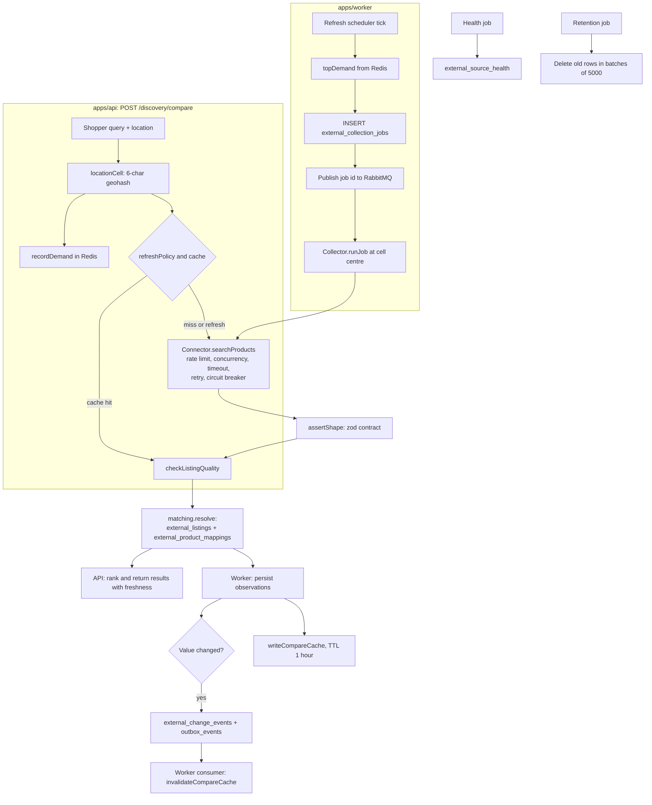

# Reference: `packages/connectors` and `packages/external-data`

This page documents, function by function, the two packages that let LocalStock show offers from other shopping platforms next to LocalStock sellers.

- `@localstock/connectors` (`packages/connectors/src/`) talks to outside data sources.
- `@localstock/external-data` (`packages/external-data/src/`) checks, matches, stores, refreshes, caches and deletes what those sources return.

Related documents:

- [Architecture](../ARCHITECTURE.md) for the whole system.
- [Platform access research](../platforms/README.md) for the legal and access status of each platform.
- [Data dictionary](../DATA_DICTIONARY.md) for every table and column mentioned here.

---

## 1. The big picture, in plain words

### What "external platform discovery" means

A shopper searches for a product, for example "Amul Taaza 1 l". LocalStock shows what its own local sellers have. It can also show the same product on other platforms (quick-commerce apps, marketplaces), so the shopper can compare price, stock and delivery time. Finding and showing those outside offers is "external platform discovery".

### The access rule

LocalStock may only get platform data through an **official API**, a **partner API**, or a **licensed provider** that has the right to share the data. It never scrapes websites. The code enforces this in several places:

- Every real platform (Blinkit, Zepto, Swiggy Instamart, BigBasket, Amazon India, Flipkart) is built as a `NotConfiguredConnector` (see `platforms.js`). It has no capabilities and every call fails with `SOURCE_NOT_CONFIGURED`. Even setting `BLINKIT_ENABLED=true` does not turn it on; it only changes the error message, because no authorized adapter exists yet.
- The only connector that makes real HTTP calls is `LicensedProviderConnector`. It refuses to work unless a mapping file names the contract (`agreementReference`), the base URL is `https://`, and an API key is set. It also refuses redirects so the key cannot leak to another host.
- The "Search on Blinkit" style links (`platformSearchLinks`) are plain links for the shopper to open in their own browser. LocalStock never fetches those pages.
- The demo connector uses an invented platform, refuses to load if its name looks like a real platform, and refuses to run in production.

### Words you will meet

| Word | Meaning |
|---|---|
| Connector | A JavaScript object that knows how to ask one source for data and turn the answer into LocalStock's standard shape. |
| Source | One connector as stored in the database (`external_sources`). One platform can have several sources. |
| Listing | One product as a platform sells it (its own id, title, price). Stored in `external_listings`. |
| Observation | One reading of a listing's price, stock or a cell's serviceability at a point in time. Observations are append-only history. |
| Canonical product / variant | LocalStock's own catalogue entry (`product_variants`). Matching links a listing to one. |
| Minor units | Money as whole paise. Rs 54.00 is `5400`. |
| Geohash cell | A short text code for a rectangle on the map. LocalStock uses 6 characters (about 1.2 km by 0.6 km), so it never stores a shopper's exact location. |
| GTIN | The barcode number on a product (8 to 14 digits). |
| Serviceability | Whether a platform delivers to an area at all. |
| Outbox event | A row in `outbox_events` written in the same transaction as a change; the worker publishes it to RabbitMQ later. |

### How data flows

There are two entry points.

1. **Live comparison (API).** `POST /discovery/compare` in `apps/api/src/modules/discovery/compare.service.js` asks each enabled connector to search, near the shopper. It uses the cache when allowed.
2. **Background collection (worker).** The worker's refresh scheduler looks at what people searched for recently (demand), creates collection jobs, and sends them to RabbitMQ. The collector runs each job at the centre of a geohash cell, never at a person's coordinates.

Both paths then do the same steps:

1. **Fetch.** The connector calls the source through a resilience policy (rate limit, concurrency limit, timeout, retries, circuit breaker).
2. **Validate shape.** The answer must match the zod schemas in `contract.js`. Anything malformed becomes an `INVALID_RESPONSE` error and is never shown.
3. **Check quality.** `checkListingQuality` drops prices that cannot be right (wrong currency, above MRP, discount over 90%) and distrusts future timestamps.
4. **Match.** `createMatchingService().resolve` stores each listing and links it to a LocalStock product, or marks it for human review, or creates a new pending product.
5. **Store observations** (worker only). Price, availability and serviceability readings are appended. If a value changed, a change event and an outbox event are written.
6. **Cache.** The raw answer is saved in Redis for one hour per source, cell and query.
7. **Keep fresh.** Each result gets a freshness label (FRESH, STALE, EXPIRED, UNVERIFIED). Popular searches are refreshed in the background. Change events invalidate cache entries.
8. **Watch health.** A health job combines each connector's own check with recent run results.
9. **Retire.** A retention job deletes old observations, runs, jobs and events in small batches.



---

## 2. How to add a new connector

Do the paperwork first. A connector may only be built once LocalStock has authorized access. Record the access in the platform's file under `docs/platforms/` (status, agreement reference, never the credentials). The README there lists the status values.

There are two ways to add a source.

### Option A: a licensed data provider (no new code)

`LicensedProviderConnector` is driven by a JSON mapping file. If your provider returns JSON over HTTPS with an API key in a header, you may only need configuration.

1. Write a mapping file that passes `mappingSchema` in `licensed-provider.js`. It must contain:
   - `provider` and `agreementReference` (the contract that grants the data rights).
   - `auth.header` (for example `x-api-key`) and an optional `auth.prefix` (for example `Bearer `).
   - `rateLimit.ratePerSecond` and an optional `rateLimit.burst`, as the contract allows.
   - `feesComplete: true` only if the contract says the mapped fees are all the mandatory charges.
   - `capabilities`: mark an operation `SUPPORTED` only if the provider really offers it.
   - `operations.product_search` and/or `operations.product_details`, each with `method`, `path` (starting with `/`), `query`, optional `body`, and `itemsPath` / `itemPath`. Placeholders allowed in path, query and body: `{query}`, `{lat}`, `{lng}`, `{cell}`, `{platform}`, `{listingId}`. Optional `operations.health`.
   - `listing`: where to find each field in one provider record. Required: `externalListingId`, `title`, `itemPrice`, `currency`, `availability`. A field is a dotted path string, or an object with `path`, `const`, `unit` (`rupees` or `paise`), `map` (value translation) and `default`.
2. Set the environment variables (in the API and the worker):
   - `LICENSED_PROVIDER_ENABLED=true`
   - `LICENSED_PROVIDER_CODE`, `LICENSED_PROVIDER_NAME` (optional), `LICENSED_PROVIDER_BASE_URL` (must be `https://`), `LICENSED_PROVIDER_API_KEY`, `LICENSED_PROVIDER_MAPPING_FILE`
   - `LICENSED_PROVIDER_PLATFORMS`: comma-separated platform codes. One connector is built per platform, with code `<provider code>-<platform code>`.
3. Restart. If anything is missing, the registry adds a `NotConfiguredConnector` named `licensed-provider` that lists what is missing. You can see it on the admin page (`GET /admin/external-platforms`).
4. Test the connection with `POST /admin/external-sources/:code/test-connection`.

Limits of option A today: the class implements search and details (price and availability reuse the details call). The mapping schema accepts a `serviceability` operation, but the class has no `doResolveServiceability`, so marking `serviceability` as `SUPPORTED` makes those calls fail with `UNSUPPORTED`. `fulfillment_node` is not implemented either.

### Option B: a new connector class

1. **Create a class that extends `BaseConnector`** in `packages/connectors/src/`. Pass to `super(...)`:
   - `code`: unique, lowercase, 2 to 50 characters matching `^[a-z0-9][a-z0-9-]{1,49}$` (the admin routes and `EXTERNAL_FRESHNESS` use this pattern).
   - `platformCode`: the platform it serves (for example `zepto`).
   - `name`: a human name.
   - `accessType`: one of `OFFICIAL_API`, `PARTNER_API`, `LICENSED_PROVIDER`, `PERMITTED_COLLECTION` (never `DEMO_FIXTURE` for real data).
   - `capabilities`: an object listing each capability from `CAPABILITIES`. Anything you leave out becomes `UNKNOWN`, and only `SUPPORTED` capabilities are ever called.
   - `policy`: resilience options (see section 4), for example the rate limit from the contract.
   - `logger`, `now`: pass through from the registry.
2. **Override `validateConfiguration()`** to return `{ ok: true }` only when all credentials and settings are present. Otherwise return `{ ok: false, missing: [...], reason: '...' }`. Every public method checks this first.
3. **Implement the `do*` hooks** for each `SUPPORTED` capability:
   - `doSearchProducts(query, location, options, signal)` returns `{ items: Listing[], queryCell }`.
   - `doGetProductDetails(id, location, signal)`, `doGetPrice(...)`, `doGetAvailability(...)` return one `Listing` or `null` if unknown.
   - `doResolveServiceability(location, signal)` and `doGetFulfillmentInfo(location, productContext, signal)` return a serviceability object.
   - `location` is `{ lat, lng, cell }`. Prefer sending `cell` (or the cell centre) to the source.
   - Pass `signal` to `fetch` so a timeout really cancels the request.
   - Shapes must match `listingSchema`, `searchResultSchema` and `serviceabilitySchema` in `contract.js`. Use `null` for anything the source did not say; never invent values.
4. **Throw `ConnectorError` with the right code** for failures: `TIMEOUT`, `RATE_LIMITED` (set `retryAfterMs` if the source sent `Retry-After`), `UPSTREAM_ERROR`, `INVALID_RESPONSE`. Mark credential errors `retryable: false`. Messages must not contain payloads, keys or customer data. `licensed-provider.js` `request()` is a good template.
5. **Optionally override `healthCheck()`** to call a cheap endpoint, as `LicensedProviderConnector` does.
6. **Register it in `registry.js`.** There is no plug-in mechanism; you edit `buildConnectorRegistry`. For a listed platform, today `createPlatformConnector` in `platforms.js` always builds a `NotConfiguredConnector`. You would change it (or the registry loop) to build your class when `<ENV_PREFIX>_ENABLED=true` and its credentials are present. Add any new environment flags to `envSchema` in `registry.js` and any secrets to `.env.example` (never real values).
7. **Export the class** from `packages/connectors/src/index.js` if other packages need it.
8. **Set `connector.platformName`** if the platform row may not exist yet. `sources.js` uses `platformName ?? platformCode` as the name when it creates the `external_platforms` row. The six real platforms are already seeded by migration 002.
9. **Add tests** in `packages/connectors/test/` (see `connectors.test.js` and `resilience.test.js`).

### What happens after you deploy

- The first time the API admin page, the compare service, the health job, the scheduler or the collector sees the connector, `createSourceRegistry().ensure` inserts an `external_sources` row. Its `integration_status` starts as `SANDBOX` if configured, or `RESEARCH_REQUIRED` if not.
- Code never sets `ACTIVE`. An admin does that with `PATCH /admin/external-sources/:code/status`, which needs a note of at least 10 characters describing the acceptance tests. Demo sources can never be `ACTIVE`.
- The refresh scheduler only schedules jobs for connectors that are configured and have `product_search: 'SUPPORTED'`. The collector also records serviceability if `serviceability` is `SUPPORTED`.
- You can override freshness rules for your source code with the `EXTERNAL_FRESHNESS` environment variable (see `freshness.js`).

---

## 3. File-by-file reference

Callers listed below come from searching `apps/api/src` and `apps/worker/src`. "Internal" means the function is only used inside its own package.

---

### `packages/connectors/src/index.js`

**Purpose.** The public entry point of `@localstock/connectors`. It only re-exports names from the other files. It has no functions of its own.

Exported names: everything from `contract.js` except `priceSchema`, `etaSchema` and `fulfillmentNodeSchema`; `BaseConnector`; `NotConfiguredConnector`; `PLATFORMS`, `createPlatformConnector`, `platformSearchLinks`; `LicensedProviderConnector`, `licensedProviderConfig`, `mappingSchema`; `DemoFixtureConnector`, `DEMO_FIXTURE_PATH`, `loadDemoFixture`; `buildConnectorRegistry`, `loadConnectorConfig`; `backoffDelay`, `CircuitBreaker`, `createResiliencePolicy`, `retry`, `Semaphore`, `TokenBucket`, `withTimeout`; `DEFAULT_CELL_PRECISION`, `decodeGeohash`, `encodeGeohash`, `locationCell`.

Note: `readPath` in `licensed-provider.js` is exported from its file but not from `index.js`.

---

### `packages/connectors/src/contract.js`

**Purpose.** Defines the "contract" every connector must follow: the list of capabilities, the allowed values, the error codes, and zod schemas for every answer. The header comment states the rule: a connector never reports more than its source supplied.

#### Constants

| Name | Value | Meaning |
|---|---|---|
| `CAPABILITIES` | `product_search`, `product_details`, `price`, `availability`, `serviceability`, `fulfillment_node`, `delivery_eta`, `delivery_fee`, `offers`, `webhooks` | Things a source might be able to do. |
| `CAPABILITY_STATES` | `SUPPORTED`, `UNSUPPORTED`, `UNKNOWN` | `UNKNOWN` means access is not researched or granted. Only `SUPPORTED` is ever called. |
| `AVAILABILITY` | `IN_STOCK`, `OUT_OF_STOCK`, `NOT_SERVICEABLE`, `UNKNOWN`, `FETCH_FAILED` | Stock status of a listing. |
| `SERVICEABILITY` | `SERVICEABLE`, `NOT_SERVICEABLE`, `UNKNOWN` | Whether the platform delivers to the area. |
| `COST_COMPLETENESS` | `COMPLETE`, `PARTIAL`, `UNKNOWN` | Whether all mandatory fees are known. |
| `ACCESS_TYPES` | `OFFICIAL_API`, `PARTNER_API`, `LICENSED_PROVIDER`, `PERMITTED_COLLECTION`, `DEMO_FIXTURE` | How LocalStock is allowed to get the data. |
| `HEALTH` | `HEALTHY`, `DEGRADED`, `DOWN`, `NOT_CONFIGURED`, `UNKNOWN` | Source health values. |
| `ERROR_CODES` | `SOURCE_NOT_CONFIGURED`, `UNSUPPORTED`, `TIMEOUT`, `RATE_LIMITED`, `UPSTREAM_ERROR`, `INVALID_RESPONSE`, `CIRCUIT_OPEN` | Shared with `external_collection_runs.error_code`. |
| `RETRYABLE` (internal) | `TIMEOUT`, `RATE_LIMITED`, `UPSTREAM_ERROR` | Codes that are retryable by default. |

#### `class ConnectorError extends Error`

```js
new ConnectorError(code, message, { source, retryAfterMs, status, retryable } = {})
```

- **What it does.** The one error type connectors throw. The message must be safe to log (no payloads, tokens or customer data).
- **Parameters.** `code`: one of `ERROR_CODES`. `message`: safe text. `source`: connector code. `retryAfterMs`: how long the source asked us to wait. `status`: HTTP status, if any. `retryable`: override; defaults to `true` for `TIMEOUT`, `RATE_LIMITED`, `UPSTREAM_ERROR` and `false` otherwise.
- **Properties set.** `name = 'ConnectorError'`, `code`, `source`, `retryAfterMs`, `status`, `retryable`.
- **Callers.** Thrown throughout both packages. `apps/api/src/modules/discovery/compare.service.js` uses it in `safeError` to decide what error text the shopper sees.

#### `isRetryable(err)`

- Returns `true` only if `err` is a `ConnectorError` and `err.retryable` is true.
- Used by `retry()` and `CircuitBreaker` in `resilience.js`.

#### Schemas

All money is an integer of minor units, at least 0. Times are ISO 8601 with a time-zone offset.

| Schema | Fields and rules |
|---|---|
| `priceSchema` | `itemPriceMinor`, `mrpMinor` (nullable), `currency` (3 capital letters), `taxInclusive` (nullable boolean), `deliveryFeeMinor`, `platformFeeMinor`, `handlingFeeMinor`, `otherFeeMinor` (each null when the source did not say), `totalCostCompleteness`. |
| `etaSchema` | `minMinutes`, `maxMinutes` (nullable integers), `provenance` (where the estimate came from, never a LocalStock guess). Fails if `minMinutes > maxMinutes`. |
| `fulfillmentNodeSchema` | `externalNodeId`, `name`, `lat`, `lng`, `verification` (`UNVERIFIED`, `SOURCE_PROVIDED`, `VERIFIED`). `lat` and `lng` must both be set or both null. Coordinates are only allowed if verification is not `UNVERIFIED`. |
| `listingSchema` | `externalListingId`, `title` (non-empty), `brand`, `variantText`, `gtin` (8 to 14 digits), `imageUrl`, `deepLink` (only a link the source authorizes us to show), `price`, `availability`, `eta`, `fulfillmentNode`, `sourceObservedAt` (null if the source gave no time), `collectedAt` (required). |
| `serviceabilitySchema` | `status`, `eta`, `deliveryFeeMinor`, `currency`, `fulfillmentNode`, `sourceObservedAt`, `collectedAt`. |
| `searchResultSchema` | `items` (array of listings), `queryCell` (geohash of 1 to 6 characters, or null). |
| `locationSchema` | `lat` between -90 and 90, `lng` between -180 and 180. |

`priceSchema`, `etaSchema` and `fulfillmentNodeSchema` are exported from this file but not re-exported by `index.js`.

#### `assertShape(schema, value, source)`

- **What it does.** Validates `value` against a zod `schema`.
- **Returns.** The parsed data (zod's cleaned copy).
- **Throws.** `ConnectorError(INVALID_RESPONSE, 'response failed validation at <path>: <message>')` using the first zod issue. This is how a malformed upstream answer is kept from ever being shown as data.
- **Callers.** `BaseConnector.invoke` (internal).

---

### `packages/connectors/src/base-connector.js`

**Purpose.** The parent class of every connector. It provides the public methods (search, details, price, and so on), checks configuration and capabilities, validates the location, runs the call through the resilience policy, validates the answer and logs the outcome. Subclasses fill in `do*` hooks. Logs never include the query location, credentials or payloads.

`noopLogger` (internal constant): a logger whose methods do nothing; used when no logger is passed.

#### `constructor({ code, platformCode, name, accessType, capabilities = {}, isDemo = false, policy = {}, logger = noopLogger, now = Date.now })`

- Stores the identity fields.
- Builds `this.capabilities` with **every** name in `CAPABILITIES`; any not given becomes `'UNKNOWN'`.
- Builds `this.policy = createResiliencePolicy({ source: code, now, ...policy, onRetry })`. `onRetry` logs `'external source retry'` at warn level with `source`, `attempt`, `delayMs`, `errorCode`.

#### `describe()`

- **Returns.** `{ code, platformCode, name, accessType, isDemo, configured, missing, capabilities }`. `configured` and `missing` come from `validateConfiguration()`.
- **Callers.** The registry's `describe()`. No direct callers in `apps/`.

#### `validateConfiguration()`

- **Returns.** `{ ok: true }` in the base class. Subclasses return `{ ok: false, missing: string[], reason: string }` when not usable.
- **Callers.** Used everywhere to decide whether to call a source: `compare.service.js` (`querySource` and the demand check), `admin/sources.routes.js`, `collector.js`, `scheduler.js`, `sources.js`, the registry's `enabled()`.

#### `async healthCheck()`

- **Returns.** `{ health: 'NOT_CONFIGURED', reason, circuitState, checkedAt }` if not configured, otherwise `{ health: 'UNKNOWN', reason: 'no health check implemented for this source', circuitState, checkedAt }`.
- **Side effects.** None; no network call in the base class.
- **Callers.** `health.js` (`createHealthJob`), `POST /admin/external-sources/:code/test-connection` in `apps/api/src/modules/admin/sources.routes.js`.

#### `async searchProducts(query, location, options = {})`

- **What it does.** Searches the source for products near `location`.
- **Parameters.** `query`: 1 to 200 characters (trimmed before use). `location`: `{ lat, lng }`. `options`: `{ requestId, limit }` (passed to the hook; `requestId` goes into logs).
- **Returns.** A validated `searchResultSchema` object.
- **Throws.** `TypeError('query must be 1-200 characters')` for a bad query (callers validate first, so this is a programming error). Everything `invoke` throws.
- **Callers.** `compare.service.js` `querySource` (API); `collector.js` `runJob` (worker, with `limit: 50`).

#### `getProductDetails(externalListingId, location, options = {})`, `getPrice(...)`, `getAvailability(...)`

- **What they do.** Look up one listing. Capabilities checked: `product_details`, `price`, `availability` respectively.
- **Returns.** A validated listing, or `null` when the source does not know the listing.
- **Throws.** Everything `invoke` throws.
- **Callers.** None in `apps/` today. Only tests call them.

#### `resolveServiceability(location, options = {})`

- **What it does.** Asks whether the platform delivers to the location. Capability: `serviceability`.
- **Returns.** A validated `serviceabilitySchema` object.
- **Callers.** `collector.js` `runJob`, only when `capabilities.serviceability === 'SUPPORTED'`. A failure there is logged and ignored.

#### `getFulfillmentInfo(location, productContext = {}, options = {})`

- **What it does.** Asks which store or warehouse would fulfil an order. Capability: `fulfillment_node`.
- **Returns.** A validated `serviceabilitySchema` object.
- **Callers.** None. No connector implements the hook yet.

#### `normalizeResponse()`

- Throws `ConnectorError(UNSUPPORTED, 'this source has no response normalizer')`. Subclasses override it to turn one raw record into a listing.

#### `async close()`

- Does nothing in the base class. Called by the registry's `close()`. Override it if your connector holds open connections.

#### `isoNow()`

- Returns the current time (from `this.now()`) as an ISO string. Used for `collectedAt` and `checkedAt`.

#### `async invoke(capability, operation, { requestId } = {}, schema, fn, location)` (internal)

This is the heart of the class. Every public data method goes through it. Steps:

1. If `validateConfiguration()` is not ok, throw `ConnectorError(SOURCE_NOT_CONFIGURED, reason)`.
2. If `this.capabilities[capability] !== 'SUPPORTED'`, throw `ConnectorError(UNSUPPORTED, '<name> does not support <capability>')`.
3. Validate `location` with `locationSchema`. If invalid, throw `TypeError('a valid customer location { lat, lng } is required')`.
4. Add `cell = locationCell(location)` (6-character geohash).
5. Run `this.policy.call((signal) => fn(loc, signal))`. This applies the circuit breaker, concurrency limit, retries, rate limit and timeout.
6. Validate the answer with `assertShape(schema, raw, code)`.
7. Log `'external source call'` at info with `source`, `operation`, `requestId`, `outcome: 'ok'`, `durationMs`.
8. On any error: keep a `ConnectorError` as it is; wrap anything else as `ConnectorError(UPSTREAM_ERROR, 'unexpected connector failure', { retryable: false })` with the original in `cause`. Log at warn with `outcome: 'error'` and `errorCode`, then rethrow.

Note: shape validation (step 6) happens outside the resilience policy, so an `INVALID_RESPONSE` from `assertShape` is not retried and does not count toward the circuit breaker.

#### `unsupportedHook()`

- Throws `ConnectorError(UNSUPPORTED, '<name> has no implementation for this operation')`.

#### `doSearchProducts()`, `doGetProductDetails()`, `doGetPrice()`, `doGetAvailability()`, `doResolveServiceability()`, `doGetFulfillmentInfo()`

- Default hooks. Each calls `unsupportedHook()`. Subclasses override the ones they support. See section 2 for the arguments they receive.

---

### `packages/connectors/src/demo-fixture.js`

**Purpose.** A development-only source that reads invented data from `packages/connectors/fixtures/demo-quick-commerce.json`. It lets you build and test comparison without any real platform. Its results are marked `isDemo: true` and carry no source timestamp, so freshness always shows `UNVERIFIED`.

#### Constants

- `DEMO_FIXTURE_PATH`: absolute path to `../fixtures/demo-quick-commerce.json`.
- `fixtureSchema` (internal): zod schema for the file. The platform name must contain the words "fixture data".
- `SIZE_TOKEN` (internal): regex for size words such as `500`, `1kg`, `ml`, `pack`, `of`, `x`. These words are ignored when searching.
- `REAL_PLATFORMS` (internal): regex `blinkit|zepto|instamart|swiggy|bigbasket|amazon|flipkart|jiomart|dunzo`, case-insensitive.

#### `loadDemoFixture(path = DEMO_FIXTURE_PATH)`

- **What it does.** Reads and parses the JSON file, validates it with `fixtureSchema`.
- **Returns.** The fixture object.
- **Throws.** A zod error for a malformed file. `Error('the demo fixture must use a fictional platform name')` if the platform name or code matches `REAL_PLATFORMS`.
- **Side effects.** Reads a file from disk (synchronously).
- **Callers.** The `DemoFixtureConnector` constructor. Not used in `apps/`.

#### `class DemoFixtureConnector extends BaseConnector`

##### `constructor({ env = process.env, fixturePath, ...opts } = {})`

- **Throws.** `Error('The demo fixture source is for development only and cannot run in production')` if `env.NODE_ENV === 'production'`. Also anything `loadDemoFixture` throws.
- Sets `code` (from the file, `demo-quick-commerce-fixture`), `platformCode` (`demo-quick-commerce`), `name`, `accessType: 'DEMO_FIXTURE'`, `isDemo: true`.
- Capabilities: `SUPPORTED` for `product_search`, `product_details`, `price`, `availability`, `serviceability`, `delivery_eta`, `delivery_fee`; `UNSUPPORTED` for `fulfillment_node`, `offers`, `webhooks`.
- **Callers.** `buildConnectorRegistry` when `DEMO_EXTERNAL_FIXTURES=true`.

##### `async healthCheck()`

- Returns `{ health: 'HEALTHY', reason: 'fixture file loaded (demo data)', circuitState, checkedAt }`.

##### `serviceable(cell)`

- Returns `true` if `cell` starts with any prefix in `serviceableCellPrefixes` (in the shipped file: `ttnf`).

##### `eta()`

- Returns the fixture ETA plus `provenance: 'demo fixture'`.

##### `normalizeResponse(raw, cell)`

- Turns one fixture listing into a contract listing for the given cell.
- If the cell is not serviceable: `price: null`, `eta: null`, `availability: 'NOT_SERVICEABLE'` (prices are location-specific).
- If serviceable: price with item price, MRP, the fixture currency, delivery and handling fees, `platformFeeMinor` and `otherFeeMinor` null, and `totalCostCompleteness: 'PARTIAL'` (because the platform fee is unknown). Availability is `OUT_OF_STOCK` if the cell is in `outOfStockCells`, otherwise `IN_STOCK`.
- Always: `imageUrl: null`, `deepLink: null`, `fulfillmentNode: null`, `sourceObservedAt: null`, `collectedAt: now`.

##### `findListing(id)`

- Returns the raw fixture listing with that `id`, or `undefined`.

##### `listingOrNull(id, cell)`

- Returns `normalizeResponse(findListing(id), cell)`, or `null` if not found.

##### `async doSearchProducts(query, location, { limit = 20 } = {})`

- Splits the lower-cased query into words, drops size words (`SIZE_TOKEN`).
- A listing matches if its GTIN equals the whole query, or if every remaining word appears in `"<brand> <title> <variantText>"`.
- Sizes are not matched; every size is returned and the caller chooses.
- Returns up to `limit` normalized listings and `queryCell: location.cell`.

##### `async doGetProductDetails(id, location)`, `async doGetPrice(id, location)`, `async doGetAvailability(id, location)`

- Each returns `listingOrNull(id, location.cell)`.

##### `async doResolveServiceability(location)`

- Returns `SERVICEABLE` with the fixture ETA, delivery fee and currency if the cell is serviceable; otherwise `NOT_SERVICEABLE` with those fields null. `fulfillmentNode` and `sourceObservedAt` are always null.

---

### `packages/connectors/src/geohash.js`

**Purpose.** Converts coordinates to and from geohash text. A geohash splits the map into a grid; each extra character makes the cell smaller. LocalStock uses precision 6 (about 1.2 km by 0.6 km): enough for serviceability and caching, too coarse to identify a home.

`BASE32` (internal): the geohash alphabet `0123456789bcdefghjkmnpqrstuvwxyz` (no `a`, `i`, `l`, `o`).

`DEFAULT_CELL_PRECISION = 6`.

#### `encodeGeohash(lat, lng, precision = 6)`

- **Returns.** A geohash string of `precision` characters.
- **Throws.** `RangeError('lat/lng out of range')`; `RangeError('precision must be 1-12')`.
- **Callers.** `locationCell` (internal). Not used directly in `apps/`.

#### `decodeGeohash(hash)`

- **Returns.** `{ lat, lng }` of the cell's centre.
- **Throws.** `RangeError('invalid geohash')` if the text is not 1 to 12 valid characters.
- **Callers.** `collector.js` `runJob`: background collection queries the cell centre, never a person's location.

#### `locationCell({ lat, lng }, precision = 6)`

- **Returns.** The geohash of the point, with precision capped at 6 even if a larger number is passed.
- **Callers.** `BaseConnector.invoke`; `compare.service.js` `compare` (API); `price-history.routes.js` `GET /catalog/variants/:variantId/price-history` (API).

---

### `packages/connectors/src/licensed-provider.js`

**Purpose.** A generic adapter for a contracted data provider that has display rights. All endpoints and field positions come from a JSON mapping file. The connector stays disabled unless the mapping, an HTTPS base URL and an API key are all present. This is currently the only connector that makes outbound HTTP calls.

#### Schemas

- `fieldSpec` (internal): either a dotted path string (for example `"pricing.sale"`) or an object `{ path?, const?, unit?: 'rupees' | 'paise', map?, default? }`.
- `operationSchema` (internal): `{ method: 'GET' | 'POST' (default GET), path (starts with '/'), query (default {}), body?, itemsPath?, itemPath? }`. Placeholders: `{query} {lat} {lng} {cell} {platform} {listingId}`.
- `mappingSchema` (exported): the full mapping file. See section 2, option A, for the fields. `capabilities` is a partial record of capability states. `operations` may contain `product_search`, `product_details`, `serviceability`, `health`.

#### `readPath(obj, path)`

- Follows a dotted path (`"a.b.c"`) into an object. Returns `undefined` if any step is missing.
- Exported from the file (not from `index.js`). Used internally by `readField`, `doSearchProducts`, `doGetProductDetails`.

#### `readField(record, spec)` (internal)

- Returns `null` if `spec` is undefined.
- String spec: the value at that path, or `null`.
- Object spec with `const` and no `path`: returns the constant.
- Otherwise reads `path`, translates it through `map` if given (an unmapped value becomes `undefined`), and falls back to `default ?? null` when the result is missing.

#### `toMinor(value, spec, field)` (internal)

- Converts a money value to integer paise.
- `null`/`undefined` stays `null`. Strings are converted with `Number`.
- If `spec.unit` is `'paise'`, the number is used as is. Otherwise (default `'rupees'`) it is multiplied by 100 and rounded.
- **Throws.** `ConnectorError(INVALID_RESPONSE, '<field> is not a number')` if the value is not a finite number.

#### `fill(template, values)` (internal)

- Replaces `{name}` placeholders with URL-encoded values.
- **Throws.** A plain `Error('unknown placeholder {x} in provider mapping')` for an unknown name.

#### `licensedProviderConfig(env)`

- **What it does.** Reads the `LICENSED_PROVIDER_*` environment variables.
- **Returns.** `{ missing, code, name, baseUrl, apiKey, mappingFile, platforms }`. `missing` lists `LICENSED_PROVIDER_ENABLED=true` (if not set to `true`) and any of `LICENSED_PROVIDER_CODE`, `LICENSED_PROVIDER_BASE_URL`, `LICENSED_PROVIDER_API_KEY`, `LICENSED_PROVIDER_MAPPING_FILE`, `LICENSED_PROVIDER_PLATFORMS` that are empty. `name` defaults to the code. `platforms` is the comma-separated list, trimmed.
- **Callers.** `buildConnectorRegistry` (internal).

#### `class LicensedProviderConnector extends BaseConnector`

##### `constructor({ platformCode, provider, fetchImpl = globalThis.fetch, policy = {}, ...opts })`

- Loads the mapping from `provider.mapping` or, if absent, reads `provider.mappingFile` and validates it with `mappingSchema`.
- Collects problems instead of throwing: invalid or unreadable mapping, invalid base URL, non-HTTPS base URL, missing API key.
- Sets `code: '<provider.code>-<platformCode>'`, `name: '<provider.name> (<platformCode>)'`, `accessType: 'LICENSED_PROVIDER'`, capabilities from the mapping.
- The rate limit from the mapping (`ratePerSecond`, `burst`) overrides the policy's defaults.
- Stores `mapping`, `baseUrl`, `apiKey`, `problems`, `fetchImpl`.
- **Callers.** `buildConnectorRegistry`, once per platform in `LICENSED_PROVIDER_PLATFORMS`.

##### `validateConfiguration()`

- Returns `{ ok: false, missing: problems, reason: 'Licensed provider <name> is not configured: missing ...' }` if any problems were found; otherwise `{ ok: true }`.

##### `async healthCheck()`

- Returns the base result if not configured, or if the mapping has no `health` operation.
- Otherwise calls the `health` operation through `this.policy.call` (so it uses the rate limit, retries and circuit breaker).
- **Returns.** `{ health: 'HEALTHY', latencyMs, circuitState, checkedAt }` on success, or `{ health: 'DOWN', errorCode, circuitState, checkedAt }` on failure.
- **Side effects.** One outbound HTTPS request.

##### `async request(op, values, signal)`

- **What it does.** Makes one HTTP call to the provider.
- Builds the URL from `op.path` against `baseUrl`, adds query parameters, sets `accept: application/json` and the auth header (`<prefix><apiKey>`). For a `body`, sends JSON.
- Calls `fetchImpl` with `redirect: 'error'` so the key is never sent to another host, and with the abort `signal` from the timeout.
- **Returns.** The parsed JSON, or `null` for HTTP 404.
- **Throws** (all `ConnectorError`):

| Situation | Code | Retryable |
|---|---|---|
| Aborted by the timeout | `TIMEOUT` | yes |
| Other network error | `UPSTREAM_ERROR` (`network error: <name>`) | yes |
| HTTP 429 | `RATE_LIMITED`, with `retryAfterMs` from a numeric `Retry-After` header (seconds x 1000) | yes |
| HTTP 500 and above | `UPSTREAM_ERROR` | yes |
| HTTP 401 or 403 | `UPSTREAM_ERROR` (`provider rejected the credentials`) | no |
| Any other non-2xx | `UPSTREAM_ERROR` (`provider refused the request`) | no |
| Body is not JSON | `INVALID_RESPONSE` | no |

- **Side effects.** Outbound HTTPS to `LICENSED_PROVIDER_BASE_URL`.

##### `values(location, extra = {})`

- Returns the placeholder values `{ lat, lng, cell, platform, ...extra }`.

##### `normalizeResponse(record)`

- Turns one provider record into a contract listing, using the `listing` section of the mapping.
- Fees: each of delivery, platform, handling and other fee is converted with `toMinor`. `totalCostCompleteness` is `COMPLETE` only if `feesComplete` is true in the mapping **and** all four fees are known; `PARTIAL` if at least one is known; else `UNKNOWN`.
- `price` is `null` if the item price is missing.
- `taxInclusive` is kept only if it is a real boolean.
- `availability` must be one of `AVAILABILITY`; anything else becomes `UNKNOWN`.
- `eta` is `null` if both min and max are missing; otherwise includes `provenance: 'licensed provider <provider>'`.
- `fulfillmentNode` is `null` without a node id. With coordinates it is `SOURCE_PROVIDED`; without, `UNVERIFIED` and lat/lng null.
- Empty strings become `null`. `collectedAt` is now.
- **Throws.** `INVALID_RESPONSE` from `toMinor` for a non-numeric amount.

##### `async doSearchProducts(query, location, { limit = 20 } = {}, signal)`

- Uses `operations.product_search` (or `unsupportedHook()` if missing). Reads the items array from `itemsPath` (or the whole body).
- **Throws.** `INVALID_RESPONSE('search response has no item list')` if that is not an array.
- **Returns.** `{ items: first <limit> normalized, queryCell: location.cell }`.

##### `async doGetProductDetails(listingId, location, signal)`

- Uses `operations.product_details` (or `unsupportedHook()`). Returns `null` for a 404, otherwise the normalized record at `itemPath` (or the whole body).

##### `doGetPrice(listingId, location, signal)`, `doGetAvailability(listingId, location, signal)`

- Both call `doGetProductDetails`, because the details operation also carries price and availability.

Not implemented in this class: `doResolveServiceability`, `doGetFulfillmentInfo` (they fall back to `unsupportedHook()`).

---

### `packages/connectors/src/not-configured.js`

**Purpose.** A connector for a source LocalStock has no authorized access to. Every operation fails, and it never returns data.

#### `class NotConfiguredConnector extends BaseConnector`

##### `constructor({ missing, reason, ...opts })`

- Calls the base constructor with `capabilities: {}`, so every capability is `UNKNOWN`.
- Stores `missing` (a list of what is needed) and `reason` (a human sentence).
- **Callers.** `createPlatformConnector` (every real platform) and `buildConnectorRegistry` (incomplete licensed-provider configuration).

##### `validateConfiguration()`

- Always returns `{ ok: false, missing: [...missing], reason }`.
- Effect: `invoke` throws `SOURCE_NOT_CONFIGURED` for every call; `healthCheck` returns `NOT_CONFIGURED`; the compare service reports the source as `NOT_CONFIGURED` with the reason.

---

### `packages/connectors/src/platforms.js`

**Purpose.** The list of real platforms and their (disabled) connectors. No platform has an authorized integration yet (see `docs/platforms/`). Each platform also has a public search URL that the shopper can open; LocalStock never fetches these pages.

#### `PLATFORMS`

A frozen list. Each item: `{ code, name, envPrefix, doc, searchUrl, searchUrlVerified }`.

| code | name | envPrefix | search URL verified |
|---|---|---|---|
| `blinkit` | Blinkit | `BLINKIT` | no |
| `zepto` | Zepto | `ZEPTO` | yes |
| `instamart` | Swiggy Instamart | `INSTAMART` | no |
| `bigbasket` | BigBasket | `BIGBASKET` | yes |
| `amazon` | Amazon India | `AMAZON` | yes |
| `flipkart` | Flipkart | `FLIPKART` | yes |

**Callers.** `registry.js`; `apps/api/src/modules/admin/sources.routes.js` (maps platform code to its doc file); `apps/api/src/modules/discovery/price-history.routes.js` (counts platforms in a notice).

#### `platformSearchLinks(query)`

- **What it does.** Builds one "Search on <platform>" link per platform. The query is trimmed, inner spaces collapsed, and URL-encoded.
- **Returns.** `[{ platformCode, name, url, verified }]`.
- **Side effects.** None. It only builds strings; nothing is fetched.
- **Callers.** `GET /catalog/variants/:variantId/platform-links` in `price-history.routes.js`.

#### `createPlatformConnector(platform, { enabled, logger, now })`

- **What it does.** Builds a `NotConfiguredConnector` for a platform, with code `<code>-official`, `accessType: 'OFFICIAL_API'`, and `missing: ['authorized access agreement', 'approved <name> integration']`.
- The `reason` depends on `enabled`. If `<PREFIX>_ENABLED=true`, it says the flag is on but no authorized integration has been implemented. Otherwise it says LocalStock has no authorized access. Either way the connector stays disabled.
- Sets `connector.platformName = platform.name` (used by `sources.js`).
- **Returns.** The connector.
- **Callers.** `buildConnectorRegistry` (internal).

---

### `packages/connectors/src/registry.js`

**Purpose.** Reads the environment and builds the list of connectors for one process (API or worker).

#### `envSchema` (internal)

| Variable | Default | Rule |
|---|---|---|
| `NODE_ENV` | `development` | `development`, `test` or `production` |
| `EXTERNAL_SOURCE_TIMEOUT_MS` | `4000` | integer 100 to 30000 |
| `EXTERNAL_SEARCH_MAX_CONCURRENCY` | `4` | integer 1 to 32 |
| `DEMO_EXTERNAL_FIXTURES` | `false` | `true` or `false` |
| `LICENSED_PROVIDER_ENABLED` | `false` | `true` or `false` |
| `BLINKIT_ENABLED`, `ZEPTO_ENABLED`, `INSTAMART_ENABLED`, `BIGBASKET_ENABLED`, `AMAZON_ENABLED`, `FLIPKART_ENABLED` | `false` | `true` or `false` |

#### `loadConnectorConfig(env = process.env)`

- **Returns.** The parsed configuration object.
- **Throws.** `Error('Invalid external source configuration: ...')` listing each problem. `Error('DEMO_EXTERNAL_FIXTURES must not be enabled in production: demo data may never be shown as live data')` if both are set.
- **Callers.** `buildConnectorRegistry` (internal).

#### `buildConnectorRegistry({ env = process.env, logger, now, fetchImpl } = {})`

- **What it does.**
  1. Loads the configuration.
  2. Creates a shared policy `{ timeoutMs: EXTERNAL_SOURCE_TIMEOUT_MS, maxConcurrency: EXTERNAL_SEARCH_MAX_CONCURRENCY }`. Each connector still gets its own policy instance (its own rate limiter, breaker and semaphore).
  3. Adds one disabled connector per platform in `PLATFORMS`.
  4. If `LICENSED_PROVIDER_ENABLED=true`: adds a `NotConfiguredConnector` named `licensed-provider` when settings are missing, or one `LicensedProviderConnector` per listed platform.
  5. If `DEMO_EXTERNAL_FIXTURES=true`: adds a `DemoFixtureConnector`.
- **Returns.** A registry object:

| Method | Returns |
|---|---|
| `list()` | A copy of the array of all connectors, configured or not. |
| `get(code)` | The connector with that code, or `undefined`. |
| `enabled()` | Only connectors whose `validateConfiguration().ok` is true. |
| `describe()` | `describe()` of every connector. |
| `close()` | A promise that closes every connector. |

- **Throws.** Anything from `loadConnectorConfig`, and from the `DemoFixtureConnector` constructor.
- **Callers.**
  - `apps/api/src/server.js`: builds it from `process.env` and logs the enabled codes at start-up.
  - `apps/api/src/app.js`: fallback when no registry is injected; it passes only `NODE_ENV`, so every source is disabled.
  - `apps/worker/src/start-worker.js`: builds it from `process.env`.

---

### `packages/connectors/src/resilience.js`

**Purpose.** Tools that stop one slow or broken source from hurting the rest of the system. Section 4 explains the ideas in plain words.

`realSleep(ms)` (internal): a promise that resolves after `ms` milliseconds.

#### `async withTimeout(fn, ms, { source } = {})`

- **What it does.** Runs `fn(signal)` and races it against a timer. When the timer fires, it aborts the `AbortController` (so a `fetch` using that signal is cancelled) and rejects.
- **Returns.** Whatever `fn` returns, if it finishes in time.
- **Throws.** `ConnectorError(TIMEOUT, 'no response within <ms> ms')` (retryable). Or whatever `fn` throws.
- **Callers.** `createResiliencePolicy` (internal). `compare.service.js` also uses it for the overall per-source and local-vendor deadline (`COMPARE_DEADLINE_MS`). Note that in that use the inner call ignores the signal and keeps running; a late answer still fills the cache.

#### `backoffDelay(attempt, { baseMs = 200, maxMs = 5000, random = Math.random } = {})`

- **Returns.** A random delay between 0 and `min(maxMs, baseMs x 2^(attempt-1))` milliseconds, rounded. This is "exponential backoff with full jitter". `attempt` starts at 1.
- **Callers.** `retry` (internal).

#### `async retry(fn, { attempts = 3, baseMs = 200, maxMs = 5000, sleep, random, onRetry } = {})`

- **What it does.** Calls `fn(attempt)`. If it throws a **retryable** `ConnectorError` and attempts remain, waits and tries again.
- The wait is `min(maxMs, err.retryAfterMs ?? backoffDelay(...))`. A source's `Retry-After` wins over the computed backoff, but is still capped at `maxMs`.
- Calls `onRetry({ attempt, delay, code })` before each wait.
- **Throws.** The last error, or the first non-retryable error.
- **Callers.** `createResiliencePolicy` (internal).

#### `class TokenBucket`

A rate limiter. Picture a bucket that holds up to `burst` tokens and refills at `ratePerSecond`. Each call takes one token.

- `constructor({ ratePerSecond, burst = ratePerSecond, maxWaitMs = 2000, now, sleep })`. Throws `Error('ratePerSecond must be positive')`. Starts full.
- `refill()`: adds tokens for the time passed since the last update, up to `burst`.
- `async acquire({ source } = {})`: takes a token if one is there. Otherwise works out how long to wait for one. If the wait would exceed `maxWaitMs` (2 seconds), it throws `ConnectorError(RATE_LIMITED, 'local rate limit for this source reached', { retryAfterMs, retryable: false })` instead of queueing. Otherwise it reserves the token now (so concurrent callers queue behind it) and sleeps.

#### `class CircuitBreaker`

Stops calling a source that keeps failing, to give it time to recover.

- `constructor({ failureThreshold = 5, cooldownMs = 30_000, now } = {})`. Starts `CLOSED` with 0 failures.
- `currentState()`: returns `CLOSED`, `OPEN` or `HALF_OPEN`. An `OPEN` breaker becomes `HALF_OPEN` once `cooldownMs` has passed since it opened.
- `async run(fn, { source } = {})`:
  - If `OPEN`, or `HALF_OPEN` with a trial already running, throws `ConnectorError(CIRCUIT_OPEN, 'source temporarily disabled after repeated failures', { retryAfterMs: remaining cooldown, retryable: false })`.
  - In `HALF_OPEN`, lets exactly one trial call through.
  - On success: state `CLOSED`, failures reset to 0.
  - On a **retryable** error: failures + 1. Opens if this was the half-open trial, or failures reached the threshold.
  - Non-retryable errors (for example a 401, or a local rate-limit refusal) do not count.

#### `class Semaphore`

Limits how many calls run at the same time.

- `constructor(limit)`. Throws `Error('limit must be at least 1')`.
- `async run(fn)`: waits in a first-in-first-out queue if `limit` calls are already running, then runs `fn`. Always releases its slot in `finally`.

#### `createResiliencePolicy({ source, timeoutMs = 4000, ratePerSecond = 5, burst, maxConcurrency = 4, retries = 2, baseBackoffMs = 200, maxBackoffMs = 5000, failureThreshold = 5, cooldownMs = 30_000, now, sleep, random, onRetry } = {})`

- **What it does.** Builds one token bucket, one circuit breaker and one semaphore, and chains them.
- **Order of wrapping (outside to inside):** circuit breaker, then concurrency limit, then retry. Inside each retry attempt: take a rate-limit token, then run the call with a timeout. Each retry takes a fresh token.
- **Returns.** `{ breaker, circuitState(), call(fn) }`. `call(fn)` passes `fn` an `AbortSignal`.
- **Callers.** `BaseConnector` constructor (one policy per connector).

---

### `packages/external-data/src/index.js`

**Purpose.** The public entry point of `@localstock/external-data`, shared by the API (comparison, review) and the worker (collection, health). It only re-exports.

Exported names: `checkListingQuality`, `listingPackSize`, `KNOWN_CURRENCIES`, `MAX_PLAUSIBLE_DISCOUNT`; `decideMatch`, `findCandidates`, `gtinForms`, `nameTokens`; `createMatchingService`; `createSourceRegistry`; `assessFreshness`, `createFreshnessPolicy`, `DEFAULT_POLICY`, `fieldFreshness`, `parseFreshnessConfig`; `normalizeQuery`, `recordDemand`, `topDemand`; `CACHE_TTL_SECONDS`, `compareCacheKey`, `compareCachePattern`, `invalidateCompareCache`, `readCompareCache`, `writeCompareCache`; `detectChanges`, `persistListingObservations`, `persistServiceability`, `recordChange`; `createCollector`, `MAX_JOB_ATTEMPTS`; `createRefreshScheduler`, `dedupKey`, `demandPriority`; `createHealthJob`, `deriveHealth`; `createRetentionJob`.

`MAX_CLOCK_SKEW_MS` (in `quality.js`) is not re-exported.

---

### `packages/external-data/src/collector.js`

**Purpose.** Runs one background collection job: search a source at a cell centre, check quality, match listings, write observations, update the cache. Sources are queried at the job's cell centre, never at a customer's coordinates.

#### Constants and helpers

- `MAX_JOB_ATTEMPTS = 3` (exported).
- `retryDelaySeconds(attempt)` (internal): `min(3600, 60 x 2^(attempt-1))`. Attempt 1 waits 60 s, attempt 2 waits 120 s.
- `safeMessage(err)` (internal): the `ConnectorError` message, or `'unexpected collector failure'` for anything else, cut to 300 characters. ConnectorError messages carry no payloads or credentials.

#### `createCollector({ pool, redis, connectors, logger, sources = createSourceRegistry({ pool }), matching = createMatchingService({ pool, sources }) })`

- **Returns.** `{ runJob(jobId) }`.
- **Callers.** `apps/worker/src/start-worker.js`. The returned `runJob` is called by `runCollectionConsumer` in `apps/worker/src/consumers/external-collection.js` for each RabbitMQ message on `localstock.external-collection`.

##### `claim(jobId)` (internal)

- Atomically sets the job to `RUNNING` and adds 1 to `attempts`, but only if it is `PENDING` or `QUEUED`.
- **Returns.** The job row joined with the source code, or `undefined` if nothing was claimed.
- **DB.** `UPDATE external_collection_jobs ... FROM external_sources`.

##### `fail(job, runId, err, startedAt)` (internal)

- Decides whether to retry: only if `err` is a retryable `ConnectorError` and `job.attempts < 3`.
- In one transaction:
  - If there is a run, marks `external_collection_runs` `FAILED` with `error_code`, a safe message and latency.
  - Sets the job to `PENDING` (with `scheduled_for = now + retryDelaySeconds`) when retrying, or `FAILED` otherwise. Stores `last_error_code`.
  - Writes an outbox event `CollectionFailed` (aggregate type `external_collection`) with `jobId`, `runId`, `sourceCode`, `cell`, `errorCode`, `willRetry`.
- Logs `'external collection failed'` at warn.
- **Returns.** `{ status: 'FAILED', source, errorCode, willRetry }`.
- Non-`ConnectorError` errors are stored as `UPSTREAM_ERROR` and are not retried.

##### `async runJob(jobId)`

It is idempotent: a job that is not `PENDING`/`QUEUED` is skipped, so a redelivered message does nothing.

1. `claim(jobId)`. If nothing was claimed, return `{ status: 'SKIPPED' }`.
2. Find the connector by `source_code`. If it is missing or not configured, fail with `SOURCE_NOT_CONFIGURED` (not retried).
3. If `job_type` is not `SEARCH`, fail with `UNSUPPORTED`.
4. `sources.ensure(connector)`, then insert an `external_collection_runs` row with `request_id = 'job-<id>'`.
5. `decodeGeohash(query_cell)` to get the cell centre.
6. `connector.searchProducts(search_query, centre, { requestId, limit: 50 })`.
7. If the connector supports `serviceability`, call `resolveServiceability`. Errors there are logged (`'serviceability lookup failed'`) and treated as `null`.
8. Run `checkListingQuality` on every listing. Count as "rejected" every listing with at least one `ERROR` issue. (Rejected listings are still stored; only their bad values were removed.)
9. `matching.resolve(connector, checked)` to get a listing record id for each listing.
10. In one transaction: `persistListingObservations`, `persistServiceability` (if any), mark the run `SUCCEEDED` with `items_received`, `items_valid` (received minus rejected), `items_rejected`, `observations_written`, `latency_ms`; mark the job `SUCCEEDED` and clear `last_error_code`.
11. Best effort: `writeCompareCache` with the raw items and the current time. Errors are ignored.
12. Log `'external collection succeeded'`. Return `{ status: 'SUCCEEDED', source, runId, items, observations, changes }`.

Any error in steps 5 to 11 goes to `fail(job, runId, err, startedAt)`.

Errors in steps 4 (for example the database is down) are not caught. They propagate to the consumer, which logs `'collection job crashed'` and acks the message. The job then stays `RUNNING` until the scheduler's stuck-job sweep (10 minutes) puts it back to `PENDING`.

- **DB tables.** `external_collection_jobs`, `external_collection_runs`, `external_sources`, `external_platforms` (via `sources`), `external_listings` and `external_product_mappings` and `product_variants` (via `matching`), observation tables and `external_change_events` (via `observations.js`), `external_fulfillment_nodes`, `outbox_events`.
- **Redis.** Writes `compare:src:<source>:<cell>:<sha1>`.
- **Outbound HTTP.** Through the connector only.

---

### `packages/external-data/src/compare-cache.js`

**Purpose.** A Redis cache of the latest answer per source, query and cell. It is keyed by the coarse cell, never by exact coordinates.

- `PREFIX = 'compare:src'` (internal).
- `CACHE_TTL_SECONDS = 3600` (one hour, exported).

#### `compareCacheKey(sourceCode, cell, query)`

- **Returns.** `compare:src:<sourceCode>:<cell>:<sha1 hex of normalizeQuery(query)>`. Hashing keeps the key short and hides the raw query.
- **Callers.** `compare.service.js` `querySource` (API); `collector.js`.

#### `compareCachePattern(sourceCode, cell)`

- **Returns.** `compare:src:<sourceCode>:<cell>:*`, a pattern matching every query for that source and cell.
- **Callers.** `invalidateCompareCache` (internal).

#### `async readCompareCache(redis, key)`

- **Returns.** The parsed `{ collectedAt, items }`, or `null` on a miss.
- **Throws.** Redis errors and JSON parse errors are not caught here. The API's `readCache` wrapper catches them and treats them as a miss.
- **Redis.** `GET`.
- **Callers.** `compare.service.js` `readCache`.

#### `writeCompareCache(redis, key, { collectedAt, items })`

- **Returns.** The Redis `SET` promise.
- **Redis.** `SET key value EX 3600`.
- **Callers.** `compare.service.js` `writeCache` (fire and forget); `collector.js` (best effort).

#### `async invalidateCompareCache(redis, sourceCode, cell, { maxKeys = 1000, olderThan = null } = {})`

- **What it does.** Finds cache keys for one source and cell with `SCAN` (200 keys per step) and deletes them. Stops when the scan finishes or `maxKeys` keys were removed.
- With `olderThan` (an ISO time), it reads the values first (`MGET`) and keeps any entry whose `collectedAt` is at or after that time, because it already reflects the change. Entries that cannot be parsed are deleted.
- **Returns.** The number of keys removed.
- **Redis.** `SCAN`, `MGET`, `DEL`.
- **Callers.** `createExternalChangeHandler` in `apps/worker/src/consumers/handlers.js`. It runs for `PriceChanged`, `AvailabilityChanged` and `ServiceabilityChanged` events (routing keys `external_price.#`, `external_availability.#`, `external_serviceability.#` on queue `localstock.external-changes`), passing the event's `detectedAt` as `olderThan`.

---

### `packages/external-data/src/demand.js`

**Purpose.** Counts what people search for, so the background collector refreshes popular searches first. It stores only the normalized query text and the coarse cell, in hourly Redis sorted sets. Nothing identifies a customer.

- `PREFIX = 'external:demand'`, `BUCKET_TTL_SECONDS = 4 x 3600` (internal).
- `bucketKey(t)` (internal): `external:demand:<YYYY-MM-DDTHH>` (UTC hour).

#### `normalizeQuery(query)`

- **Returns.** The query trimmed, lower-cased, with runs of whitespace collapsed to one space, cut to 200 characters.
- **Callers.** `recordDemand`; `compareCacheKey`.

#### `async recordDemand(redis, { query, cell, now = Date.now() })`

- **What it does.** Adds 1 to the score of member `{"q": <normalized>, "cell": <cell>}` in this hour's sorted set, and sets the set's expiry to 4 hours.
- **Returns.** Nothing. It never fails the caller: any Redis error is swallowed (demand is only a hint).
- **Redis.** `ZINCRBY`, `EXPIRE`.
- **Callers.** `compare.service.js` `compare`, only if at least one requested source is configured. It is not awaited.

#### `async topDemand(redis, { hours = 2, limit = 50, now = Date.now() } = {})`

- **What it does.** Reads the top 500 members of each of the last `hours` hourly sets (the current hour and the one before, by default), adds up the counts, sorts by count (ties by member text), and keeps `limit`.
- **Returns.** `[{ query, cell, count }]`.
- **Redis.** `ZREVRANGE ... WITHSCORES`.
- **Callers.** `scheduler.js` `tick` (with `limit: 100`).

---

### `packages/external-data/src/freshness.js`

**Purpose.** Decides how old a price or stock reading may be before it is labelled stale or hidden.

The labels:

| Label | Meaning |
|---|---|
| `FRESH` | Age is below `freshSeconds`. |
| `STALE` | Age is at least `freshSeconds` but below `expireSeconds`. Shown, with a label. |
| `EXPIRED` | Age is at least `expireSeconds`. Not meant to be shown. |
| `UNVERIFIED` | Demo data, or no trustworthy timestamp. |

`minRefreshSeconds` is the shortest permitted gap between two background refreshes of the same search.

#### `DEFAULT_POLICY`

| Source type | Price fresh / expire | Availability fresh / expire | Serviceability fresh / expire | Min refresh |
|---|---|---|---|---|
| `LOCALSTOCK_INVENTORY` | never / never | never / never | (not set) | (not set) |
| `EXTERNAL` | 15 min / 6 h | 5 min / 1 h | 30 min / 12 h | 15 min |

Internal schemas: `timeWindow` (`freshSeconds`, `expireSeconds`, both positive, fresh not more than expire), `sourceRules` (optional `price`, `availability`, `serviceability`, `minRefreshSeconds` at least 60), `configSchema` (a record keyed by source code matching `^[a-z0-9][a-z0-9-]{1,49}$`).

#### `parseFreshnessConfig(text)`

- **What it does.** Parses the `EXTERNAL_FRESHNESS` environment variable: JSON keyed by source code, for example `{"my-source": {"price": {"freshSeconds": 600, "expireSeconds": 7200}, "minRefreshSeconds": 900}}`.
- **Returns.** The parsed overrides, or `{}` for empty text.
- **Throws.** `Error('EXTERNAL_FRESHNESS must be valid JSON')`; `Error('EXTERNAL_FRESHNESS: <path>: <message>')` for a schema problem.
- **Callers.** `apps/api/src/config/env.js` and `apps/worker/src/config.js` (inside a zod transform, so a bad value stops start-up).

#### `createFreshnessPolicy(overrides = {})`

- **Returns.** `{ rulesFor(sourceType, sourceCode), minRefreshSeconds(sourceCode) }`.
  - `rulesFor` starts from `DEFAULT_POLICY[sourceType]` (or `EXTERNAL` for an unknown type) and shallow-merges the source's override on top. An override for `price` replaces the whole `price` window.
  - `minRefreshSeconds(sourceCode)` returns the `EXTERNAL` rules' value for that source (default 900).
- **Callers.** `compare.service.js` (`createCompareService` and `externalResult` default); `apps/worker/src/start-worker.js` (for the refresh scheduler).

`DEFAULT` (internal): `createFreshnessPolicy()` with no overrides, used as the default in `assessFreshness`.

#### `fieldFreshness(collectedAt, { freshSeconds, expireSeconds }, now = Date.now())`

- **Returns.** `UNVERIFIED` if the time is missing or unparseable; otherwise `FRESH`, `STALE` or `EXPIRED` by age (negative ages count as 0).
- **Callers.** `assessFreshness` (internal). Only tests call it from `apps/`.

#### `assessFreshness({ sourceType, sourceCode = null, isDemo = false, sourceObservedAt = null, collectedAt }, { now = Date.now(), policy = DEFAULT } = {})`

- **What it does.** Labels one result.
  - Uses the source's own timestamp (`sourceObservedAt`) if present, otherwise `collectedAt`. `basis` says which: `SOURCE_OBSERVED_AT` or `COLLECTED_AT`.
  - Demo data is always `UNVERIFIED` for both fields.
  - Otherwise computes price and availability labels separately; the overall `status` is the worse of the two (order: FRESH, STALE, EXPIRED, UNVERIFIED).
- **Returns.** `{ status, fields: { price, availability }, basis, sourceObservedAt, collectedAt, ageSeconds }`. `ageSeconds` is `null` if the time cannot be parsed.
- **Callers.** `compare.service.js` `externalResult`; `apps/api/src/modules/discovery/local-vendor-source.js` (with `sourceType: 'LOCALSTOCK_INVENTORY'`, so LocalStock's own stock is always `FRESH`).

Serviceability windows exist in the policy but `assessFreshness` only looks at price and availability.

---

### `packages/external-data/src/health.js`

**Purpose.** Works out each source's health by combining the connector's own health check with the last hour of collection runs, and stores it.

`MIN_RUNS_FOR_RATE = 3` (internal): the error rate is only trusted with at least 3 runs.

#### `deriveHealth(check, stats)`

- **Parameters.** `check`: the connector's `healthCheck()` result. `stats`: `{ total, errorRate }` for the last hour.
- **Rules, in order:**
  1. Check says `NOT_CONFIGURED`: `NOT_CONFIGURED`.
  2. Check says `DOWN`: `DOWN`.
  3. With 3 or more runs: error rate 100% gives `DOWN`; 50% or more gives `DEGRADED`.
  4. Check says `HEALTHY`: `HEALTHY`.
  5. Check says `UNKNOWN`: `HEALTHY` if there was at least one run and the error rate is below 50%; otherwise `UNKNOWN`.
- **Callers.** `createHealthJob` (internal).

#### `createHealthJob({ pool, connectors, logger, sources = createSourceRegistry({ pool }) })`

- **Returns.** An async function `checkSourceHealth()`.
- **Callers.** `apps/worker/src/start-worker.js` runs it every `EXTERNAL_HEALTH_INTERVAL_MS` (default 300000 ms, 5 minutes).

##### `async checkSourceHealth()`

For each connector in `connectors.list()` (configured or not), one at a time:

1. `sources.ensure(connector)`.
2. `connector.healthCheck()` (may make one outbound call for a licensed provider).
3. Reads the last hour of finished runs from `external_collection_runs`: total, failed, median latency, last success, last failure, last error code.
4. `deriveHealth(check, stats)`.
5. In one transaction: locks the current `external_source_health` row, upserts the new values (health, circuit state, last success/failure, last error, p50 latency, error rate rounded to 4 decimals, `checked_at`). Older last-success/failure/error values are kept if the new ones are null.
6. If the stored health changed, calls `recordChange` with `entityType: 'SOURCE_HEALTH'` (writes `external_change_events` and an outbox `HealthChanged` event).

If anything fails for one connector, it logs `'source health check failed'` and records `{ source, health: 'UNKNOWN', error: true }` for it, then continues.

- **Returns.** `[{ source, health }]`.

---

### `packages/external-data/src/matcher.js`

**Purpose.** Pure matching rules (plus one database query) that decide whether an external listing is the same product as a LocalStock product variant. Section 4 explains the scoring in plain words.

Rule order: GTIN, then brand + size + same name words, then brand + size + overlapping name words, then fuzzy title. A known pack-size difference always rules a candidate out, and fuzzy matches only ever propose (never auto-confirm).

Helpers from `@localstock/database`: `normalizeText` (lower-case, strip punctuation, join "400 g" to "400g"), `extractPackSize`, `packSizeFromAttributes`, `samePackSize` (unknown sizes are never equal).

#### Constants

- `NOISE` (internal): words ignored when comparing names: `the, and, with, of, a, pack, pouch, bottle, tetra, tetrapack, carton, box, jar, tin, can, packet, pkt, combo, new, fresh, x`.
- `SIZE_OR_NUMBER` (internal): plain numbers and leftover sizes such as `400g`, `1l`, `6pcs`. A word like `2minute` is kept.

#### `nameTokens(text, brand)`

- **What it does.** Turns a product name into a set of "identifying words". It removes the pack-size phrase, normalizes the text, and drops brand words, noise words and size/number words.
- **Returns.** A `Set` of words.
- **Callers.** `decideMatch`; `matching.js` `createCanonical`.

#### `sameSet(a, b)`, `isSubset(small, big)`, `differsBothWays(a, b)` (internal)

- `sameSet`: both sets contain exactly the same words.
- `isSubset`: `small` is non-empty and every word is in `big`.
- `differsBothWays`: each set has at least one word the other lacks (for example "Masti Dahi" against "Masti Spiced Buttermilk").

#### `gtinForms(gtin)`

- **What it does.** Barcodes can be written with or without leading zeros (EAN-8, UPC-12, EAN-13, GTIN-14). This returns every zero-padded length (8, 12, 13, 14) that can hold the number.
- **Returns.** An array of strings, or `[]` if `gtin` is not 8 to 14 digits.
- **Callers.** `decideMatch`, `findCandidates`.

#### `sizeRelation(a, b)` (internal)

- Returns `UNKNOWN` if either size is missing, `SAME` if `samePackSize` agrees, else `DIFFERENT`.

#### `decideMatch(listing, candidates, { excludeVariantIds = new Set() } = {})`

- **Parameters.** `listing`: `{ gtin, brand, title, packSize }`. `candidates`: from `findCandidates`. `excludeVariantIds`: variants a reviewer already rejected for this listing.
- **Returns.** `{ status, proposals }` where `status` is `AUTO_CONFIRMED`, `NEEDS_REVIEW` or `UNMATCHED`, and each proposal is `{ variantId, method, confidence, evidence }`. At most 3 proposals.
- **Side effects.** None (pure function).
- **Callers.** `matching.js` `resolve`.

#### `async findCandidates(db, listing)`

- **What it does.** Finds up to 25 possible matches in `product_variants`. A variant is considered if it is `ACTIVE`, or `PENDING_REVIEW` with `origin = 'EXTERNAL'` (so the same product found on a second platform links to it instead of being created twice). It must also have one of: a matching barcode form; the same brand (case-insensitive); or a name similar to `"<brand> <title>"` by the PostgreSQL `pg_trgm` `%` operator (trigram similarity above the database's threshold, 0.3 by default; the project does not change it).
- Orders by barcode match first, then similarity, then id.
- **Returns.** `[{ id, brand, name, barcode, similarity, packSize }]`. `packSize` comes from the `pack_*` columns, or else from the variant's `attributes`.
- **DB.** Reads `product_variants`.
- **Callers.** `matching.js` `resolve`.

---

### `packages/external-data/src/matching.js`

**Purpose.** Stores external listings and their match decisions, and reuses them. A listing is matched once and the stored decision is reused. Open `NEEDS_REVIEW` candidates are never shown as a match. Re-matching skips products a reviewer rejected.

#### `createMatchingService({ pool, sources = createSourceRegistry({ pool }), createCanonicalProducts = true })`

- `pool` may also be a transaction client.
- **Returns.** `{ ensureSource(connector), upsertListings(source, entries), resolve(connector, entries) }`.
- **Callers.** `compare.service.js` (`createMatchingService({ pool })`); `collector.js` (default argument).

##### `upsertListings({ sourceId, platformId }, entries)`

- **What it does.** Inserts or updates one `external_listings` row per unique `externalListingId` in a single statement (using `unnest` arrays). On conflict (same platform and listing id) it updates title, brand, variant text, pack size, image, deep link and `last_seen_at`; it keeps an existing GTIN if the new one is null.
- **Parameters.** `entries`: `[{ listing, packSize }]` (the output of `checkListingQuality`).
- **Returns.** `Map(externalListingId -> listing row id)`.
- **DB.** `external_listings`.

##### `createCanonical(listingId, listing, packSize)` (internal)

- **What it does.** Creates a new LocalStock product (`product_variants`, `status = 'PENDING_REVIEW'`, `origin = 'EXTERNAL'`) from a listing that matched nothing.
- Needs a known pack size and a title; otherwise returns `null` (without a size, different sizes could not be kept apart).
- The name drops a leading brand. The `normalized_key` is `ext|<brand>|<sorted identifying words>|<size>` (for example `6x200ml`). Because of this key, two platforms creating the same product at the same time land on one row (`ON CONFLICT (normalized_key)`).
- If the insert hits a different unique violation (PostgreSQL code `23505`, the barcode is already used), it looks for a usable product with that barcode and the same (or unknown) pack size, and returns its id or `null`. Other errors are rethrown.
- **Returns.** The variant id, or `null`.
- **DB.** `product_variants`.

##### `storeDecision(listingId, decision)` (internal)

- Inserts one `external_product_mappings` row per proposal with `match_status = decision.status`. `ON CONFLICT DO NOTHING`.
- Database rules back this up: at most one accepted (`AUTO_CONFIRMED`/`CONFIRMED`) mapping per listing, and a `FUZZY_CANDIDATE` can never be `AUTO_CONFIRMED`.

##### `unmapped(listingRecordId)` (internal)

- Returns `{ listingRecordId, matchStatus: 'UNMAPPED', canonicalProductId: null, match: null }`.

##### `ensureSource(connector)`

- Calls `sources.ensure(connector)`. No callers in `apps/`.

##### `async resolve(connector, entries)`

- **What it does.**
  1. Returns an empty map for no entries.
  2. Ensures the source row and upserts all listings.
  3. Loads every existing mapping for those listings in one query.
  4. For each listing that has **no accepted mapping and no open review**:
     - Collects rejected variant ids.
     - Runs `findCandidates` and `decideMatch` (excluding rejected variants).
     - If `UNMATCHED` and `createCanonicalProducts` is on, tries `createCanonical`. On success the decision becomes `AUTO_CONFIRMED` with method `NEW_CANONICAL`, confidence 1.
     - If not `UNMATCHED`, stores the decision and reloads that listing's mappings.
  5. Builds the result per listing:
     - Accepted mapping: `{ listingRecordId, matchStatus: 'MATCHED', canonicalProductId, match: { status, method, confidence } }`.
     - Open reviews: `{ listingRecordId, matchStatus: 'NEEDS_REVIEW', canonicalProductId: null, match: { status: 'NEEDS_REVIEW', candidates: <count> } }`.
     - Otherwise: `unmapped(listingRecordId)`.
- **Returns.** `Map(externalListingId -> result)`.
- **DB.** `external_platforms`, `external_sources`, `external_listings`, `external_product_mappings`, `product_variants`.
- **Callers.** `compare.service.js` `querySource` (failures are logged and the results are shown unmapped); `collector.js` `runJob`.

#### `groupBy(items, key)` (internal)

- Groups an array into a `Map` by `key(item)`. Written by hand because `Map.groupBy` needs Node 21 and the project supports Node 20.

---

### `packages/external-data/src/observations.js`

**Purpose.** Writes append-only history of prices, stock and serviceability, and records changes. Nothing here touches LocalStock sellers' own prices or stock.

`PRICE_FIELDS = ['itemPriceMinor', 'mrpMinor', 'currency']` (internal).

`EVENT` (internal): maps an entity type to its outbox event.

| Entity type | Aggregate type | Event type | Routing key |
|---|---|---|---|
| `PRICE` | `external_price` | `PriceChanged` | `external_price.PriceChanged` |
| `AVAILABILITY` | `external_availability` | `AvailabilityChanged` | `external_availability.AvailabilityChanged` |
| `SERVICEABILITY` | `external_serviceability` | `ServiceabilityChanged` | `external_serviceability.ServiceabilityChanged` |
| `SOURCE_HEALTH` | `external_source` | `HealthChanged` | `external_source.HealthChanged` |

The worker's `localstock.external-changes` queue is bound to the first three only.

#### `detectChanges(previous, next)`

- **What it does.** Compares the last stored reading with the new one.
  - A `PRICE` change if both have a price and item price, MRP or currency differ.
  - An `AVAILABILITY` change if both have a status and they differ.
  - Nothing is reported when there is no previous value (first sighting).
- **Returns.** `[{ entityType, oldValue, newValue }]`.
- **Callers.** `persistListingObservations` (internal).

#### `async recordChange(client, { entityType, sourceId, sourceCode, listingId = null, cell = null, oldValue, newValue, aggregateId })`

- **What it does.** Must run inside a transaction, so the change and its outbox event commit together.
  1. Inserts into `external_change_events`.
  2. Writes an outbox event (`enqueueEvent`) with `schemaVersion: 1`, `changeEventId`, `entityType`, `sourceId`, `sourceCode`, `listingId`, `cell`, `oldValue`, `newValue`, `detectedAt`. Aggregate id is `aggregateId ?? listingId ?? sourceId`.
  3. Stores the outbox id on the change row.
- **Returns.** The change's `event_id`.
- **Callers.** `persistListingObservations`, `persistServiceability`, `health.js`. Not called from `apps/` source (only from a test).

#### `upsertNode(client, { platformId, sourceId }, node)` (internal)

- Inserts or updates an `external_fulfillment_nodes` row (a store or warehouse). Location is stored as a PostGIS point only if the source gave coordinates; otherwise verification is `UNVERIFIED`. On conflict it keeps existing name and location when the new ones are null, and only updates verification when a location is given.
- **Returns.** The node id.

#### `async persistListingObservations(client, ctx, entries)`

- **Parameters.** `client`: a transaction client. `ctx`: `{ sourceId, platformId, sourceCode, runId, cell }`. `entries`: `[{ listing, listingRecordId, ... }]`.
- **What it does.**
  1. Skips entries without a `listingRecordId`.
  2. Loads the latest previous price and availability for these listings **in this cell** (two queries).
  3. For each entry: upserts its fulfilment node if present; inserts an `external_price_observations` row if it has a price; always inserts an `external_availability_observations` row; then records any detected changes.
- **Returns.** `{ observations, changes }`.
- **DB.** `external_price_observations`, `external_availability_observations`, `external_fulfillment_nodes`, `external_change_events`, `outbox_events`.
- **Callers.** `collector.js`.

#### `async persistServiceability(client, ctx, result)`

- **What it does.** Reads the last serviceability status for this platform, cell and source; upserts the node if any; inserts an `external_serviceability_observations` row (status, ETA, delivery fee, currency, times). If the status changed, records a `SERVICEABILITY` change.
- **Returns.** `{ observations: 1, changes: 0 or 1 }`.
- **Callers.** `collector.js`.

---

### `packages/external-data/src/quality.js`

**Purpose.** Checks one listing for values that cannot be right. Problems are reported, never silently fixed: implausible prices are dropped and future timestamps are distrusted.

#### Constants

- `KNOWN_CURRENCIES = new Set(['INR'])` (exported).
- `MAX_PLAUSIBLE_DISCOUNT = 0.9` (exported): a discount deeper than 90% off MRP is treated as a data error, not a deal.
- `MAX_CLOCK_SKEW_MS = 5 x 60 x 1000` (exported from the file only): allowed clock difference between a source and LocalStock.

#### `listingPackSize(listing)`

- **What it does.** Works out the pack size. Tries, in order: parse the whole `variantText`; find a size inside `variantText`; find a size inside `title`.
- **Returns.** `{ quantity, unit, count }` or `null`/`undefined` if none was found.
- **Callers.** `checkListingQuality`; `compare.service.js` `externalResult` (default argument).

#### `checkListingQuality(listing, { now = Date.now() } = {})`

- **Returns.** `{ listing, packSize, issues }`. `listing` is a copy with unusable values removed. Each issue is `{ code, severity, field, message }`.
- **Checks:**

| Code | Severity | When | Effect |
|---|---|---|---|
| `UNKNOWN_CURRENCY` | ERROR | Currency is not `INR`. | Price dropped. |
| `ZERO_PRICE` | WARNING | Item price is 0. | Kept. |
| `PRICE_ABOVE_MRP` | ERROR | Item price is above MRP. | Price dropped. |
| `IMPLAUSIBLE_DISCOUNT` | ERROR | MRP > 0 and `1 - price/MRP > 0.9`. | Price dropped. |
| `FUTURE_TIMESTAMP` | ERROR | `sourceObservedAt` more than 5 minutes in the future. | `sourceObservedAt` set to null. |
| `FUTURE_TIMESTAMP` | ERROR | `collectedAt` more than 5 minutes in the future. | Reported only. |
| `PACK_SIZE_UNKNOWN` | INFO | No pack size found. | The listing is not matched on size. |

- **Side effects.** None.
- **Callers.** `compare.service.js` `querySource`; `collector.js` `runJob`.

---

### `packages/external-data/src/retention.js`

**Purpose.** Deletes old data in small batches to avoid long table locks. The table order follows foreign keys. Listings and product mappings are never deleted.

- `BATCH = 5000` (internal).
- `STEPS` (internal), in order:

| Table | Deleted when | Days setting |
|---|---|---|
| `external_change_events` | `detected_at` older than N days | external |
| `external_price_observations` | `collected_at` older | external |
| `external_availability_observations` | `collected_at` older | external |
| `external_offer_observations` | `collected_at` older | external |
| `external_serviceability_observations` | `collected_at` older and no availability observation points to it | external |
| `external_collection_runs` | `started_at` older, not `RUNNING`, and no observation of any kind points to it | external |
| `external_collection_jobs` | `updated_at` older, status `SUCCEEDED`/`FAILED`/`CANCELLED`, and no run points to it | external |
| `outbox_events` | published, `published_at` older, and no change event points to it | events |
| `inbox_events` | `processed_at` older | events |

#### `createRetentionJob({ pool, logger, externalDays, eventDays, batch = 5000 })`

- **Returns.** An async function `applyRetention()`.
- **Callers.** `apps/worker/src/start-worker.js` runs it every `RETENTION_INTERVAL_MS` (default 3600000 ms, 1 hour) with `EXTERNAL_RETENTION_DAYS` (default 90) and `EVENT_RETENTION_DAYS` (default 30).

##### `async applyRetention()`

- For each step, repeatedly runs `DELETE ... WHERE ctid IN (SELECT ... LIMIT batch)` until a pass deletes fewer than `batch` rows.
- Logs `'retention applied'` if anything was deleted.
- **Returns.** `{ <table>: <rows deleted> }` for tables where something was deleted.

---

### `packages/external-data/src/scheduler.js`

**Purpose.** Turns recent demand into background collection jobs and sends them to RabbitMQ. Open jobs are unique per dedup key (a partial unique index on `external_collection_jobs(dedup_key)` for `PENDING`, `QUEUED`, `RUNNING`), and a key that succeeded within the source's `minRefreshSeconds` is not scheduled again.

`STUCK_AFTER_SECONDS = 600` (internal).

#### `dedupKey(sourceCode, cell, query)`

- **Returns.** `search:<sourceCode>:<cell>:<sha1 hex of query>`.
- **Callers.** `enqueue` (internal).

#### `demandPriority(count)`

- **Returns.** A RabbitMQ priority from 1 to 9: `ceil(log2(count + 1))`, clamped. 1 search gives 1; 3 give 2; 7 give 3; 255 give 8; 511 or more give 9.
- **Callers.** `enqueue` (internal).

#### `createRefreshScheduler({ pool, redis, connectors, policy, publish, logger, maxJobsPerSource = 20, sources = createSourceRegistry({ pool }) })`

- `publish(jobId, priority)` must use publisher confirms (the worker passes `createJobPublisher`, which waits for confirms).
- **Returns.** `{ tick() }`.
- **Callers.** `apps/worker/src/start-worker.js` runs `tick` every `EXTERNAL_REFRESH_INTERVAL_MS` (default 60000 ms).

##### `refreshable()` (internal)

- Connectors that are configured and have `product_search: 'SUPPORTED'`.

##### `enqueue(connector, demand)` (internal)

- For each `{ query, cell, count }` in demand, until `maxJobsPerSource` (20) new jobs were created:
  - Skips it if a job with the same dedup key `SUCCEEDED` within `policy.minRefreshSeconds(code)` (default 900 s).
  - Inserts a `SEARCH` job with the computed priority. `ON CONFLICT DO NOTHING` skips it if an open job already exists.
- **Returns.** The number of jobs created.
- **DB.** `external_collection_jobs`; `external_sources`/`external_platforms` via `sources.ensure`.

##### `dispatch(limit = 200)` (internal)

- Reads up to 200 `PENDING` jobs whose `scheduled_for` has passed, highest priority first. For each: `publish`, then set it to `QUEUED`. Stops at the first publish failure (logged; the job stays `PENDING` and is sent again next tick). This also re-sends jobs whose earlier publish failed, and retries scheduled by the collector.
- **Returns.** The number sent.
- **Side effects.** RabbitMQ messages `{ jobId }` on `localstock.external-collection`.

##### `recoverStuck()` (internal)

- A worker that died mid-job leaves it `RUNNING`. Jobs `RUNNING` for more than 600 seconds go back to `PENDING`, unless they have already used `MAX_JOB_ATTEMPTS` (3) attempts. Those become `FAILED` with `last_error_code = 'WORKER_LOST'` and a warning is logged, so a job that keeps crashing the worker cannot loop forever.
- **Returns.** The number of jobs put back in the queue (not counting the ones marked `FAILED`).

##### `async tick()`

1. If any source is refreshable, reads `topDemand(redis, { limit: 100 })` and calls `enqueue` for each refreshable source.
2. `recoverStuck()`.
3. `dispatch()`.
4. Logs `'external refresh scheduled'` if anything happened.
- **Returns.** `{ scheduled, queued, recovered }`.

---

### `packages/external-data/src/sources.js`

**Purpose.** Makes sure every connector has a row in `external_platforms` and `external_sources`, and remembers the ids. It never sets a source to `ACTIVE`; that is an operator decision after acceptance tests against the real source.

`CONFIG_REFERENCE` (internal): the configuration names shown for an access type: `DEMO_FIXTURE` to `DEMO_EXTERNAL_FIXTURES`, `LICENSED_PROVIDER` to `LICENSED_PROVIDER_*`.

#### `createSourceRegistry({ pool })`

- **Returns.** `{ ensure(connector) }`.
- **Callers.** `apps/worker/src/start-worker.js` (one shared instance for the collector, scheduler and health job); `apps/api/src/modules/admin/sources.routes.js`; default argument in `collector.js`, `health.js`, `matching.js`, `scheduler.js`.

##### `register(connector)` (internal)

1. Upserts `external_platforms` by `connector.platformCode`. Name: the connector name for demo sources, otherwise `connector.platformName ?? connector.platformCode`. A new row gets `status = 'ACTIVE'`; an existing row only gets `updated_at` changed. (The six real platforms are seeded by migration 002.)
2. Upserts `external_sources` by `connector.code` with platform id, name, access type, `integration_status` (`SANDBOX` if configured, else `RESEARCH_REQUIRED`), config reference and the list of `SUPPORTED` capabilities. On conflict only name, capabilities and `updated_at` change, so an admin's status choice is kept.
- **Returns.** `{ sourceId, platformId }`.

##### `ensure(connector)`

- **What it does.** Calls `register` once per connector code and caches the promise in memory. If registration fails, the cache entry is removed so the next call tries again.
- **Returns.** A promise of `{ sourceId, platformId }`.
- **Callers.** `GET /admin/external-platforms` (for every connector); `matching.js`; `collector.js`; `health.js`; `scheduler.js`.

---

## 4. Concepts explained

### Resilience: what protects LocalStock from slow or broken sources

All of these live in `packages/connectors/src/resilience.js` and are combined by `createResiliencePolicy`. Every connector gets its **own** set, per process.

| Concept | What it means | Values in the code |
|---|---|---|
| Timeout | Give up on a call that takes too long, and cancel the HTTP request. | 4000 ms per attempt by default (`EXTERNAL_SOURCE_TIMEOUT_MS`, 100 to 30000). Error `TIMEOUT`. |
| Retries with backoff | Try again after a short, growing, random wait, but only for errors that might go away (`TIMEOUT`, `RATE_LIMITED`, `UPSTREAM_ERROR`, unless marked not retryable). | 2 retries (3 attempts in total). Wait is random between 0 and `min(5000, 200 x 2^(attempt-1))` ms. A source's `Retry-After` is used instead, capped at 5000 ms. |
| Rate limiting (token bucket) | Never call a source faster than allowed. If a call would have to wait too long, fail at once instead. | 5 calls per second by default, burst equal to the rate. Licensed providers use the rate from the mapping file. Maximum wait 2000 ms, then `RATE_LIMITED` (not retried). |
| Concurrency limit (semaphore) | At most N calls to one source at the same time; others queue. | 4 by default (`EXTERNAL_SEARCH_MAX_CONCURRENCY`, 1 to 32). |
| Circuit breaker | After repeated failures, stop calling the source for a while, then let one trial call through. | Opens after 5 failed calls in a row (each counted after its retries ran out, and only for retryable errors). Stays open 30 seconds. Then `HALF_OPEN`: one trial; success closes it, a retryable failure opens it again. While open, calls fail at once with `CIRCUIT_OPEN`. |

Order of wrapping: circuit breaker, then concurrency limit, then retry; inside each attempt, rate-limit token, then timeout.

Worst case for one call, before the breaker opens: 3 attempts of up to 4 s each, plus up to 2 backoff waits of up to 5 s, plus rate-limit waits of up to 2 s each.

Other protections around the connectors:

- **API deadline.** `compare.service.js` wraps each source in `withTimeout` with `COMPARE_DEADLINE_MS`, so a slow source never fails the whole comparison. Identical lookups already in flight share one call.
- **Job retries.** The collector retries a failed job up to 3 attempts in total (1 minute, then 2 minutes later), only for retryable connector errors. `CIRCUIT_OPEN` and local `RATE_LIMITED` are not retryable, so those jobs become `FAILED`.
- **Stuck jobs.** The scheduler returns jobs that were `RUNNING` for more than 10 minutes to `PENDING`.
- **Idempotency.** `runJob` only claims jobs that are `PENDING` or `QUEUED`, so a message delivered twice does nothing the second time.

### Matching: how a listing is linked to a LocalStock product

Goal: decide whether, for example, "Amul Taaza Toned Milk 1 l" on another platform is the same as LocalStock's product. A wrong match would show a misleading price, so the rules are careful.

First, `findCandidates` gets up to 25 LocalStock variants that share a barcode, share the brand, or have a similar name.

Then `decideMatch` applies these rules, in order:

1. **Barcode (GTIN).** If exactly one candidate has the same barcode (allowing for leading zeros):
   - Sizes agree or are unknown: **auto-confirmed**, method `GTIN`, confidence **1.0**.
   - Both sizes known and different: **needs review**, confidence **0.5** (one side's data must be wrong).
   - If two or more candidates share the barcode, rule 1 does not decide and the next rules run.
2. **Filter out impossible candidates.** Remove any candidate whose pack size is known and different. Remove same-brand candidates whose name words differ in both directions (for example two flavours of one brand).
3. **Exact brand, size and name.** Same brand, same pack size, and exactly the same identifying words. If exactly one candidate fits: **auto-confirmed**, method `BRAND_ATTRIBUTES`, confidence **0.95**.
4. **Otherwise, build proposals for a human reviewer** (each candidate is proposed once, by the first rule that applies):
   - Same brand and same words: confidence **0.8** if the size is the same (there were several such candidates), **0.6** if the size is unknown. Method `BRAND_ATTRIBUTES`.
   - Same brand, same size, and one name's words are all inside the other's: confidence **0.7**. Method `ATTRIBUTES`.
   - Name similarity (PostgreSQL trigram) of at least **0.45**: confidence `min(0.6, similarity x 0.6)`, so at most **0.6**. Method `FUZZY_CANDIDATE`. Fuzzy matches can never be auto-confirmed (also enforced by a database check).
   - Keep the top **3** by confidence. Status **needs review**.
5. **Nothing fits:** status **unmatched**.

Finally, in `matching.js`:

- If a listing is unmatched and has a known pack size, LocalStock creates a new product from it with status `PENDING_REVIEW` (method `NEW_CANONICAL`, confidence 1). A second platform selling the same product later links to it instead of creating a copy.
- Decisions are stored and reused. A listing with an accepted match or open review is not matched again. Variants a reviewer rejected are never proposed again for that listing.
- Only an accepted match (`AUTO_CONFIRMED` by rules or `CONFIRMED` by a reviewer) is shown as "the same product" (`matchStatus: 'MATCHED'`). Listings awaiting review are shown as `NEEDS_REVIEW`, and the comparison response adds a notice asking the shopper to compare carefully.

### Quality scoring: which values are trusted

`checkListingQuality` does not give a numeric score. It produces a list of issues with a severity (`ERROR`, `WARNING`, `INFO`) and removes values that cannot be trusted:

- Only `INR` prices are accepted.
- A selling price above MRP is dropped.
- A discount of more than **90%** off MRP is dropped.
- A zero price is kept but flagged as a warning.
- A source timestamp more than **5 minutes** in the future is ignored (so freshness falls back to collection time).
- A missing pack size is noted; such listings can still be matched, but never on size.

In the worker, a listing with any `ERROR` issue counts as "rejected" in the run statistics (`items_rejected`), though its remaining values are still stored. In the API, any `ERROR` adds the notice "Some source values failed data-quality checks and are shown as unknown."

### Freshness, caching and clean-up at a glance

| Item | Value | Where |
|---|---|---|
| Comparison cache lifetime | 1 hour | `compare-cache.js` |
| API reuses a cached answer under `prefer_fresh` if younger than | 120 seconds | `compare.service.js` |
| External price fresh / expired after | 15 minutes / 6 hours | `freshness.js` |
| External availability fresh / expired after | 5 minutes / 1 hour | `freshness.js` |
| External serviceability fresh / expired after | 30 minutes / 12 hours | `freshness.js` |
| Minimum gap between background refreshes of one search | 15 minutes | `freshness.js` |
| Demand counting window | hourly buckets, kept 4 hours, last 2 hours used | `demand.js` |
| Health window | last 1 hour of runs; rates trusted from 3 runs | `health.js` |
| External data kept for | 90 days by default | worker config, `retention.js` |
| Published events kept for | 30 days by default | worker config, `retention.js` |
