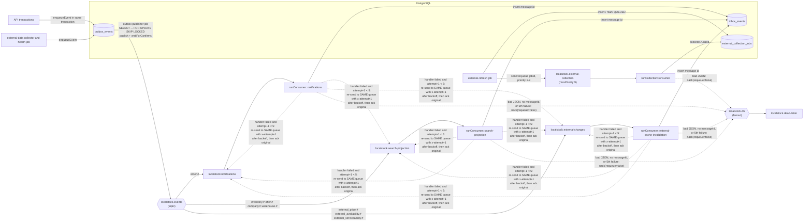

# Worker reference

This page documents every file in `apps/worker/src/` and `deploy/all-in-one.mjs`, function by function.
For the big picture, read [ARCHITECTURE.md](../ARCHITECTURE.md) first. For payments, see [PAYMENTS.md](../PAYMENTS.md).
For table columns, see [DATA_DICTIONARY.md](../DATA_DICTIONARY.md).

## What the worker does

The worker is a separate Node.js process. The API serves HTTP requests. The worker handles everything that
should happen in the background. It has four jobs:

1. **Publish events.** The API never talks to RabbitMQ directly. It writes events into the `outbox_events`
   table. The worker reads that table and publishes the events to RabbitMQ.
2. **Consume events.** The worker also listens on RabbitMQ queues and reacts to events: it "sends"
   notifications (simulated, it only logs), and it clears Redis caches when data changes.
3. **Run scheduled jobs.** Every few seconds or minutes it expires old stock reservations, checks data for
   drift, schedules refreshes of external platform data, checks the health of external sources, deletes old data,
   and (if Razorpay keys are set) syncs payments and refunds with Razorpay.
4. **Collect external data.** It runs "collection jobs" that fetch prices and availability from configured
   external sources. All sources are disabled by default.

It can also serve a small HTTP endpoint for Prometheus metrics and a liveness check.

### Key terms

- **Transactional outbox.** A pattern for sending messages reliably. Instead of publishing to RabbitMQ in the
  middle of a business operation (which could fail after the database commit, or succeed before a rollback),
  the code inserts an event row into the `outbox_events` table in the *same* database transaction as the
  business change. Both commit together, or neither does. A separate publisher (the worker) later reads unpublished rows and sends them.
  A broker outage can delay an event but cannot lose it.
- **At-least-once delivery.** Because the publisher marks rows as published only after RabbitMQ confirms them,
  a crash in between means the same event may be sent twice. Consumers must therefore tolerate duplicates.
- **Inbox / idempotent consumer.** A consumer that records each message id it has processed (here, in the
  `inbox_events` table) in the same transaction as its own effects. If the same message arrives again, the
  insert finds the id already present, and the consumer skips the work. "Idempotent" means running it twice has the
  same effect as running it once.
- **`FOR UPDATE SKIP LOCKED`.** A PostgreSQL row-locking clause. `FOR UPDATE` locks the selected rows until the
  transaction ends. `SKIP LOCKED` makes other transactions skip rows that are already locked instead of waiting.
  This lets several worker processes share one table without picking up the same rows.
- **Dead-letter queue (DLQ).** A queue where RabbitMQ puts messages that were rejected (here: messages that
  cannot be parsed, or that failed too many times). Messages there are not retried automatically. A human
  can look at them.
- **Publisher confirms.** A RabbitMQ feature: on a "confirm channel", the broker acknowledges each published
  message once it has safely taken it. `waitForConfirms()` waits for those acknowledgements.
- **Prometheus.** A monitoring system that regularly "scrapes" (fetches) a plain-text `/metrics` page from each
  service and stores the numbers over time.

## Messaging topology

All names below come from `apps/worker/src/messaging/topology.js`.

- `localstock.events`: a durable **topic** exchange. The outbox publisher sends every event here with the
  routing key `<aggregateType>.<EventType>`, for example `order.OrderConfirmed`.
- `localstock.dlx`: a durable **fanout** exchange used as the dead-letter exchange of every queue.
- `localstock.dead-letter`: the single durable dead-letter queue, bound to `localstock.dlx`.
- Four durable work queues, each with `deadLetterExchange: localstock.dlx`:

| Key in `QUEUES` | Queue name | Bound to `localstock.events` with | Consumer name (in `inbox_events`) | Handler |
|---|---|---|---|---|
| `notifications` | `localstock.notifications` | `order.#` | `notifications` | `handleNotification` |
| `searchProjection` | `localstock.search-projection` | `inventory.#`, `offer.#`, `company.#`, `warehouse.#` | `search-projection` | `createSearchProjectionHandler(redis)` |
| `externalChanges` | `localstock.external-changes` | `external_price.#`, `external_availability.#`, `external_serviceability.#` | `external-cache-invalidation` | `createExternalChangeHandler(redis)` |
| `externalCollection` | `localstock.external-collection` | none (messages are sent straight to the queue); `maxPriority: 9` | not used (no inbox) | `runCollectionConsumer` with `collector.runJob` |

There is **no separate retry queue**. A failed message is re-sent to the *same* queue after a delay
(see `runConsumer`). Events whose routing key matches no binding (for example `external_source.HealthChanged`,
written by the external-data health job) are not delivered to any queue; the topic exchange drops them.

## Scheduled jobs

All jobs are started by `startWorker` through `every()` in `jobs/scheduler.js`. Each job runs **once right
away** at start-up, then again `interval` milliseconds **after the previous run finishes** (runs never overlap).
A thrown error is logged as `job failed` and the job is still scheduled again.

| Job name | Default interval | Env var (limits) | What it does |
|---|---|---|---|
| `outbox-publisher` | 1 s | `OUTBOX_POLL_INTERVAL_MS` (positive integer) | Publishes up to 100 unpublished `outbox_events` rows to `localstock.events`, then marks them published. See `createOutboxPublisher`. |
| `reservation-expiry` | 15 s | `RESERVATION_EXPIRY_INTERVAL_MS` (positive integer) | Releases `ACTIVE` stock reservations whose `expires_at` has passed (up to 50 orders per run), cancels `PENDING_PAYMENT` orders, enqueues `OrderExpired`. See `createReservationExpiryJob`. |
| `reconciliation` | 5 min | `RECONCILIATION_INTERVAL_MS` (positive integer) | Runs four read-only consistency checks and logs any mismatch. Fixes nothing. See `createReconciliationJob`. |
| `external-refresh` | 60 s | `EXTERNAL_REFRESH_INTERVAL_MS` (min 5000) | `createRefreshScheduler(...).tick` from `@localstock/external-data`: turns recent search demand (read from Redis) into `SEARCH` rows in `external_collection_jobs` for each configured source that supports product search, hands `RUNNING` jobs older than 600 s back to `PENDING`, and sends up to 200 due `PENDING` jobs to `localstock.external-collection` (marking them `QUEUED`). |
| `external-health` | 5 min | `EXTERNAL_HEALTH_INTERVAL_MS` (min 10000) | `createHealthJob` from `@localstock/external-data`: for every connector, calls its health check, combines it with the last hour of `external_collection_runs`, and upserts `external_source_health`. A health change also writes a change event and an outbox event. |
| `retention` | 1 h | `RETENTION_INTERVAL_MS` (min 60000); ages from `EXTERNAL_RETENTION_DAYS` (default 90) and `EVENT_RETENTION_DAYS` (default 30) | `createRetentionJob` from `@localstock/external-data`: deletes old external observations, change events, runs and finished jobs (older than `EXTERNAL_RETENTION_DAYS`), and old published `outbox_events` and `inbox_events` (older than `EVENT_RETENTION_DAYS`), in batches of 5000. Listings and product mappings are never deleted. |
| `razorpay-sync` | 30 s | `RAZORPAY_SYNC_INTERVAL_MS` (min 10000). Only scheduled when `RAZORPAY_KEY_ID` and `RAZORPAY_KEY_SECRET` are set | `gateway.sync()` from `@localstock/payments`: checks pending Razorpay payments nobody reported, sends pending refunds, and confirms sent refunds. See [packages-core.md](packages-core.md#packagespaymentssrcgatewayjs). |

## Environment variables (`apps/worker/src/config.js`)

`config.js` loads `.env` from the repository root (with `dotenv`), then validates `process.env` with a
[zod](https://zod.dev) schema. Unknown variables are dropped from the result.

| Variable | Type and limits | Default | Used for |
|---|---|---|---|
| `LOG_LEVEL` | `debug`, `info`, `warn`, `error`, `silent` | `info` | Logger threshold. |
| `DATABASE_URL` | URL, required | none | PostgreSQL pool (max 5 connections). |
| `REDIS_URL` | URL, required | none | Redis client (search version key, compare cache, demand counters). |
| `RABBITMQ_URL` | URL, required | none | RabbitMQ connection. |
| `OUTBOX_POLL_INTERVAL_MS` | positive int | `1000` | `outbox-publisher` interval. |
| `RESERVATION_EXPIRY_INTERVAL_MS` | positive int | `15000` | `reservation-expiry` interval. |
| `RECONCILIATION_INTERVAL_MS` | positive int | `300000` | `reconciliation` interval. |
| `EXTERNAL_REFRESH_INTERVAL_MS` | int, min 5000 | `60000` | `external-refresh` interval. |
| `EXTERNAL_HEALTH_INTERVAL_MS` | int, min 10000 | `300000` | `external-health` interval. |
| `EXTERNAL_COLLECTION_CONCURRENCY` | int, 1 to 16 | `2` | Prefetch on the collection channel, so at most this many collection jobs run at once. |
| `EXTERNAL_RETENTION_DAYS` | int, 1 to 3650 | `90` | Age limit for external data in the retention job. |
| `EVENT_RETENTION_DAYS` | int, 1 to 3650 | `30` | Age limit for published outbox and processed inbox rows. |
| `RETENTION_INTERVAL_MS` | int, min 60000 | `3600000` | `retention` interval. |
| `NODE_ENV` | `development`, `test`, `production` | `development` | In production, `/metrics` is closed unless `METRICS_TOKEN` is set. |
| `WORKER_METRICS_PORT` | positive int, optional | unset | If set, starts the metrics HTTP server on this port. The worker Docker image sets `9100`. |
| `METRICS_TOKEN` | string, at least 16 chars, optional | unset | If set, `/metrics` needs `Authorization: Bearer <token>`. |
| `RAZORPAY_KEY_ID` | string, optional | unset | Razorpay test key id. Must start with `rzp_test_`. |
| `RAZORPAY_KEY_SECRET` | string, optional | unset | Razorpay key secret. Must be set together with the key id. |
| `RAZORPAY_SYNC_INTERVAL_MS` | int, min 10000 | `30000` | `razorpay-sync` interval. |
| `EXTERNAL_FRESHNESS` | optional JSON text | unset | Per-source freshness overrides, parsed by `parseFreshnessConfig` from `@localstock/external-data`. Invalid JSON or shape fails start-up. |

Notes:

- `RAZORPAY_WEBHOOK_SECRET` is **not** in the worker schema, so zod drops it and `config.razorpay.webhookSecret`
  is always `null` in the worker. The worker does not receive webhooks, so it does not need it.
- The external connectors read their own settings straight from `process.env` (see `buildConnectorRegistry`
  in `@localstock/connectors`), not from this schema.
- `deploy/all-in-one.mjs` also reads `API_PORT` / `PORT` for its placeholder server.

---

## apps/worker/src/worker.js

**Purpose.** Entry point of the stand-alone worker process (`npm run dev:worker`, `npm start -w @localstock/worker`,
and the worker Docker image). It loads config, creates the logger, starts the worker, and handles shutdown signals.

Top-level code (runs on import):

1. `loadConfig()` reads and validates the environment. Throws `Invalid environment configuration` if invalid,
   which stops the process.
2. `createLogger({ level: config.LOG_LEVEL, base: { service: 'worker' } })`.
3. `await startWorker({ config, logger })`. Uses the default `onFatal`, which exits with code 1 if the RabbitMQ
   connection drops.
4. Registers `SIGINT` and `SIGTERM` handlers that call `shutdown`.

### `async function shutdown(signal)` (internal)

- **What it does.** Stops the worker gracefully, once.
- **Parameters.** `signal`: the signal name, for logging only.
- **Steps.** Returns at once if a shutdown is already running. Logs `shutting down`. Starts a 15-second
  timer that force-exits with code 1 (the timer is `unref()`ed so it does not keep the process alive by itself).
  Awaits `worker.stop()`. Logs `shutdown complete` and exits with code 0.
- **Returns.** Nothing (the process exits).
- **Called by.** The `SIGINT` / `SIGTERM` handlers in this file.

## apps/worker/src/start-worker.js

**Purpose.** Builds and starts everything the worker does. Shared by `worker.js` and `deploy/all-in-one.mjs`.

### `async function connectWithRetry(url, logger, attempts = 30)` (internal)

- **What it does.** Connects to RabbitMQ with `amqplib.connect(url)`, retrying on failure.
- **Parameters.** `url`: AMQP URL. `logger`: for warnings. `attempts`: maximum tries (default 30).
- **Backoff.** After failed try `i`, waits `min(10 000, 500 * 2^i)` ms. So 1 s, 2 s, 4 s, 8 s, then 10 s each time.
- **Returns.** The amqplib connection.
- **Errors.** Re-throws the last connection error after `attempts` failures.
- **Side effects.** Logs `rabbitmq not reachable yet, retrying` on each failure.
- **Called by.** `startWorker`.

### `export async function startWorker({ config, logger, onFatal = () => process.exit(1) })`

- **What it does.** Opens all connections, declares the RabbitMQ topology, starts the consumers and the scheduled
  jobs, and optionally the metrics server.
- **Parameters.**
  - `config`: the object returned by `loadConfig()`.
  - `logger`: a `@localstock/logger` logger.
  - `onFatal(reason)`: called if the RabbitMQ connection closes while the worker is not stopping. Default exits with code 1
    so a supervisor (Docker, Render) restarts the process.
- **Steps, in order.**
  1. Creates a PostgreSQL pool (`createPool(DATABASE_URL, { max: 5 })`); idle-client errors are logged.
  2. Creates a Redis client (`maxRetriesPerRequest: 3`); errors are logged as warnings.
  3. Connects to RabbitMQ with `connectWithRetry`. Registers a `close` handler that logs and calls `onFatal`
     unless `stop()` was called.
  4. Opens a **confirm channel** (`publishChannel`) and calls `assertTopology` on it.
  5. Opens a normal channel (`consumeChannel`) with `prefetch(10)` (at most 10 unacknowledged messages per consumer).
  6. Starts three inbox consumers with `runConsumer` on `consumeChannel`: notifications, search projection,
     external cache invalidation (see the topology table above).
  7. Builds the external-data pieces: `buildConnectorRegistry({ env: process.env, logger })`, `createSourceRegistry({ pool })`,
     `createCollector({ pool, redis, connectors, logger, sources })`.
  8. Opens a third channel (`collectChannel`) with `prefetch(EXTERNAL_COLLECTION_CONCURRENCY)`, so slow external
     sources cannot hold up the other consumers.
  9. Creates worker metrics (`createWorkerMetrics({ pool, channel: publishChannel })`).
  10. Starts `runCollectionConsumer` on `localstock.external-collection`. Its `onResult` increments the
      `collection_jobs_total` counter with `{ source, status }` when the result has a `source`.
  11. Creates the refresh scheduler with `createFreshnessPolicy(config.EXTERNAL_FRESHNESS)` and a job publisher
      from `createJobPublisher(publishChannel, 'localstock.external-collection')`.
  12. Starts the scheduled jobs with `every(...)` (see the table above). If `config.razorpay` is not `null`, also creates
      a Razorpay client and gateway and schedules `razorpay-sync`.
  13. If `WORKER_METRICS_PORT` is set, starts the metrics HTTP server.
  14. Logs `worker started` with the queue names.
- **Returns.** `{ stop }`, where `stop()` is async and:
  1. sets `stopping = true` (so the connection `close` event does not call `onFatal`);
  2. closes the metrics server if any;
  3. waits for every scheduled job to stop (each waits for its current run);
  4. closes the three channels;
  5. closes the RabbitMQ connection, ends the PostgreSQL pool, and quits Redis.
  All steps use `Promise.allSettled`, so one failure does not stop the others.
- **Errors.** Throws if RabbitMQ stays unreachable after 30 tries, or if channel creation or topology declaration fails.
- **Side effects.** Network connections to PostgreSQL, Redis and RabbitMQ; declares exchanges and queues; starts timers; may listen on a port.
- **Called by.** `apps/worker/src/worker.js` and `deploy/all-in-one.mjs`.

## apps/worker/src/config.js

**Purpose.** Loads `.env` from the repository root and validates the worker's environment variables.
See the [environment variable table](#environment-variables-appsworkersrcconfigjs) above.

Top-level code: `loadDotenv({ path: <repo root>/.env })`. Variables already set in the real environment are not overwritten (dotenv default).

### `export function loadConfig(env = process.env)`

- **What it does.** Validates `env` against the schema and adds a `razorpay` field.
- **Parameters.** `env`: an object of environment strings (defaults to `process.env`; tests can pass their own).
- **Returns.** The parsed config: every schema key with numbers already converted (`z.coerce.number()`), defaults
  applied, `EXTERNAL_FRESHNESS` parsed into an object (or its parsed default), plus
  `razorpay: razorpaySettings(parsed)`, which is `null` when no Razorpay keys are set, otherwise
  `{ keyId, keySecret, webhookSecret }`.
- **Errors.**
  - `Error('Invalid environment configuration:\n  <path>: <message>...')` listing every schema problem.
  - `Error('Invalid environment configuration:\n  RAZORPAY_KEY_ID: <message>')` if `razorpaySettings` throws (only
    one of the two keys set, or a key id that does not start with `rzp_test_`).
- **Side effects.** None besides reading `env`.
- **Called by.** `worker.js`, `deploy/all-in-one.mjs`.

## apps/worker/src/metrics.js

**Purpose.** Defines the worker's Prometheus metrics and a tiny HTTP server that exposes them.

### `export function createWorkerMetrics({ pool, channel })`

- **What it does.** Creates a registry (`createRegistry()` from `@localstock/metrics`, prefix `localstock_`) and
  registers one counter and five gauges. Gauges are computed **at scrape time**, by running a query each time `/metrics` is read.
- **Parameters.** `pool`: PostgreSQL pool. `channel`: an amqplib channel used for `checkQueue`.
- **Metrics registered** (in addition to the registry's built-in process gauges):

| Metric | Type | Labels | Source |
|---|---|---|---|
| `localstock_collection_jobs_total` | counter | `source`, `status` | Incremented by `startWorker` after each collection job. |
| `localstock_outbox_unpublished_events` | gauge | none | `count(*)` of `outbox_events` where `published_at IS NULL`. |
| `localstock_outbox_oldest_unpublished_seconds` | gauge | none | Age in seconds of the oldest unpublished outbox row (0 if none). |
| `localstock_collection_jobs` | gauge | `status` | Count of `external_collection_jobs` per status, for open jobs (`PENDING`, `QUEUED`, `RUNNING`) or rows updated in the last hour. |
| `localstock_external_source_health` | gauge | `source`, `health` | Value 1 for each source's current health from `external_source_health` joined to `external_sources`. |
| `localstock_rabbitmq_queue_messages` | gauge | `queue` | `messageCount` (ready messages) from `channel.checkQueue` for the four work queues and `localstock.dead-letter`. |

- **Returns.** `{ registry, collectionRuns }` (`collectionRuns` is the counter).
- **Errors.** None at creation. If a gauge's query fails at scrape time, the registry skips that gauge's values (see `packages/metrics`).
- **Called by.** `startWorker`.

### `export function startMetricsServer({ port, registry, token, production, logger })`

- **What it does.** Starts a Node `http` server.
  - `GET /health/live` (any method, matched on URL only): always `200 {"status":"ok"}`. The worker Docker image uses this for its health check.
  - `/metrics`: if `metricsAccess({ token, production })` allows the request's `Authorization` header, returns
    `200` with the registry text. Otherwise falls through to 404.
  - Anything else: `404` with an empty body.
- **Parameters.** `port`; `registry` (from `createWorkerMetrics`); `token` (`METRICS_TOKEN` or undefined);
  `production` (boolean); `logger`.
- **Returns.** The `http.Server`.
- **Side effects.** Listens on `port`; logs `worker metrics listening`.
- **Called by.** `startWorker`, only when `WORKER_METRICS_PORT` is set.

## apps/worker/src/messaging/topology.js

**Purpose.** Single source of truth for RabbitMQ exchange and queue names, and the code that declares them.

### Constants

- `EVENTS_EXCHANGE = 'localstock.events'`
- `DEAD_LETTER_EXCHANGE = 'localstock.dlx'`
- `DEAD_LETTER_QUEUE = 'localstock.dead-letter'`
- `QUEUES`: frozen object; see the topology table above for each entry's `name`, `bindings` and `maxPriority`.

### `export const routingKey = (aggregateType, eventType) => string`

- **What it does.** Returns `` `${aggregateType}.${eventType}` ``, e.g. `routingKey('order', 'OrderConfirmed')` is `order.OrderConfirmed`.
- **Called by.** `createOutboxPublisher`.

### `export async function assertTopology(channel)`

- **What it does.** Declares (creates if missing) everything, idempotently:
  1. `localstock.events` as a durable topic exchange;
  2. `localstock.dlx` as a durable fanout exchange;
  3. `localstock.dead-letter` as a durable queue bound to `localstock.dlx` with an empty routing key;
  4. each queue in `QUEUES` as durable, with `deadLetterExchange: localstock.dlx` and, if set, `maxPriority`;
     then binds it to `localstock.events` with each of its patterns.
- **Parameters.** `channel`: an amqplib channel.
- **Returns.** Nothing.
- **Errors.** Rejects if RabbitMQ refuses a declaration (for example, a queue already exists with different arguments).
- **Called by.** `startWorker` (on the publish channel).

## apps/worker/src/consumers/run-consumer.js

**Purpose.** The generic RabbitMQ consumer with inbox deduplication, retry with backoff, and dead-lettering.

### `export const backoffMs = (attempt) => number`

- **What it does.** Delay before retry number `attempt + 1`: `min(30 000, 500 * 2^attempt)` ms plus a random 0 to 249 ms
  ("jitter", so many failed messages do not all retry at the same instant).
- **Parameters.** `attempt`: how many times the message has already been retried (0 for the first failure).
- **Returns.** Milliseconds (integer).
- **Called by.** `runConsumer`; tested in `apps/worker/test/scheduler.test.js`.

### `export async function runConsumer({ channel, pool, logger, queue, consumer, handle, maxAttempts = 5 })`

- **What it does.** Registers a consumer on `queue`. For each message:
  1. Reads `messageId` from the message properties and `attempt` from the `x-attempt` header (default 0).
  2. Parses the body as JSON. On failure: logs `poison message: invalid JSON, dead-lettering` and
     `nack(msg, false, false)`. Because the queue has a dead-letter exchange, the message goes to `localstock.dead-letter`.
  3. If there is no `messageId`: logs and dead-letters the same way.
  4. Opens a transaction with `withTransaction(pool, ...)`. Inserts `(consumer, messageId)` into `inbox_events`
     with `ON CONFLICT DO NOTHING`. If no row was inserted, the message was already processed: the transaction
     commits with no further work. Otherwise calls `handle(event, { client, logger })` inside the same transaction.
     So the handler's database effects and the inbox row commit together.
  5. On success: `ack(msg)`.
  6. On error: if `attempt + 1 >= maxAttempts`, logs `message failed permanently, dead-lettering` and nacks
     without requeue (to the dead-letter queue). Otherwise logs `message failed, scheduling retry` and, after
     `backoffMs(attempt)` ms, re-sends a copy of the message **to the same queue** (`sendToQueue`) with the same properties
     and `x-attempt: attempt + 1`, then acks the original.
- **Parameters.**
  - `channel`: amqplib channel to consume on.
  - `pool`: PostgreSQL pool.
  - `logger`.
  - `queue`: queue name.
  - `consumer`: name stored in `inbox_events.consumer` (dedup is per consumer, so different consumers can each process the same event once).
  - `handle(event, { client, logger })`: async handler. `client` is the transaction's database client.
  - `maxAttempts`: total tries before dead-lettering (default 5: attempts 0 to 4).
- **Returns.** A promise that resolves once the consumer is registered.
- **Side effects.** Writes `inbox_events`; whatever the handler does; acks/nacks/republishes messages.
- **Things to know.**
  - While waiting for a retry, the original message stays unacknowledged and counts against the channel prefetch.
    If the process dies during the wait, RabbitMQ redelivers the original.
  - Redis-only handlers (search projection, cache invalidation) still get an inbox row, but their Redis effects
    are not part of the database transaction.
- **Called by.** `startWorker` (three times).

## apps/worker/src/consumers/handlers.js

**Purpose.** The three event handlers used with `runConsumer`.

Constants: `SEARCH_VERSION_KEY = 'search:version'`; `CUSTOMER_TEMPLATES` maps event types to template names:
`OrderCreated` to `order-received`, `OrderConfirmed` to `order-confirmed`, `OrderCancelled` to `order-cancelled`,
`OrderExpired` to `order-expired`, `OrderPaymentFailed` to `payment-failed`, `PaymentRefundRequested` to `refund-initiated`.

### `export async function handleNotification(event, { client, logger })`

- **What it does.** Simulates sending a customer notification. If `event.type` has no template (for example `PaymentRefunded`), does nothing.
  Otherwise reads `customer_id` from `orders` where `id = event.aggregateId`; if found, logs
  `notification sent (simulated)` with `customerId`, `template` and `orderId`. It never logs contact details.
- **Parameters.** `event`: the parsed outbox message (`{ id, type, aggregateType, aggregateId, occurredAt, payload }`).
  `client`: transaction client. `logger`.
- **Returns.** Nothing.
- **Side effects.** One `SELECT` on `orders`; a log line. No real message is sent.
- **Called by.** `runConsumer` for `localstock.notifications`.

### `export function createExternalChangeHandler(redis)`

- **What it does.** Returns `handleExternalChange(event, { logger })`, which reads `sourceCode`, `cell` and `detectedAt`
  from `event.payload`. If `sourceCode` or `cell` is missing it does nothing. Otherwise it calls
  `invalidateCompareCache(redis, sourceCode, cell, { olderThan: detectedAt })` from `@localstock/external-data`, which
  removes cached comparison results for that source and location cell that were stored before the change. Logs the count at debug level.
- **Returns.** The handler function.
- **Side effects.** Deletes Redis keys.
- **Called by.** `startWorker` (handler for `localstock.external-changes`).

### `export function createSearchProjectionHandler(redis)`

- **What it does.** Returns `handleSearchProjection()`, which runs `INCR search:version` in Redis. The search
  cache keys include this version number, so bumping it makes every cached search result stale at once.
- **Returns.** The handler function.
- **Side effects.** One Redis `INCR`.
- **Called by.** `startWorker` (handler for `localstock.search-projection`).

## apps/worker/src/consumers/external-collection.js

**Purpose.** Consumer and publisher for the `localstock.external-collection` queue. Here the database row in
`external_collection_jobs` is the source of truth, not the message, so there is no inbox and no message retry.

### `export async function runCollectionConsumer({ channel, queue, collector, logger, onResult = () => {} })`

- **What it does.** Consumes `queue`. For each message:
  1. Parses `{ jobId }` from the JSON body. If parsing fails, logs `poison collection message` and nacks without
     requeue (to the dead-letter queue).
  2. Calls `collector.runJob(jobId)` (from `@localstock/external-data`). The collector claims the job row
     atomically, so a redelivered message for a job already taken does nothing, and it reschedules retries itself.
     Passes the result to `onResult`.
  3. If `runJob` throws, logs `collection job crashed`. The job row stays `RUNNING`; the `external-refresh` job's
     stuck-job sweep hands it back to `PENDING` after 600 seconds.
  4. Always `ack`s the message (except for invalid JSON).
- **Parameters.** `channel` (with its own prefetch); `queue`; `collector`; `logger`; `onResult(result)` callback.
- **Returns.** Resolves once the consumer is registered.
- **Side effects.** Whatever `runJob` does: external HTTP calls to the configured source, writes to external
  observation tables, Redis cache updates, outbox events for detected changes.
- **Called by.** `startWorker`.

### `export function createJobPublisher(confirmChannel, queue)`

- **What it does.** Returns `async (jobId, priority) => {...}` that sends `{"jobId": ...}` straight to `queue`
  (through the default exchange) with `messageId: jobId`, `contentType: application/json`, `persistent: true` and the
  given `priority` (1 to 9), then waits for the broker confirm.
- **Parameters.** `confirmChannel`: must be a confirm channel. `queue`: queue name.
- **Returns.** The publish function. It rejects if the broker does not confirm.
- **Called by.** `startWorker`, which passes it to `createRefreshScheduler` as `publish`.

## apps/worker/src/jobs/scheduler.js

**Purpose.** A tiny scheduler with no overlapping runs.

### `export function every(name, intervalMs, job, logger)`

- **What it does.** Runs `job()` immediately, then again `intervalMs` after each run *finishes* (fixed delay, not
  fixed rate). Errors from `job` are caught and logged as `job failed` with `{ job: name, err }`; the next run is still scheduled.
- **Parameters.** `name`: label for logs. `intervalMs`: delay between runs. `job`: async function. `logger`.
- **Returns.** `{ stop }`. `stop()` sets a flag so no new run is scheduled, clears the pending timer, and waits for the
  run in progress (if any) to finish.
- **Called by.** `startWorker`; tested in `apps/worker/test/scheduler.test.js`.

## apps/worker/src/jobs/outbox-publisher.js

**Purpose.** The publishing half of the transactional outbox.

### `export function createOutboxPublisher({ pool, channel, logger, batchSize = 100 })`

- **What it does.** Returns `publishOutbox()`, which in one transaction:
  1. Selects up to `batchSize` rows from `outbox_events` where `published_at IS NULL`, oldest first, with
     `FOR UPDATE SKIP LOCKED` (so two workers never publish the same rows at once).
  2. For each row, publishes a JSON message `{ id, type, aggregateType, aggregateId, occurredAt, payload }` to
     `localstock.events` with routing key `<aggregate_type>.<event_type>` and properties `messageId` (the row id,
     used by consumers for dedup), `type`, `contentType`, `persistent: true`, `timestamp` (seconds).
  3. Waits for broker confirms.
  4. Sets `published_at = now()` and `attempts = attempts + 1` for those rows, and commits.
- **Parameters.** `pool`; `channel` (must be a confirm channel); `logger`; `batchSize`.
- **Returns.** `publishOutbox` resolves to the number of events published (0 if none).
- **Errors.** If publishing or confirming fails, the error propagates, the transaction rolls back, and the rows stay
  unpublished for the next run. Some of them may already have reached RabbitMQ, so they can be delivered twice (at-least-once).
- **Side effects.** Row locks on `outbox_events`; messages to RabbitMQ; debug log `published outbox events`.
- **Called by.** `startWorker` (job `outbox-publisher`).

## apps/worker/src/jobs/reservation-expiry.js

**Purpose.** Gives back stock held by orders that were not paid in time.

### `export function createReservationExpiryJob({ pool, logger, batchSize = 50 })`

- **What it does.** Returns `expireReservations()`:
  1. Without a lock, finds up to `batchSize` distinct `order_id`s with `ACTIVE` reservations whose `expires_at <= now()`.
  2. For each order, in its own transaction (`withTransaction`):
     - locks the order row (`SELECT status FROM orders ... FOR UPDATE`). This is the same lock order as payment
       settlement, so an expiry and a payment for the same order run one after the other, never both at once;
     - calls `releaseReservations(client, { orderId, toStatus: 'EXPIRED', onlyExpired: true })`. If nothing was released
       (another process got there first), returns 0;
     - if the order is `PENDING_PAYMENT`: `transitionOrder` to `CANCELLED` (source `reservation-expiry`) and sets its
       `PENDING` / `INVENTORY_RESERVED` shipments to `CANCELLED`;
     - enqueues an `OrderExpired` outbox event with `{ orderId, releasedReservations }`.
  3. Errors for one order are logged (`failed to expire reservations`) and do not stop the others.
- **Parameters.** `pool`; `logger`; `batchSize`.
- **Returns.** Resolves to the total number of reservation rows released.
- **Side effects.** Updates `inventory_reservations`, `warehouse_inventory.reserved`, `inventory_movements`, `orders`,
  `order_status_history`, `shipments`, `outbox_events`.
- **Things to know.** If a payment succeeds *after* expiry, `settlePayment` finds no active reservations and moves
  the order to refund instead of confirming it (see `settlePayment` in [packages-core.md](packages-core.md#packagesdatabasesrcdomainpaymentsjs)).
- **Called by.** `startWorker` (job `reservation-expiry`).

## apps/worker/src/jobs/reconciliation.js

**Purpose.** Detects data drift and reports it in the logs. It deliberately fixes nothing: automatically changing
stock or money is riskier than alerting a person.

The `CHECKS` object holds four read-only queries (each `LIMIT 100`):

| Check | Finds |
|---|---|
| `inventoryReservedMismatch` | `warehouse_inventory` rows whose `reserved` differs from the sum of their `ACTIVE` + `CONFIRMED` reservations. |
| `confirmedWithoutPayment` | `CONFIRMED` orders with no `SUCCEEDED` payment. |
| `stalePendingPayments` | `PENDING` payments, untouched for over an hour, whose order is `CANCELLED` or `PAYMENT_FAILED`. |
| `stuckRefunds` | Payments in `REFUND_PENDING` for over a day. |

### `export function createReconciliationJob({ pool, logger })`

- **What it does.** Returns `reconcile()`, which runs each check in turn. For any check with rows, logs a warning
  `reconciliation mismatch` with the check name, count and up to 5 sample rows. Then logs `reconciliation finished` with all counts.
- **Returns.** `reconcile` resolves to `{ inventoryReservedMismatch, confirmedWithoutPayment, stalePendingPayments, stuckRefunds }` (row counts, capped at 100).
- **Side effects.** Read-only queries; logs.
- **Called by.** `startWorker` (job `reconciliation`).

## deploy/all-in-one.mjs

**Purpose.** Runs the release step, the API, and the worker **in one Node process**. Used by the Render free plan,
which has no background workers and no pre-deploy commands (`deploy/render/Dockerfile` runs `node deploy/all-in-one.mjs`).

Top-level code, in order:

1. **Placeholder server.** Reads the port from `API_PORT`, else `PORT`, else `5000`. Starts an `http` server at once
   so the host sees the port open. It answers `GET /health/live` with `200 {"status":"ok"}` and everything else with
   `503` and `{"error":{"code":"STARTING",...}}` plus `retry-after: 30`.
2. **Release.** `await import('../apps/api/src/scripts/release.js')`, which runs migrations and, when
   `SEED_DEMO_DATA=true`, the demo seed scripts and the pack-size backfill (each as a child process). If any step
   fails, `release.js` exits the process.
3. **Hand over the port.** Closes the placeholder and all its open connections.
4. **API.** `await import('../apps/api/src/server.js')`, which starts the real API on the same port.
5. **Worker.** Imports `loadConfig` and `startWorker`, creates a logger with `service: 'worker'`, and starts the worker
   (default `onFatal`, so a lost RabbitMQ connection exits the whole process, API included).
6. **Signals.** For `SIGINT` and `SIGTERM`, registers a one-time handler that calls `worker.stop()`. The API's own
   signal handler closes the HTTP server and exits.

This file defines no named functions.
